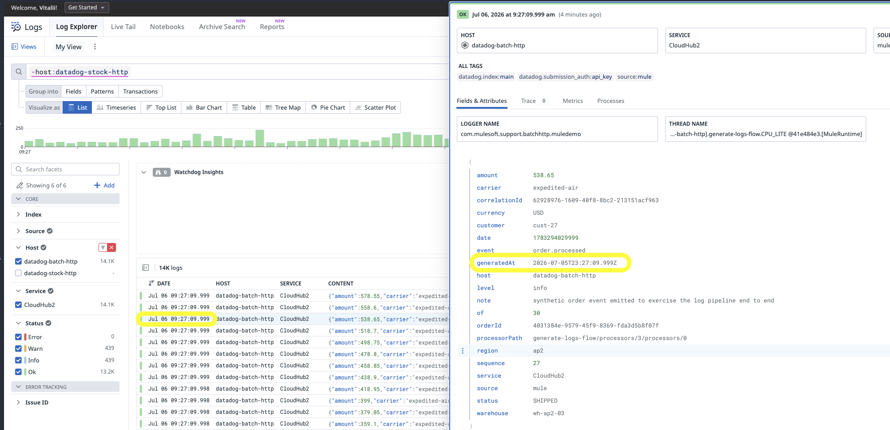
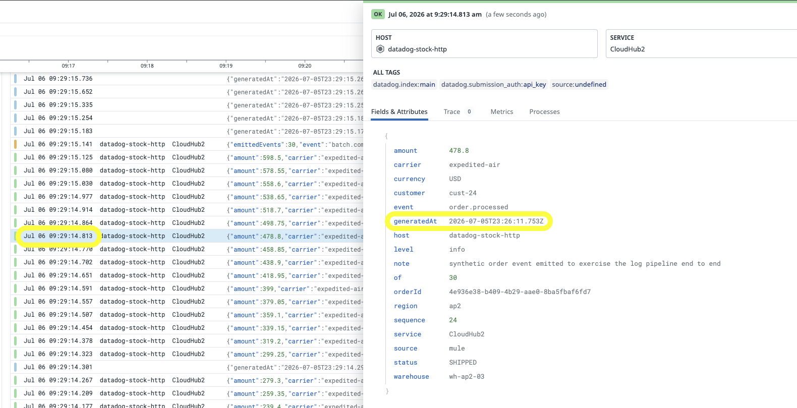
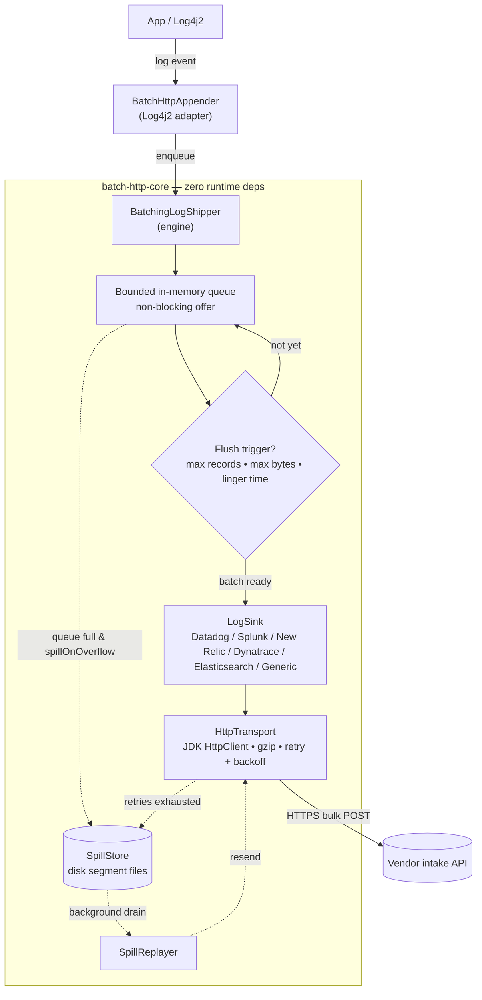
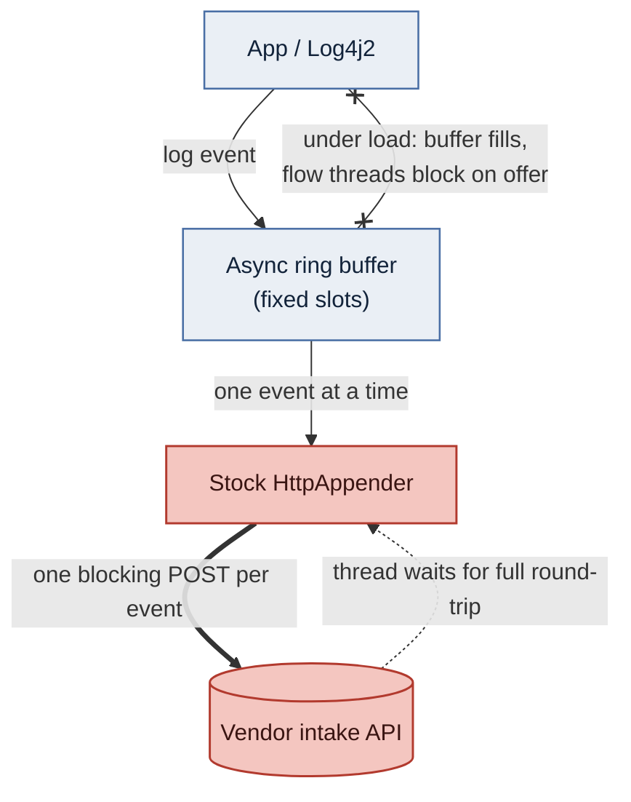

# batch-http-appender

A **batching HTTP log shipper** for Java — a fast, drop-in replacement for Log4j2's
stock `HttpAppender`, which sends one synchronous HTTP request per log event.

Instead, events are enqueued (non-blocking) and shipped in **compressed batches**
by background threads to **Datadog**, **Splunk HEC**, **New Relic**, **Dynatrace**,
**Elasticsearch** (ELK / Elastic Cloud), or any HTTP log intake.

## Why

The default Log4j2 `HttpAppender` does one blocking request per event. At volume,
per-request overhead (TLS, headers, round-trip latency) dominates and the logging
call blocks the application thread. Vendor intake APIs are all designed for bulk
ingest — this library uses them.

### Benchmark (local mock intake, 5 ms simulated latency/request, 5000 events)

| Mode | Wall clock | HTTP requests |
|------|-----------:|--------------:|
| naive (1 request/event) | 32634 ms | 5000 |
| **batched (this lib)** | **82 ms** | **10** |

≈ **400× faster wall-clock, 500× fewer requests.** Reproduce with:

```bash
mvn install -DskipTests
cd demo/java/benchmark && mvn exec:java
```

### Measured on CloudHub (real Datadog and New Relic intake)

Two batch/stock pairs — one shipping to **Datadog**, one to **New Relic** — were deployed to
**both CloudHub 1.0 and CloudHub 2.0** (0.1 vCore each) and load-tested with
[`oha`](https://github.com/hatoo/oha) over a **5-minute** sustained run. Each request hits
`/log?count=20`, emitting **22 log events** (a `batch.start`, 20 `order.processed`, a
`batch.completed`). Each app was restarted and warmed before the run. **Concurrency differs by
plane — CloudHub 1.0 at `-c 10`, CloudHub 2.0 at `-c 5`** — because the CloudHub 2.0 replica is
a capped-CPU, no-swap worker held at lower concurrency to stay off its OOM ceiling; **so
compare only within a plane, never CloudHub 1.0 against CloudHub 2.0.** Every run finished at
**100% success**. Measured 2026-08-04. **Full report (charts, percentiles, all four tests):**
[`docs/benchmark-results.md`](docs/benchmark-results.md) (rendered natively on GitHub); the
styled standalone view is [`docs/index.html`](docs/index.html) (open it locally after cloning).

**Throughput gain, batch versus stock, within each vendor-and-platform pair (5-minute run):**

| Platform | Datadog | New Relic |
|----------|--------:|----------:|
| CloudHub 1.0 — 0.1 vCore worker (`-c 10`) | **55.5×** | **133.8×** |
| CloudHub 2.0 — 0.1 vCore replica (`-c 5`) | **7.6×** | **55.9×** |

The stock `<Http>` appender ships one synchronous POST per event on a single background
flusher; under sustained concurrency that flusher never catches up, so its throughput
collapses and its tail latency climbs into the multi-second — sometimes tens-of-seconds —
range. The batch appender coalesces events and enqueues non-blocking, so request latency stays
decoupled from intake latency.

**CloudHub 1.0** — 0.1 vCore worker, `-c 10`, 5-minute run:

| App | req/s | Requests | Mean | p50 | p90 | p99 |
|-----|------:|---------:|-----:|----:|----:|----:|
| **Datadog — batch 0.1.3** | **151.12** | **45,343** | **66 ms** | **52 ms** | **96 ms** | **304 ms** |
| Datadog — stock `<Http>` | 2.72 | 840 | 3,630 ms | 323 ms | 11,504 ms | 14,857 ms |
| **New Relic — batch 0.1.3** | **160.60** | **48,190** | **62 ms** | **52 ms** | **88 ms** | **238 ms** |
| New Relic — stock `<Http>` | 1.20 | 421 | 7,725 ms | 386 ms | 22,649 ms | 55,227 ms |

**CloudHub 2.0** — 0.1 vCore replica, `-c 5`, 5-minute run:

| App | req/s | Requests | Mean | p50 | p90 | p99 |
|-----|------:|---------:|-----:|----:|----:|----:|
| **Datadog — batch 0.1.3** | **43.53** | **13,060** | **115 ms** | **96 ms** | **200 ms** | **503 ms** |
| Datadog — stock `<Http>` | 5.75 | 1,741 | 867 ms | 211 ms | 4,738 ms | 7,367 ms |
| **New Relic — batch 0.1.3** | **42.57** | **12,774** | **117 ms** | **96 ms** | **202 ms** | **513 ms** |
| New Relic — stock `<Http>` | 0.76 | 248 | 6,400 ms | 481 ms | 23,037 ms | 34,612 ms |

Each pair is a batch-versus-stock contrast within one vendor on one platform; the two tables
are not a controlled comparison of each other (different concurrency, different CPU models —
see the caveats below). Across all four stock runs the p99 tail lands between **7 s and 55 s**,
against batch p99s of 238 ms to 513 ms.

Every run validates against Little's Law — requests/sec × mean latency ≈ the plane's
concurrency — so the load parameters are corroborated by the results rather than merely
asserted. Latency figures from [`oha` 1.14.0](https://github.com/hatoo/oha) may carry a ×10
unit-selection display glitch, which prints a `0.0774 10 sec`-style value where it means
`0.774 sec`; the figures above are already normalised (the correction touches latency only,
not request counts or requests/sec).

**Read all of this as directional.** Every caveat below ships with the figures:

- **One run per pair, no median.** These are single measurements, not repeated ones. The
  pattern is directional, not established.
- **⚠ Cold-start caveat.** The batch appender is CPU/JIT-bound and warmup-sensitive, so a
  **1-minute** run under-reports its warm throughput (e.g. CloudHub 2.0 Datadog batch rises
  **13.8 → 43.5 req/s** from a 1-minute run to the 5-minute run above as the fixed cold-start
  cost amortises). The 5-minute figures above are the better read of sustained warm throughput;
  the full report shows the 1-minute Test 1, the in-thread churn window, this 5-minute Test 3,
  and a 30s-cap Test 4 side by side.
- **Concurrency differs by plane** (CH1 `-c 10`, CH2 `-c 5`), so the two tables are not a
  controlled comparison of each other. The next benchmark round plans to even concurrency
  across planes.
- **`gzip` and `spillEnabled` were disabled in the demos**, so this measures batching in
  isolation rather than the appender as it would be deployed. Compression is off precisely
  because the stock `<Http>` appender cannot compress and leaving it on would vary two things
  at once; a production deployment should leave both on.
- **Throughput and mean latency are one measurement, not two.** The load is closed-loop
  (`oha` with no rate limit), so requests per second is the arithmetic consequence of mean
  latency, not an independent win. The percentiles are unaffected.
- **New Relic results depend on location.** The apps run in Sydney (`ap-southeast-2`), and
  Datadog's `ap2` site is in the same region. New Relic offers only US and EU regions; these
  apps ship to the US endpoint (`log-api.newrelic.com`), so every request crosses the Pacific,
  which limits how fast the appender can deliver. Requests per second measures how responsive
  the app stays, not how many logs arrive. A later delivery-checked run (2026-10-12, engine
  0.2.0) found that with this demo configuration (spill off) New Relic batch delivered only
  about 10–33% of the logs at sustained load, while Datadog delivered 100%. With spill on,
  every log arrived, but a 5-minute burst took about 12 minutes to drain, and a backlog still
  on disk is lost if the worker is replaced first. Workers closer to the New Relic region, or
  `gzip` plus more `flusherThreads`, ship faster.

### Ingest lag: generation → arrival in Datadog

The clearest real-world symptom of synchronous per-event shipping is **ingest lag** —
the gap between when the app *generated* an event and when Datadog actually *received*
it. Each event carries a `generatedAt` field (UTC ISO-8601, emitted by the demo flow
itself in its own JSON message — see each app's `app.xml` — so it records when the
business event occurred and survives any appender or layout change);
Datadog stamps its own receipt time. **The larger the gap, the further behind the
appender is falling** — and under load, the stock appender's one-blocking-POST-per-event
backs up while the batch appender ships promptly.

Same load on both apps, captured from the Datadog CloudHub 2.0 pair during an **earlier
session** than the runs tabulated above (displayed times are the deployment's local time,
UTC+10):

**Batch `<BatchHttp>` — negligible lag.** `generatedAt` `…T23:27:09.999Z` arrives at
`09:27:09.999` local (= `23:27:09.999Z`) — the same instant, sub-second:



**Stock `HttpAppender` — minutes behind.** `generatedAt` `…T23:26:11.753Z` isn't
received until `09:29:14.813` local (= `23:29:14.813Z`) — a **~3-minute** backlog as the
synchronous sends queue up behind each other:



That backlog is also a **volume** gap. Both counts below come from one Datadog query window
covering both apps, but that window is **wider than any 60 s measured run** and belongs to
that same earlier session, so neither total reconciles with the request counts in the tables
above: it spans warmups, measured minutes, and the backlog draining afterwards rather than one
measured minute. Over that window the batch app delivered **84.7K** events to Datadog while the
stock app managed only **5.66K** — it simply can't drain events as fast as they're produced:


## Architecture



The dotted path is the **crash-resilient disk buffer** (`spillEnabled`, **on by default**):
when the in-memory queue overflows or a batch exhausts its HTTP retries, records are written
to disk as `SpillStore` segment files instead of being dropped, and a background
`SpillReplayer` drains them back through the same transport once the endpoint recovers.
Because it is on by default it also writes to local storage by default — see
"Disk-spill buffer" for where, and when to turn it off.

For contrast, the stock `<Http>` appender has none of the middle — no bounded
queue, no batching, no spill. Each event is one blocking POST, and under load the
async ring buffer fills, so the flow thread blocks on the enqueue and logging turns
synchronous (a rendered PNG of this sits at `docs/img/stock-path-blocking.png`):



- **`batch-http-core`** — framework-agnostic engine. **Zero runtime dependencies**
  (uses the JDK 11+ `HttpClient`). Contains the queue, batching triggers, retry,
  gzip, lifecycle, and the per-vendor `LogSink` implementations.
- **`batch-http-log4j2`** — the `@Plugin`-annotated `BatchHttpAppender`, usable
  directly from `log4j2.xml`.
- **`demo/java/benchmark`** — runnable benchmark + example `log4j2-example.xml`
  (artifactId `batch-http-demo`).

## Build & install locally

**Prerequisites:** JDK 17+ and Maven 3.8+ (`java -version`, `mvn -version`).

The project is a Maven multi-module reactor (`groupId` `com.mulesoft.support.batchhttp`, version
`0.2.0`). To build everything and install the artifacts into your local
Maven repository (`~/.m2/repository`) so other projects can depend on them:

```bash
git clone https://github.com/mulesoft/batch-http-log-appender.git
cd batch-http-log-appender
mvn clean install
```

This compiles all modules, runs the unit + end-to-end tests, and installs the
jars locally. To skip tests for a faster install:

```bash
mvn clean install -DskipTests
```

To build and install **only the appender and its engine** (no examples):

```bash
mvn -pl batch-http-core,batch-http-log4j2 -am clean install
```

After install, the artifacts are available to other builds as:

```xml
<dependency>
    <groupId>com.mulesoft.support.batchhttp</groupId>
    <artifactId>batch-http-log4j2</artifactId>
    <version>0.2.0</version>
</dependency>
```

(`batch-http-log4j2` transitively brings in `batch-http-core`. The core jar has
**no runtime dependencies** beyond the JDK.)

### Verify the build

```bash
mvn test                 # run all unit + end-to-end tests
mvn -pl batch-http-core dependency:tree   # confirm core has zero runtime deps
```

### Dependency hygiene & CVE scanning

Keeping third-party dependencies current and free of known CVEs is a project requirement,
not an afterthought. The surface is deliberately tiny — `batch-http-core` has **zero** runtime
dependencies, and `batch-http-log4j2` compiles against log4j 2.x (which the Mule runtime
provides, so it is excluded at runtime). All versions are pinned in the parent POM.

```bash
# What's stale? Reports any dependency or plugin with a newer release.
mvn versions:display-dependency-updates
mvn versions:display-plugin-updates

# CVE gate: OWASP dependency-check against the NVD over the whole reactor.
# Fails the build on any dependency with CVSS >= 7 (high/critical).
mvn -Psecurity verify
```

The `security` profile is opt-in because a full NVD scan is slow and benefits from an
[NVD API key](https://nvd.nist.gov/developers/request-an-api-key) (`-Dnvd.api.key=…`); wire
`mvn -Psecurity verify` into CI (nightly or pre-release) rather than every local build. Stay on
the **log4j 2.x** line — a 3.x bump would diverge from the log4j the Mule runtime actually
supplies. Accepted/false-positive findings go in a `dependency-check-suppressions.xml`.

### Run the benchmark / example

```bash
mvn install -DskipTests
cd demo/java/benchmark && mvn exec:java
```

### Using it from a Mule app

The `demo/mule/newrelic-batch-http` module shows the appender bundled into a Mule 4.9
application. After `mvn install` (so the appender jars are in your local `.m2`),
build the Mule app — the `mule-maven-plugin` bundles the appender into the app so
Mule's app classloader can discover the `<BatchHttp>` plugin at startup:

```bash
cd demo/mule/newrelic-batch-http && mvn clean package
```

Set the New Relic key at runtime (it is **not** committed) via an env var or JVM
arg, then deploy the resulting `target/*-mule-application.jar`:

```bash
export NEW_RELIC_API_KEY=YOUR_NEW_RELIC_INGEST_KEY
```

#### Measuring the batching impact (A/B control)

The `demo/mule/newrelic-stock-http` module is a **control sibling** of
`demo/mule/newrelic-batch-http`: the same Mule app and workload, but wired to Log4j2's **stock
`<Http>` appender** (one synchronous POST per event) instead of `<BatchHttp>`. Run both
side-by-side (ports 8081 vs 8082) against a local mock intake and compare request counts
and wall-clock to quantify the batching speedup. See that module's README for the
step-by-step measurement guide and a ready-to-run mock.

Note that **both batch demo apps deliberately override three library defaults**, in each case
to keep the A/B varying only the appender:

- **`gzip="false"`** (library default `true`). The stock `<Http>` appender has no compression
  option, so leaving gzip on would make the pair differ by batching *and* compression.
- **`spillEnabled="false"`** (library default `true`). The disk-spill buffer runs a replay
  driver thread, adds transient replay workers, and does disk I/O on the failure and overflow
  paths — real competitors for a 0.1 vCore worker or a CPU-capped CloudHub 2.0 replica, and
  machinery the stock appender has no equivalent of. With it off, the batch demos also revert
  to dropping on queue overflow, so **`dropped` is their overload signal, not
  `spilledRecords`** — the reverse of the library default described under "Disk-spill buffer"
  below. Every other `spill*` attribute stays in those files but is inert.
- **`includeTimestamp="false"`** (library default `true`). This one is not about the stock
  appender's capabilities but about what stays observable: with the vendor's reserved
  event-time field omitted, the vendor stamps each record with its own *arrival* time, so
  `arrival − generatedAt` is the ingest lag. Supply the field and the stored timestamp equals
  the generation time, hiding shipping delay by construction. The stock siblings omit it the
  same way — their layouts carry no such key — so both halves are measured identically.

The first two are the right production settings — a real deployment should leave compression
and spill on — so treat them as separate measurements rather than properties of these demos.
The third is a measurement decision either way: a production app usually *wants* its own
event time.

#### Datadog flavor of the same pair

The `demo/mule/datadog-batch-http` and `demo/mule/datadog-stock-http` modules are the **Datadog
counterparts** of the New Relic pair above — the same flow shape and workload, shipping instead
to the Datadog Logs intake (`/api/v2/logs`). The two pairs are not byte-identical to each other:
the New Relic flows lead each event with an extra `message` summary key, because that vendor's
Logs UI parses a JSON `message` and shows nothing without one. Within a pair the flow *is*
identical, which is what the A/B needs. `datadog-batch-http` (port
8083) uses `<BatchHttp vendor="datadog">`; its stock-`<Http>` control sibling
`datadog-stock-http` (port 8084) sends one POST per event. Every Mule demo
uses a distinct port (8081–8086) so they can all run at once. See each module's README for
build, key injection (`DD_API_KEY` / `-Ddatadog.apiKey`), and the A/B measurement guide.

#### Elasticsearch flavor of the same pair

`demo/mule/elastic-batch-http` (port 8085) and `demo/mule/elastic-stock-http` (port 8086) are
the **Elasticsearch counterparts** of the Datadog pair: the same flow and workload, shipping to an
Elasticsearch data stream (`logs-mule-default` by default). The batch app uses
`<BatchHttp vendor="elasticsearch">`, which posts to the Bulk API. Its stock-`<Http>` sibling
posts one document per event to `/<data-stream>/_doc`, and its layout spells out the same
ECS document, so the stored documents differ only in `service.name`. Both read the endpoint
from the `elastic.url` property and the API key from the secure `elastic.apiKey` property. See each module's README for the
API key privileges and the optional ingest pipeline that parses the JSON inside `message`.

#### Splitting CloudHub 1.0 from CloudHub 2.0

Every demo emits a **`platform`** attribute on every event, so a pair deployed to both
CloudHub generations stays separable in the log backend. The two facets have one job each and
should not be swapped: **`service` identifies the app** (batch versus stock) and **`platform`
identifies the plane** (CloudHub 1.0 versus 2.0). Both are overridable — `service` with
`-Dapp.service=...`, defaulting to each app's own name, and `platform` as below — and for both, an
override you no longer want must be **deleted, not cleared**: Log4j2 honours a `:-` default only
when the property is *absent*, so a present-but-empty value wins and blanks the facet. Overloading
`service` with a plane name and then clearing it is precisely how the `SERVICE` column once went
empty for a whole run, and `platform` exists so there is no reason to overload it again.

Set the plane per deployment with `-Dapp.platform=cloudhub-1.0` or
`APP_PLATFORM=cloudhub-2.0`; unset it reads `unspecified` rather than guessing. Both lookup keys
are namespaced because `sys:` and `env:` are shared with whatever the container already defines —
a bare `PLATFORM` is a plausible base-image variable and would silently shadow the facet. The
emitted attribute stays `platform`. It must be set on **both** apps of a pair to be useful — a
value on one half only makes the pair look like a comparison of two platforms. This is a demo
convenience, not a library feature: a `<Properties>` entry plus one field in each app's
`<PatternLayout>`, which is the one mechanism `<BatchHttp>` and the stock `<Http>` appender share.

**The scripted CloudHub 1.0 deploy does not set this facet.** `scripts/deploy-ch1.sh` passes
only the vendor credential (for the Elasticsearch pair, also `elastic.url`) as `--property`, so an app deployed through it reports
`platform: unspecified` until you add `app.platform` by hand in the Runtime Manager **Properties**
tab (CloudHub 1.0 surfaces those as JVM system properties) and restart. Do that for both halves of
the pair before a benchmark run, or the CH1 side of the comparison arrives unlabelled.

## Usage (log4j2.xml)

```xml
<Configuration status="WARN" packages="com.mulesoft.support.batchhttp.log4j2">
    <Appenders>
        <BatchHttp name="datadog" vendor="datadog"
                   apiKey="${env:DD_API_KEY}" service="orders-api" source="java"
                   maxBatchRecords="500" lingerMillis="1000" gzip="true">
            <PatternLayout pattern="%m"/>
        </BatchHttp>
    </Appenders>
    <Loggers>
        <!-- Your application's logs. additivity="false" keeps them from also
             bubbling to the root below, so they ship to the appender exactly once. -->
        <AsyncLogger name="com.example.orders" level="INFO" additivity="false">
            <AppenderRef ref="datadog"/>
        </AsyncLogger>

        <!-- Root ships everything else (framework + libraries) to the appender too. -->
        <AsyncRoot level="INFO">
            <AppenderRef ref="datadog"/>
        </AsyncRoot>
    </Loggers>
</Configuration>
```

> **The `packages` attribute is required.** Log4j2 only recognizes the custom
> `<BatchHttp>` element if its `<Configuration>` carries
> `packages="com.mulesoft.support.batchhttp.log4j2"` so the plugin package is scanned.
> Omit it and Log4j2 silently ignores the appender (you'll see a startup warning that
> `BatchHttp` is unknown, and no logs ship). This is needed wherever the library is on
> the application classloader rather than the Log4j2 boot classpath — which includes
> **every Mule 4 / CloudHub app**. Log4j2 2.x additionally emits its own `WARN` that
> "the use of package scanning to locate Log4j plugins is deprecated"; keep the attribute
> anyway — that warning is about the mechanism, and without it the container's Log4j2 does
> not resolve a plugin that lives on the app classloader.

> **Two loggers, one appender-ref each.** A dedicated `<AsyncLogger>` for your application
> package with `additivity="false"` ships your logs to the appender exactly once, and the
> `<AsyncRoot>` catches everything else (framework + libraries) so the whole app is shipped.
> Without `additivity="false"` the app logger's events would be handled *and* also bubble to
> root — double-shipping every app log. If you only want your own logs shipped, drop the
> `<AsyncRoot>` appender-ref (or keep root local-only). The Mule demos in this repo do exactly
> that: their root carries the file appender alone, because their layout wraps the flow's JSON
> message and a plain-text framework line would render as an invalid document.

> **`<AsyncRoot>`/`<AsyncLogger>` vs `<Root>`/`<Logger>`.** The async variants hand the logging
> call off to Log4j2's background thread so it never touches the application thread — but they
> **require the LMAX Disruptor on the classpath** (`com.lmax:disruptor`). The **Mule runtime
> already provides it**, but a standalone Java app must add that dependency or Log4j2 logs an
> error and falls back to sync. If you'd rather not add it, use the plain `<Root>`/`<Logger>`
> elements instead: `<BatchHttp>` is *already* non-blocking — it enqueues each event to a
> bounded in-memory queue and returns immediately — so synchronous loggers still never block
> your app threads on network I/O.

<!-- -->

> **The layout renders the message; its `charset` attribute does not apply.** `<BatchHttp>`
> takes the text a `StringLayout` (`<PatternLayout>` and the JSON/CSV layouts) has already
> rendered and ships it as **UTF-8 JSON**, so a `charset` set on the layout has no effect on
> what goes on the wire. This differs from Log4j2's stock `HttpAppender`, where the layout's
> charset *does* govern the request bytes — when porting a config from it, drop the attribute
> rather than expecting it to change the request encoding. Multi-byte content (accents, CJK,
> emoji) is preserved regardless of what the layout declares.

### Injecting secrets (API keys / tokens)

`log4j2.xml` is parsed by **Log4j2's own property resolver, not by Mule** (or Spring, or
any host framework). Two consequences that trip people up:

- **Mule `${...}` placeholders do *not* work here.** A `secure::` property or an
  `${api.key}` from a Mule property file will arrive as the literal string. Use a
  **Log4j2 lookup** instead — `${sys:...}` for a JVM system property or `${env:...}` for
  an environment variable:

  ```xml
  apiKey="${sys:datadog.apiKey:-${env:DD_API_KEY:-MISSING_KEY}}"
  ```

  The `:-` chains fallbacks left to right and ends in a visible sentinel, so a missing
  secret surfaces as an obvious `MISSING_KEY` rather than an empty header.

- **On CloudHub, map the secret to a `-D` JVM argument.** A CloudHub *application
  property* is a Mule property and is invisible to Log4j2; set the value as a JVM system
  property (e.g. `-Ddatadog.apiKey=…` via the runtime's JVM args / wrapper) so the
  `${sys:...}` lookup resolves it. The `apiKey`/`token` attributes are marked
  `sensitive`, so Log4j2 masks them in its own status/debug output.

### Per-vendor examples

A full multi-vendor file is at
[`demo/java/benchmark/src/main/resources/log4j2-example.xml`](demo/java/benchmark/src/main/resources/log4j2-example.xml).
Each `<BatchHttp>` below goes inside `<Appenders>`; reference it from a logger as usual.

**Datadog** — `site` is the log-intake host for the site your organization lives in (the sink
appends `/api/v2/logs`); leave it unset to use the sink's default. Datadog publishes the host
for each of its sites, and the set changes over time, so take the value from
[their documentation](https://docs.datadoghq.com/getting_started/site/) rather than from here.
`host` is Datadog's reserved host facet and `service` its reserved service attribute; both are
optional and omitted when unset:

```xml
<BatchHttp name="datadog" vendor="datadog"
           site="${env:DD_SITE}"
           apiKey="${env:DD_API_KEY}" service="orders-api" host="${env:HOSTNAME}" source="java"
           maxBatchRecords="500" lingerMillis="1000" gzip="true">
    <PatternLayout pattern="%m"/>
</BatchHttp>
```

**Splunk HEC** — `url` is the HEC base URL (the sink appends
`/services/collector/event`); auth is `Authorization: Splunk <token>`:

```xml
<BatchHttp name="splunk" vendor="splunk"
           url="https://hec.example.com:8088"
           token="${env:SPLUNK_HEC_TOKEN}"
           index="main" sourcetype="mulesoft:app" host="prod-app-01"
           lingerMillis="1000" gzip="true">
    <PatternLayout pattern="%m"/>
</BatchHttp>
```

**New Relic** — `host` is the Log API host for your account's data centre; leave it unset to
use the sink's default, or take the value for your region from
[New Relic's documentation](https://docs.newrelic.com/docs/logs/log-api/introduction-log-api/).
`apiKey` is a license/ingest key sent as `Api-Key`. Optional identity facets: `hostname` is New
Relic's **reserved** host attribute (its Logs UI surfaces it — distinct from `host`, which only
picks the intake endpoint), and `service` is a plain, NRQL-queryable attribute. Both are
omitted when unset:

```xml
<BatchHttp name="newrelic" vendor="newrelic"
           host="${env:NEW_RELIC_LOG_HOST}"
           apiKey="${env:NEW_RELIC_LICENSE_KEY}"
           service="orders-api" hostname="${env:HOSTNAME}"
           lingerMillis="1000" gzip="true">
    <PatternLayout pattern="%m"/>
</BatchHttp>
```

**Elasticsearch** (ELK, Elastic Cloud Hosted or Serverless; `0.1.5+`) — `url` is the
Elasticsearch endpoint and `apiKey` the **encoded** API key, sent as `Authorization: ApiKey
<apiKey>`. The key needs only `create_doc` and `auto_configure` on the target. `index` names
the data stream (default `logs-mule-default`, which matches the built-in `logs-*-*` template, so
it is created on first write). The sink posts to `<url>/<index>/_bulk`. Each record becomes an
ECS document: `@timestamp`, `message`, `log.level`, `log.logger`, `process.thread.name`,
`service.name` and `host.name` (both from config, both optional), `error.stack_trace`, and every
MDC entry as `labels.<key>`. `vendor` also accepts `elastic` and `elk`:

```xml
<BatchHttp name="elastic" vendor="elasticsearch"
           url="${env:ELASTIC_URL}"
           apiKey="${env:ELASTIC_API_KEY}"
           index="logs-orders-prod"
           service="orders-api" host="${env:HOSTNAME}"
           lingerMillis="1000" gzip="true">
    <PatternLayout pattern="%m"/>
</BatchHttp>
```

The Bulk API answers `200` even when it refused some of the documents, and reports a status
per document. The sink reads those statuses. Only the documents refused with `429` or `5xx` are
re-sent, on the normal backoff schedule. A document refused with any other `4xx` (a mapping
conflict, say) would fail the same way again, so it is counted as `dropped` and the appender
logs an ERROR quoting Elasticsearch's reason. A `409` (version conflict) counts as delivered
and is not re-sent. The sink lets Elasticsearch generate document IDs, so a re-sent batch (a
retry after a timeout, or a spill replay) can store duplicate documents: delivery is
at-least-once, as with the other sinks.

**Generic HTTP intake** — any other endpoint (Loki HTTP, an in-house
collector). `apiKey`, when set, is sent as `Authorization: Bearer <apiKey>`:

```xml
<BatchHttp name="generic" vendor="generic"
           url="https://logs.internal.example.com/ingest"
           apiKey="${env:INTERNAL_LOG_TOKEN}"
           lingerMillis="500" gzip="true">
    <PatternLayout pattern="%m"/>
</BatchHttp>
```

The generic sink defaults to **NDJSON** framing (`Content-Type: application/x-ndjson`,
one JSON object per line) and, when `apiKey` is set, sends it as
`Authorization: Bearer <apiKey>`. A few of its knobs are **builder-only** — they have
no `<BatchHttp>` XML attribute and are reachable only when you embed the engine
programmatically via `GenericNdjsonSink.builder()`:

| Builder method | Default | Purpose |
|----------------|---------|---------|
| `framing(Framing)` | `NDJSON` | `NDJSON` (newline-delimited) or `JSON_ARRAY` (one JSON array body). `JSON_ARRAY` also switches the default `Content-Type` to `application/json` |
| `maxRecords(int)` | 500 | per-batch record ceiling advertised to the engine (the sink's own `Limits`, distinct from the engine's `maxBatchRecords`) |
| `maxBytes(int)` | 1 MiB | per-batch uncompressed-byte ceiling advertised to the engine |
| `header(String, String)` | — | add an arbitrary request header (e.g. a non-Bearer auth scheme, a tenant id); call repeatedly for several. `Content-Type` is defaulted from the framing unless you set it explicitly |

```java
LogSink sink = GenericNdjsonSink.builder()
        .url("https://logs.internal.example.com/bulk")
        .framing(GenericNdjsonSink.Framing.JSON_ARRAY)   // send one JSON array instead of NDJSON
        .header("X-Scope-OrgID", "team-42")              // custom header the XML appender can't set
        .maxRecords(1000)
        .build();
```

For **Dynatrace**, `url` is your environment URL — the SaaS or ActiveGate base URL
Dynatrace publishes for the environment — and `token` is an access token with the
`logs.ingest` scope:

```xml
<BatchHttp name="dynatrace" vendor="dynatrace"
           url="${env:DT_ENVIRONMENT_URL}"
           token="${env:DT_API_TOKEN}" source="mule"
           maxBatchRecords="500" lingerMillis="1000" gzip="true"/>
```

The Dynatrace sink POSTs a JSON array to `/api/v2/logs/ingest` with the
`Authorization: Api-Token <token>` header. It maps the message to the reserved
`content` attribute, the level to `loglevel`, and the event time to `timestamp`
as an ISO-8601 UTC instant; everything else (logger, thread, MDC entries, stack
traces) rides along as attributes.

### Key configuration attributes

| Attribute | Default | Meaning |
|-----------|---------|---------|
| `vendor` | `generic` | `datadog` \| `splunk` \| `newrelic` \| `dynatrace` \| `elasticsearch` (aliases `elastic`, `elk`) \| `generic` |
| `maxBatchRecords` | 200 | flush when batch reaches this many records |
| `maxBatchBytes` | 1 MiB | flush when the estimated body reaches this size. The estimate counts true **UTF-8 bytes**, so a non-Latin batch (CJK, emoji) is measured the way the intake will measure it rather than undercounted by character count |
| `lingerMillis` | 1000 | flush a partial batch once its oldest record reaches this age. The window opens when the first record of a batch arrives and is not extended by later ones, so under a steady stream a partial batch still ships every interval rather than waiting for a lull |
| `queueCapacity` | 10000 | bounded in-memory queue size. Sized to bound worst-case heap on a fractional-vCore worker; raise it for high-throughput apps on larger heaps |
| `overflowPolicy` | `DROP_NEWEST` | `DROP_NEWEST` \| `DROP_OLDEST` \| `BLOCK`. `BLOCK` back-pressures the calling thread until the queue has room, but it waits in bounded steps and re-checks the running flag: once the appender has been stopped, a `BLOCK` offer returns promptly and counts a drop instead of parking the caller indefinitely |
| `gzip` | true | gzip the request body. Set `false` to send plaintext when you want to read bodies in a proxy or mock intake, or to keep a benchmark comparable against an appender that cannot compress (both Mule batch demos do this); vendor per-request ceilings are measured uncompressed either way |
| `maxRetries` | 3 | retries on 5xx/429/408/network errors, with exponential backoff unless the response supplies `Retry-After` |
| `initialRetryBackoffMillis` | 200 | backoff before the first retry (doubles each attempt); a server-supplied `Retry-After` takes precedence over it |
| `maxRetryBackoffMillis` | 10000 | ceiling for the wait — applies both to the exponential schedule and to a `Retry-After` value |
| `requestTimeoutMillis` | 10000 | per-request HTTP timeout |
| `shutdownDrainTimeoutMillis` | 5000 | max time the flushers get to send what is queued on stop. Records still queued after it are written to the spill buffer and replayed on the next start (spill on with `spillRecoveryMode=ADOPT`), or counted as `dropped` with an ERROR (spill off, or a `DELETE`/`IGNORE` recovery mode that would not replay them) — never lost silently |
| `flusherThreads` | 1 | background sender threads |
| `trustAllCertificates` | false | **insecure.** trust any server TLS certificate (self-signed/unknown CA), per-appender. For an internal collector only. See "TLS" below |
| `verifyHostName` | true | **insecure when false.** skip TLS hostname verification (Log4j2's attribute name); JVM-global — see the caveat under "TLS" below |
| `maxMessageBytes` | 32768 (32 KiB) | cap the **retained content** of a single message at this many UTF-8 bytes; longer messages are truncated on a character boundary and a `…[truncated N chars]` marker is appended **on top of** the budget, so the final string runs ~25 bytes over. 0 disables. See "Message size capping" below |
| `includeStackTrace` | true | render a logged `Throwable` into the record (vendor field varies; see matrix below). Set false to ship message-only |
| `includeTimestamp` | true | emit the vendor's **reserved event-time** field from the log event's own timestamp — Datadog's `date`, New Relic's `timestamp`. Set false to omit it, which leaves the vendor stamping each record with its own **arrival** time instead, making shipping delay observable (see matrix below). Only the datadog and newrelic sinks read it; splunk, dynatrace, elasticsearch and generic always emit their own time field (Elasticsearch data streams require `@timestamp`). The default is `true`, so an existing configuration behaves exactly as before |
| `ignoreExceptions` | true | standard Log4j2 flag: when true, an error inside the appender is logged internally and swallowed; set false to let it propagate to the caller |
| `diagnosticsLevel` | WARN | verbosity of the appender's **own** health log (written to Log4j2's `StatusLogger`, not back through this appender). `WARN` surfaces dropped batches, fatal (4xx) rejections, and queue overflow; `INFO` adds the stats heartbeat plus the crash-recovery ("recovered N spill segment(s)…"), `DELETE`-discard and lock-takeover lines; `DEBUG` adds per-retry chatter. See "Troubleshooting & diagnostics" below |
| `statsIntervalMillis` | 0 (off) | when > 0, emit a one-line stats heartbeat (`accepted`/`sentRecords`/`dropped`/`queueDepth`/spill) this often, so you can confirm delivery is healthy without inspecting the spill directory. Needs `diagnosticsLevel` `INFO` or finer to show |

> **Default changes — read before upgrading.** Five defaults have moved, and each of them
> changes the behaviour of an app that upgrades the jar without touching its
> `log4j2.xml`:
>
> | Attribute | Was | Now | What changes for an unconfigured app |
> |-----------|-----|-----|--------------------------------------|
> | `maxBatchRecords` | 100 | **200** | half as many requests for the same volume; each body twice the size |
> | `queueCapacity` (v0.1.1) | 100000 | **10000** | worst-case queue memory drops from tens of MB of `LogRecord`s to a few — comfortable on a large heap either way, but the old default was risky on a 0.1–0.2 vCore CloudHub worker |
> | `gzip` | false | **true** | bodies are compressed and carry `Content-Encoding: gzip`. A proxy, mock intake, or capture tool that assumed plaintext must decompress |
> | `spillEnabled` | false | **true** | the app now writes log payloads to local storage on a failure path, and queue overflow diverts to disk instead of being dropped. **Read "Disk-spill buffer" below before upgrading** |
> | `maxTotalSpillBytes` | 512 MiB | **32 MiB** | the on-disk buffer is bounded far more tightly; `maxSpillFileBytes` drops to 8 MiB with it, so the cap is still four segments |
>
> Any value you set explicitly wins, as always — on the `log4j2.xml` path Log4j2's value is
> what reaches the engine, so an app that already spells these out is unaffected. The Mule
> demos in this repo are one such case on all five; see "Measuring the batching impact"
> above for which of their settings are deliberate divergences and why.

<!-- -->

> **Bug fix (v0.1.2):** the background flusher no longer busy-spins. A flusher could
> pin a CPU core at ~100% while idle once its backlog had drained (it polled the queue
> with a zero timeout instead of blocking). It now blocks until the next record arrives,
> so an idle flusher uses ~0% CPU. No configuration change is needed; redeploy with the
> `0.1.2` artifacts to pick up the fix.

<!-- -->

> **New in v0.1.3 — self-diagnostics:** the appender now reports its own health
> (dropped batches with the HTTP status, fatal 4xx rejections, queue overflow, spill
> init failure) via Log4j2's `StatusLogger`, plus an opt-in periodic stats heartbeat.
> Previously a misconfigured key or an unreachable endpoint failed **silently** — the
> only signal was logs not arriving. Off by nothing: `WARN`-level health is on by
> default; set `statsIntervalMillis` for the heartbeat. See "Troubleshooting &
> diagnostics" below. Also bumps third-party deps to current patched releases (log4j
> `2.26.0`, JUnit `5.14.4`) and adds an opt-in `-Psecurity` OWASP CVE scan.
>
> Also corrects `corruptBytesSkipped`, which reported `0` for a torn trailing frame or a
> wholly unreadable segment — the two likeliest post-crash shapes. A crash-recovery replay
> may now report a non-zero value where it previously read zero; nothing regressed, the old
> number was simply under-reporting, so revisit any alert threshold set against it.

<!-- -->

> **New in v0.1.4 — benchmark documentation:** no appender code changed; this release
> publishes the reproducible 2026-08-04 CloudHub benchmark of the batch appender vs the
> stock Log4j2 `<Http>` appender (4-test harness, 5-minute Test 3 headline, plane-specific
> concurrency) as `docs/benchmark-results.md`, the rendered `docs/index.html`, the charts
> under `docs/img/`, and the `docs/benchmark-runbook.md` reproduction guide. The benchmark
> tables intentionally keep the **`0.1.3`** label because that is the build that was
> measured; the artifact version is bumped to `0.1.4` for this docs release.

<!-- -->

> **New in v0.1.5 — Elasticsearch:** `vendor="elasticsearch"` (aliases `elastic`, `elk`)
> ships to the Elasticsearch Bulk API as ECS documents. It retries only the documents
> Elasticsearch refused transiently and counts permanent refusals as `dropped`
> (see "Per-vendor examples"). No other sink's behavior changed. Every release is listed in
> [CHANGELOG.md](CHANGELOG.md).

<!-- -->

> **New in v0.2.0 — Elasticsearch as a first-class vendor, spill accounting and crash
> recovery:** the minor version marks Elasticsearch (added in 0.1.5) as a supported vendor
> alongside Datadog, Splunk HEC, New Relic and Dynatrace, and the benchmark now covers it,
> with logs delivered measured at every vendor. The batch demos run with disk spill on. In
> the engine, records in an evicted spill segment
> are now counted (`spillStats().droppedRecords` / `evictedRecords`) and reported in a
> coalesced WARN. A spill refusal is counted once, not twice. Records still queued when the
> appender stops are spilled for the next start, or counted as dropped. After a runtime/JVM
> crash the spilled segments replay as soon as the app starts again. Only intact records are
> re-sent; damaged ones are skipped and counted. `spillFormat="JSON"` segments now use the same
> corruption-tolerant framing as `BINARY` (older JSON segments still read). Read "Crash
> recovery" and "The invariant to check" below if you alert on the spill counters.

The engine also respects the hard per-request intake limits each sink declares — a record
count and an uncompressed body size, drawn from that vendor's documented ceilings — and
flushes before crossing them. A sink's `limits()` is the authoritative statement of what
it enforces; consult the vendor's own documentation for the currently published ceilings,
which move. The size half of that check is measured in **UTF-8 bytes**, the same unit the
intake enforces, so a multi-byte payload is split against the real ceiling rather than a
character count that would understate it.

### Which attributes apply to which vendor

Connection/auth attributes are vendor-specific; the batching/tuning attributes above
apply to **all** vendors, with `includeTimestamp` the one exception — it is honoured only
where the vendor treats the event time as a reserved field it will otherwise stamp itself.
A `—` means the attribute is ignored for that vendor.

| Attribute | datadog | splunk | newrelic | dynatrace | elasticsearch | generic |
|-----------|---------|--------|----------|-----------|---------------|---------|
| `url` | — | HEC base URL | — | environment URL | Elasticsearch endpoint | endpoint URL |
| `site` | intake host | — | — | — | — | — |
| `host` | reserved facet | `host` field | intake host (per region) | — | `host.name` | — |
| `hostname` | — | — | reserved facet | — | — | — |
| `apiKey` | `DD-API-KEY` | — | `Api-Key` | (token alias) | `Authorization: ApiKey` | `Authorization: Bearer` |
| `token` | — | `Splunk <token>` | — | `Api-Token` | — | — |
| `service` | reserved attr | — | attribute | — | `service.name` | — |
| `source` | `ddsource` | — | — | `log.source` | — | — |
| `index` | — | HEC `index` | — | — | data stream | — |
| `sourcetype` | — | HEC `sourcetype` | — | — | — | — |
| `includeTimestamp` | gates `date` | — | gates `timestamp` | — | — (always sent) | — |

**Where a rendered stack trace lands** (when `includeStackTrace` is true and the event
carries a `Throwable`): datadog, newrelic and dynatrace emit it as `error.stack`;
elasticsearch emits it as ECS `error.stack_trace`; splunk and generic emit it as `exception`.

**Required credential per vendor:** datadog → `apiKey`; splunk → `url` + `token`;
newrelic → `apiKey`; dynatrace → `url` + `token` (accepts `apiKey` as an alias);
elasticsearch → `url` + `apiKey`; generic → `url`. A missing required value makes the appender fail to build, and Log4j2's
`StatusLogger` reports it at startup naming the appender, the vendor, the specific reason,
and that vendor's full list of required **`log4j2.xml` attribute names** — followed by
"this appender is disabled and will ship no logs". Listing the XML names is the load-bearing
part: the sinks use different internal names than the configuration does (`baseUrl` for
`url`, `apiToken` for `token`), so a raw builder message can cite an attribute that does not
exist in `log4j2.xml` and that you would never find by grepping your config. The diagnostic
translates back to the names you actually write, and where a vendor needs two attributes
(splunk, dynatrace, elasticsearch) it lists **both** missing ones rather than stopping at the first. So a
misconfiguration is visible and diagnosable from the runtime log rather than silently
dropping logs — provided `status` on `<Configuration>` is not `OFF`, which suppresses this
report along with every other diagnostic (see "Troubleshooting & diagnostics").

### TLS: trusting a self-signed / internal collector

By default the HTTPS transport does what a browser does — it validates the server's
certificate chain against the JVM trust store **and** verifies the hostname matches the
certificate. That is the right default and you should leave it on for any real vendor
intake (Datadog, Splunk Cloud, New Relic, …), which all present publicly-trusted certs.

Two opt-in escape hatches exist for a **private / internal** collector that presents a
self-signed or privately-signed certificate (analogous to `curl -k` and to Log4j2's
own [`SslConfiguration`](https://logging.apache.org/log4j/2.x/manual/appenders/network.html#SslConfiguration)):

| Attribute | Default | Meaning |
|-----------|---------|---------|
| `trustAllCertificates` | `false` | trust **any** server certificate — self-signed, expired, unknown CA — skipping chain validation. Applied only to **this appender's** transport (its own trust-all `SSLContext`), so the rest of the JVM keeps normal validation. |
| `verifyHostName` | `true` | when `false`, skip checking that the certificate's CN/SAN matches the requested host (same name as Log4j2's attribute). |

```xml
<BatchHttp name="internal" vendor="generic"
           url="https://collector.internal.example.com/ingest"
           apiKey="${env:INTERNAL_LOG_TOKEN}"
           trustAllCertificates="true" verifyHostName="false"
           lingerMillis="1000" gzip="true">
    <PatternLayout pattern="%m"/>
</BatchHttp>
```

> **Both flags are insecure by design** — they defeat protection against a
> man-in-the-middle. Turn them on only for a collector you control on a trusted network,
> and prefer fixing trust properly (import the collector's CA into the JVM trust store)
> where you can. When either is enabled the appender logs a `WARN` to Log4j2's
> `StatusLogger` at startup so the weakened posture is visible.

<!-- -->

> **`verifyHostName` caveat (JVM-global).** Unlike chain trust, the JDK
> `java.net.http.HttpClient` has no per-client hostname-verification toggle — the only
> lever is the JVM-wide system property `jdk.internal.httpclient.disableHostnameVerification`,
> which the JDK reads **once**, at the first HTTPS request. The appender sets it when
> `verifyHostName="false"`, but if any HTTPS traffic ran earlier in the JVM the value is
> already cached and the appender's change has no effect. For a reliable result, set it as
> a JVM argument instead — on Mule/CloudHub it must carry the `-M-D` prefix to reach the
> Mule JVM:
>
> ```text
> -M-Djdk.internal.httpclient.disableHostnameVerification=true
> ```
>
> `trustAllCertificates` has no such caveat; it is fully per-appender. (Client-certificate
> auth / **mTLS** is not yet supported — see the Roadmap.)

### Message size capping

A single oversized message — a developer dumping an entire HTTP body, a multi-megabyte
stack of stringified objects, or a runaway loop concatenating into one log line — can
blow up the in-memory queue, the HTTP request, and a spill segment all at once. To bound
that blast radius, each message is capped at `maxMessageBytes` UTF-8 bytes (**default
32 KiB**) when it is enqueued:

- Truncation happens on a **UTF-8 character boundary**, so a multi-byte character is
  never split into invalid bytes, and a `…[truncated N chars]` marker is appended so the
  cut is visible downstream rather than silent.
- The budget applies to the **kept prefix**, not to the result. The marker is appended
  afterwards, so a truncated message is `maxMessageBytes` plus the marker — about 25
  bytes over, depending on the digit count in `N`. Size a downstream hard limit with that
  slack in mind rather than assuming the output is exactly capped.
- The limit is in **bytes**, not characters, because bytes are what bound memory, the
  wire payload, and the on-disk frame.
- It is **cheap even for a pathological message**: a normal log line well under the
  budget is returned untouched in O(1) (no copy, no re-allocation), and an oversized one
  is measured by walking code points only up to the budget — it never materializes the
  full UTF-8 encoding of, say, a 200 MB string just to measure it.
- Set `maxMessageBytes="0"` to disable capping entirely.

Only the `message` field is capped; structured attributes (MDC/ThreadContext) and the
rendered stack trace are left as-is.

## Resilience

- **Non-blocking by default** — logging never stalls the app; under overload the
  configured overflow policy applies.
- **Retry with exponential backoff + jitter** on retryable failures (429/5xx/408/network).
  Every other 4xx is terminal and is not retried.
- **`Retry-After` is honored.** When a retryable response carries the header, the
  server-supplied delay wins over the computed backoff — a throttled intake knows when its
  window reopens, and retrying sooner just earns another 429. Both RFC 9110 forms are
  accepted (delta-seconds and HTTP-date). The value is clamped to `maxRetryBackoffMillis`,
  so a hostile or absurd delay cannot park a flusher, and an absent, malformed, or
  already-elapsed value falls back to the exponential schedule.
- **Graceful shutdown** — `appender.stop()` drains and flushes the queue within
  `shutdownDrainTimeout`. After that, whatever is still queued is written to the spill
  buffer (replayed on the next start under `spillRecoveryMode=ADOPT`), or counted as dropped
  and logged at ERROR when spill is off or `spillRecoveryMode` is `DELETE`/`IGNORE` (the next
  start would not replay them). `close()` itself never makes another HTTP attempt,
  so it stays bounded (roughly `shutdownDrainTimeout` + 2 s + the spill write).
- **Message size capping** — a single oversized message is truncated to
  `maxMessageBytes` (default 32 KiB) on a character boundary before it can bloat the
  queue, the request, or a spill segment. See "Message size capping" above.
- **Disk-spill buffer (on by default)** — batches that fail after retries
  (or records the queue would drop on overflow) are written to rotating segment
  files on disk instead of being lost. A background thread re-ships them when the
  endpoint recovers, and segments left by a previous run/crash are replayed on
  startup. The buffer is bounded and free-space-aware (drop-oldest eviction, with the
  evicted records counted and reported), so it never exhausts the filesystem. Both on-disk
  formats are **corruption-tolerant**: a record damaged by an improperly-closed journal is
  skipped and replay resumes from the next intact one. Segments survive an abrupt
  runtime/JVM death (`kill -9`, OOM kill, a crashed worker) and are replayed as soon as the
  next start opens the same `spillDirectory` with the same `spillInstanceId`; only intact
  records are re-sent. Replay is **at-least-once** — a segment that fails partway through
  (or was being replayed when the process died) is retried whole, so a record that transits
  the buffer can be delivered twice. See "Disk-spill buffer" and "Crash recovery" below.
- **Observability** — `BatchingLogShipper.stats()` exposes accepted / dropped /
  sent / failed counts and queue depth; `spillStats()` exposes spilled / dropped /
  evicted (segments and records) / adopted / segment counts — plus `corruptBytesSkipped`
  (bytes discarded recovering a corrupted journal) — when spill is enabled.

## Disk-spill buffer

A durability safety net that is **on by default** (`spillEnabled`). Records flow through
the in-memory queue exactly as normal; they are written to disk **only** when (a) a batch
fails after retries are exhausted, (b) the in-memory queue would otherwise drop a record
on overflow, or (c) records are still queued when the appender stops after
`shutdownDrainTimeout` — this last case happens regardless of `spillOnOverflow`, but only
with `spillRecoveryMode=ADOPT` (otherwise those records are counted as dropped). The happy
path does **zero** disk I/O.

### It is on by default — read this before upgrading

`spillEnabled` used to default to `false`. It now defaults to `true`, so **an app that
upgrades the jar without changing its configuration starts writing log payloads to local
storage.** That is a deliberate trade — buffered logs survive an intake outage instead of
being dropped — but it is not free, and there are four consequences worth understanding.

**1. Where it writes when you have not said.** With no `spillDirectory`, the engine derives
one per sink in `BatchingLogShipper.defaultSpillDir`: it reads the JVM's `java.io.tmpdir`
(falling back to `/tmp` only if the JVM reports none), then appends `batch-http-spill` and a
filename-safe form of the sink's name. So a Datadog appender ends up in
`${java.io.tmpdir}/batch-http-spill/Datadog/`, a generic one in something like
`${java.io.tmpdir}/batch-http-spill/Generic_logs.example.com_/`. On a Mule/CloudHub worker
`java.io.tmpdir` is the container's temp directory; on Windows it is `%TEMP%\...`. The
directory is created eagerly at startup, so it exists as soon as the appender does, whether
or not anything is ever written into it.

**2. On many container platforms `/tmp` is memory-backed, and then "disk" buffer means
RAM.** Where the temp directory is a `tmpfs` (a common Kubernetes / container-runtime
default, including some Mule deployment topologies), every byte the spill buffer writes is a
byte of the container's memory — and it counts against the memory limit that gets the
container OOM-killed. On a memory-constrained worker that turns a durability feature into an
out-of-memory risk: the endpoint goes down, the buffer fills with up to `maxTotalSpillBytes`
of log data, and the pod dies of the thing that was supposed to protect it. If your `/tmp`
is memory-backed, either point `spillDirectory` at real storage (a mounted volume with a
real filesystem behind it) or set `spillEnabled="false"` and accept drops on failure:

```xml
<BatchHttp name="datadog" vendor="datadog" apiKey="${env:DD_API_KEY}"
           spillDirectory="/var/log/batch-http-spill"/>

<BatchHttp name="datadog" vendor="datadog" apiKey="${env:DD_API_KEY}"
           spillEnabled="false"/>
```

**3. It changes what queue overflow means.** `spillOnOverflow` defaults to `true`, so now
that spill is also on by default, a record the queue would have dropped is **written to disk
instead of being dropped** — `overflowPolicy` no longer has the last word on an overloaded
app. The practical consequence is a monitoring one: the `dropped` counter can sit at **zero**
while the app is badly overloaded, because everything that overflowed went to disk. Under
the old defaults `dropped` was the overload signal; under these it is **`spilledRecords`**
(and `segmentCount` / `onDiskBytes` growing in the stats heartbeat). Alert on those.

Which counter to watch follows `spillEnabled`, so decide it per app rather than by habit: with
spill **on** (the default) alert on `spilledRecords`, and with spill **off** alert on `dropped`,
because `spillOnOverflow` has no effect and `overflowPolicy` gets the last word again.

**4. Replay is at-least-once, so duplicates are possible.** A segment that ships partway and
then fails is re-read whole on the next pass, so any record that transits the buffer may be
delivered more than once after a failure. That is the deliberate trade — duplicates over
loss — and it is unchanged by this default; what changed is that it now applies to apps that
never asked for the buffer. See "Replay is at-least-once, not exactly-once" below.

**The staleness trap.** `spillRecoveryMode` defaults to `ADOPT`, which means a spill
directory left behind by a previous run is **adopted and replayed at startup**. That is the
right behaviour for a crash a minute ago; it is a trap for a directory that has been sitting
on a reused host or a restored volume for days. Log intakes reject events whose timestamps
are too old — Datadog and New Relic both publish a maximum age for accepted logs (on the
order of hours to a couple of days; take the current window from
[Datadog's](https://docs.datadoghq.com/logs/log_collection/) and
[New Relic's](https://docs.newrelic.com/docs/logs/log-api/introduction-log-api/) own
documentation rather than from here, since these limits change). A backlog older than that
window is replayed, accepted at the HTTP level, and discarded server-side. The engine sees a
success and counts those records in `sentRecords` before deleting the segment, so a stale
backlog can look delivered while nothing of it is searchable in the intake. If a host may
present a stale spill directory at startup, set
`spillRecoveryMode="DELETE"` (discard old segments) or `IGNORE` (leave them untouched)
rather than relying on `ADOPT`.

Spilled records are stored in rotating segment files. Each segment carries a small
self-describing header naming both the codec and the framing version it was written
with, so a reader always decodes a file correctly even across a format change. A
background replayer re-ships segments once the endpoint is healthy and deletes each on
success; on startup it recovers any segments left by a previous run or crash. The buffer
is bounded by both a total-bytes cap and a filesystem free-space floor — when either is
hit, the **oldest** segment is deleted to make room, so logging can never exhaust the disk.
The records in an evicted segment are counted in `spillStats().droppedRecords` (and
`evictedRecords`) and reported by a coalesced WARN, so the loss is never silent. A segment a
replay worker is reading is never evicted.

**Replay is at-least-once, not exactly-once.** A segment has no durable read cursor: if it
ships partway and then the endpoint starts failing — say the first 300 of 500 records are
accepted before a 503 — the successful prefix is not recorded, and the **whole segment is
re-read on the next pass**, re-delivering those 300. So any record that transits the spill
buffer may arrive at the endpoint more than once. This is a deliberate trade-off: a durable
per-record cursor would mean an `fsync` per replayed batch on the recovery path, and for
logs a duplicate is a far cheaper failure than a loss. The live (non-spilled) path is
unaffected, and duplicates only arise from a *partially* failed segment, so they are rare
in practice — but if something downstream consumes these logs and must not see repeats,
de-duplicate on a stable field (the preserved event timestamp plus the message, or your own
event id) rather than assuming the buffer suppresses them. Two more sources of duplicates:
a sub-batch delivered just before the process died, in a segment not yet deleted, is sent
again by the next start; and a send interrupted at shutdown may already have reached the
intake, yet its batch is spilled and replayed.

**Segment sizing is fuzzy and never splits a record.** Before each record is written, the
active segment's size is checked (against an in-memory byte counter — no `stat` syscall)
and a new segment is started if the record wouldn't fit. A record always lands **whole**
in exactly one segment, so a message larger than `maxSpillFileBytes` produces one
oversized segment rather than a record torn across two files. (The free-space floor probe
*is* a syscall, so it is throttled — re-checked at most once per few MB written, and
skipped entirely when `minFreeDiskBytes` is 0 — to keep the spill path cheap on
CPU-throttled workers.)

**Crash-corruption tolerance (both formats).** Both formats frame each record as
`SYNC + length + CRC32C + payload` (`JSON` since 0.2.0). If a runtime crash leaves the journal improperly
closed and a record corrupted — a torn tail, a zero-filled block, or bit-rot in the
middle of a segment — the reader detects the bad frame (failed sync, insane length, or
CRC mismatch), **skips exactly the damaged record, and resumes from the next intact one**,
rather than abandoning everything after the damage. The per-frame CRC is what makes that
resync safe for **any** payload: a message whose own bytes happen to contain the sync
marker (an HTTP wire dump, embedded JSON, raw binary) is rejected by the checksum and can
never be mistaken for a frame boundary. Skipped bytes are surfaced via `spillStats()`
(`corruptBytesSkipped`) so recovery is observable — counted for a torn trailing frame and
for a segment with nothing readable left in it, not just interior damage. That last shape is
why the counter earns its keep: zero records recovered *and* zero bytes skipped would make a
wholly destroyed journal indistinguishable from one that never held anything.

The CRC is computed only on the spill path (the abnormal case) and uses the JDK's
hardware-accelerated CRC-32C, so steady-state healthy logging pays nothing. `JSON` segments
written by 0.1.5 and earlier keep the older length-prefixed (v1) framing and are still read.
For those, a crash loses only the torn last record, but damage in the middle ends that
segment; the discarded bytes are counted in `corruptBytesSkipped`. A damaged or missing
segment header no longer silently empties a segment: the reader salvages the intact frames
behind it and counts the rest.

Turn it off, or point it somewhere durable, in `log4j2.xml`:

```xml
<BatchHttp name="newrelic" vendor="newrelic"
           apiKey="${env:NEW_RELIC_API_KEY}"
           spillEnabled="false"/>
```

| Attribute | Default | Meaning |
|-----------|---------|---------|
| `spillEnabled` | true | the disk-spill safety net. `false` turns it off, so a batch that fails after retries is dropped and counted instead of buffered |
| `spillDirectory` | `${java.io.tmpdir}/batch-http-spill/<sink>` (`%TEMP%\...` on Windows) | base directory for segment files; derived from the JVM temp dir when unset. Set it explicitly where the temp dir is memory-backed — see "It is on by default" above |
| `spillInstanceId` | appender `name` (engine falls back to the sink name) | identifier embedded in each segment file name (`spill-<instanceId>-<seq>.log`) so two or more apps sharing a spill directory never overwrite each other's logs; must be stable across restarts of the same app and distinct per running instance |
| `maxSpillFileBytes` | 8388608 (8 MiB) | segment size before rotation (fuzzy — a record always lands whole in one segment, even if larger than this). A quarter of the total cap, so the buffer holds four segments: eviction sheds a quarter of the backlog at a time, and three closed segments stay replayable while a fourth fills |
| `maxTotalSpillBytes` | 33554432 (32 MiB) | total cap; exceeding it evicts the oldest segment. Evicted records are counted in `spillStats().droppedRecords`/`evictedRecords` and reported by a coalesced WARN |
| `minFreeDiskBytes` | 268435456 (256 MiB) | filesystem free-space floor; dropping below it evicts the oldest segment. It bounds the impact on the **volume**, not on this buffer, so it is deliberately not scaled to `maxTotalSpillBytes` — the spill directory usually shares a filesystem with the runtime's own logs and temp files, and this is the margin left for them. On a volume with less than this usable, spill degrades to counting drops rather than writing; lower it for a small dedicated volume. The probe is a syscall, so it is throttled (≈ once per few MB written); set to 0 to disable it and skip the syscall entirely. Evicted records are counted and reported as for `maxTotalSpillBytes` |
| `spillReplayIntervalMillis` | 10000 | how often the replayer attempts to drain segments. When segments are already on disk at startup (a previous run or a crash), the first pass runs immediately |
| `spillOnOverflow` | true | also divert queue-overflow records to disk (vs. dropping them) |
| `spillFormat` | `BINARY` | on-disk record encoding: `BINARY` (compact TLV, all charsets, **corruption-tolerant** sync+CRC framing) or `JSON` (human-readable, same corruption-tolerant sync+CRC framing since 0.2.0) |
| `spillRecoveryMode` | `ADOPT` | what to do with segments left by a previous run: `ADOPT` replays them, `IGNORE` leaves them untouched, `DELETE` discards them at startup |
| `spillStartupReconcile` | true | at startup, evict oldest segments to satisfy the total cap and free-space floor before writing new logs |
| `spillBacklogOrder` | `OLDEST_FIRST` | drain order: `OLDEST_FIRST`, `NEWEST_FIRST`, or `DUAL_STREAM` (ship freshest logs and the historical backlog in parallel) |
| `spillReplayThreads` | 1 | parallel replay workers (forced to 2 for `DUAL_STREAM`) |
| `spillReplayMaxBytesPerSec` | 0 | throttle the backlog drain to this many on-disk bytes/sec (0 = unlimited) so replay never starves live traffic |

### Crash recovery (runtime / JVM death)

What happens when the Mule runtime or the JVM dies without stopping the appender (`kill -9`,
an OOM kill, a worker crash under load):

- **What survives: spilled records, and only those.** Every record the spill buffer reported as
  spilled had already been handed to the OS when `spill` returned, so a *process* death loses
  none of them. Records that were only in memory at that moment are lost: the in-memory
  queue, the batch a flusher was holding, and a request in flight. The buffer protects what
  reached disk, not what was waiting to.
- **Host crash or power loss (best effort).** Segments are fsynced when they roll, when the
  replayer seals them (once per `spillReplayInterval` while an outage lasts) and on shutdown,
  and the spill directory is fsynced when a segment is created so its name is durable too
  (skipped where the OS cannot sync a directory, e.g. Windows). A host failure should
  therefore lose at most about the last interval or segment of spilled data, provided the
  filesystem honours fsync; a segment deleted just before the failure can reappear and be
  replayed again (a duplicate, not a loss). There is deliberately no fsync per record.
- **Restart.** The next start re-takes the per-instance lock. The lock lives on the open file
  descriptor, not on the `.spill-<instanceId>.lock` file, so the OS drops it with the dead
  process; the lock file staying on disk is expected and harmless. The dead process's
  segments are then adopted (`spillRecoveryMode=ADOPT`) and replay starts **immediately**,
  without waiting for `spillReplayInterval`, and an INFO line says how much was recovered
  (shown only with `diagnosticsLevel="INFO"` and `status="INFO"` or finer; the defaults are
  `WARN`, so confirm recovery from the `adoptedRecords` counter or the heartbeat otherwise).
  This needs the **same `spillDirectory` and the same `spillInstanceId`**. The instance id
  defaults to the appender name; for the Generic sink without an explicit id the engine
  default includes the endpoint host, so changing the host strands the old files.
- **Damaged records are skipped and counted, never fatal.** A torn trailing frame from the
  crash, or a record damaged in the middle of a segment, is skipped, and replay resumes at the
  next intact record. The bytes are counted in `corruptBytesSkipped` and reported by a WARN
  per segment. A segment that cannot be read at all (an I/O error) is kept, retried on later
  passes and reported once. It never blocks the segments behind it.
- **At-least-once across a crash.** A sub-batch delivered just before the crash, in a segment
  not yet deleted, is sent again after the restart. A live batch whose request reached the
  intake but whose response never arrived is spilled and re-sent too. De-duplicate
  downstream if that matters (see "Replay is at-least-once" above).
- **Lock held at startup.** If another live process holds the lock, the segments are left
  untouched and a WARN is logged. That process can be a leaked appender in the same JVM after
  a Mule redeploy, or an NFS lock lease. A second store in the same JVM detects a live holder
  without opening its lock file (on Linux/macOS closing any descriptor of a file releases the
  process's lock on it, which would silently hand the directory to another process). Ownership is retried on every replay pass, and the
  segments are adopted once the holder lets go. Give each concurrently running instance its
  own `spillInstanceId`.
- **Platform limits (outside the appender's control).** Recovery needs the spill directory to
  survive the restart, so it covers **in-place restarts only**. The default
  `${java.io.tmpdir}` survives a Mule runtime/JVM restart on the same host or VM: on-prem, a
  VM, or a CloudHub 1.0 worker restarted in place. It does **not** survive these, because they
  start with an empty `/tmp`:
  - a **CloudHub 1.0** worker replaced by a new worker;
  - a **CloudHub 2.0** / Runtime Fabric / Kubernetes **pod replacement** (redeploy,
    rescheduling, node failure, scale-in);
  - a host reboot that clears `/tmp` (tmpfs or systemd-tmpfiles).

  A container restart inside the same pod keeps only volume-backed paths (for example an
  `emptyDir` mount), not the container's writable layer, so check what your platform mounts at
  `/tmp`. Where the platform offers persistent storage and durability across replacement
  matters, point `spillDirectory` at it.

### Crash-resilience behavior

- **Orphaned files from a previous run** (point 1) — on startup the store takes a
  `FileLock` on a hidden lock file in the spill directory. If the lock is free, the
  previous owner is gone and any `spill-*.log` files are genuine orphans, handled per
  `spillRecoveryMode` (default `ADOPT` → they are replayed, so logs buffered just
  before the crash still reach the endpoint). If the lock is held, a live sibling
  process owns those files, so this instance leaves them alone — never
  double-shipping or deleting another process's data.
- **Parallel backlog drain** (point 2) — `DUAL_STREAM` runs two streams at once: one
  ships the newest segments first (so recent logs surface immediately after recovery)
  while the other works through the historical backlog; they meet in the middle.
  `spillReplayMaxBytesPerSec` rate-caps the drain so a large backlog can't saturate
  the intake or starve live traffic.
- **Startup free-space check** (point 3) — with `spillStartupReconcile` on, a run that
  inherits a large backlog on a nearly-full disk evicts the oldest segments to satisfy
  both `maxTotalSpillBytes` and `minFreeDiskBytes` *before* it writes anything new. The
  records in those segments are counted in `spillStats().droppedRecords`/`evictedRecords`,
  and a one-shot WARN names how many were lost.
- **On-disk format** (point 4) — `BINARY` is a compact tag-length-value encoding
  (UTF-8 strings, varint lengths) that round-trips every character set — non-Latin
  scripts, emoji, control characters — and is smaller and faster to read/write than
  the JSON alternative. `JSON` remains available (`spillFormat="JSON"`) when you want
  to read the spill files by eye. The per-segment header records which was used, so
  the two can coexist on disk across a config change.

  Each spilled record begins with its event timestamp: the **first field of every
  record** is the original `timestampMillis` (an 8-byte big-endian `int64` in `BINARY`,
  a leading `"ts"` number in `JSON`), so no log ever loses its time — the timestamp is
  carried through the spill and restored verbatim on replay. The **segment file name**,
  by contrast, is *not* a timestamp: `spill-<instanceId>-00000000000000000000.log`
  embeds the owning instance's id (see below) plus a zero-padded **sequence number**
  whose only job is to make lexicographic order equal arrival order (so the replayer can
  drain oldest-first). Newer segments simply have a higher number. Use the file's
  modification time (or decode a record) if you need a wall-clock reference for a
  segment; the per-record timestamps inside are the authoritative event times.

- **Corrupted-journal recovery** — a record damaged by an improperly-closed journal is
  skipped and replay resumes from the next intact one, rather than everything after the
  damage being abandoned. This applies to both formats (`JSON` since 0.2.0), which is what the
  `SYNC + length + CRC32C` framing buys. Legacy v1 `JSON` segments (0.1.5 and earlier) stop
  at mid-segment damage, with the discarded bytes counted. An unreadable segment (I/O error)
  is skipped for that pass and retried later, never blocking the segments behind it. See
  "Crash-corruption tolerance" above for how the resync stays safe for arbitrary payloads
  and how the skipped bytes are reported.

- **Per-instance file naming** (`spillInstanceId`) — every segment name carries an
  instance id, so two or more apps that share one spill directory (two same-vendor apps
  on a host, or an explicitly shared `spillDirectory`) never write the same filename or
  touch each other's segments. Each store lists, replays, evicts, and counts only files
  bearing **its own** id, and takes a per-instance lock (`.spill-<instanceId>.lock`), so
  co-located instances all stay live and independent. The id defaults to the appender
  `name` (engine fallback: the sink name); set it explicitly when several appenders would
  otherwise share a name. It must be **stable across restarts** of the same app (so its
  own orphaned segments are recovered) and **distinct per running instance**. Segment
  files written by a pre-upgrade run under the old id-less name (`spill-<seq>.log`) are
  migrated into the instance's namespace on first startup (honoring `spillRecoveryMode`),
  so upgrading never strands a buffered log.

## Troubleshooting & diagnostics

When logs aren't arriving, the first question is always *"is the appender failing, and
why?"* The engine answers that itself — it logs its own health to Log4j2's **`StatusLogger`**,
the out-of-band channel Log4j2 components use to report status. It deliberately does **not**
log through an ordinary logger: this appender is often wired to the root logger, so routing
its diagnostics through a normal `Logger` would feed them straight back into itself — an
endpoint outage would then amplify into a feedback loop. `StatusLogger` never re-enters the
appender pipeline, so it is safe by construction.

### Where the messages go

`StatusLogger` output is controlled by the `status` attribute on the configuration root and
goes to the Log4j2 status console (and any status listeners):

```xml
<Configuration status="WARN" packages="com.mulesoft.support.batchhttp.log4j2">
```

In Mule/CloudHub the status output appears on the runtime's own stderr/console log — the same
place Log4j2 reports a bad `log4j2.xml`. Set `status="INFO"` to also see the heartbeat. This is
**separate** from the `<BatchHttp>` appender's own `diagnosticsLevel`: `status` is the floor for
*all* Log4j2 internal logging, `diagnosticsLevel` gates *this appender's* messages within that.

> **Avoid `status="OFF"` — it disables the whole safety net.** `StatusLogger` is the *only*
> channel this appender has for reporting on itself, so turning status output off means no
> dropped-batch warnings, no 4xx rejection, no queue-overflow notice, and no startup
> credential failure: the appender goes back to failing exactly as silently as it did before
> the v0.1.3 self-diagnostics were added, and the only symptom is logs not arriving.
> `status="WARN"` is the minimum that keeps the failure reporting — it is what the stock
> Mule demos and the Java example use, while the batch Mule demos use `status="INFO"` so
> their heartbeat surfaces too. If your concern is status-log noise rather than this
> appender, leave `diagnosticsLevel` at its `WARN` default (which already limits the appender
> to failures only) or attach your own `StatusListener` to route the messages elsewhere,
> instead of silencing `status` globally. Note this is a property of Log4j2's status plumbing
> rather than something the appender can enforce, and it is not covered by a test, so treat
> it as an operational recommendation.

### What gets logged

| Situation | Level | What you see |
|-----------|-------|--------------|
| Batch rejected with a 4xx (bad API key, wrong endpoint, payload too large) | `ERROR` | `dropped N record(s) — endpoint rejected the batch (HTTP 403); check credentials/endpoint, retrying will not help` |
| Bulk intake (Elasticsearch) answered `200` but refused some documents for good (mapping conflict, …) | `ERROR` | `dropped N of M record(s) — the intake accepted the request but refused them (document_parsing_exception: …); retrying will not help` |
| Send failed after all retries, spill **on** | `WARN` | `send failed after 3 retries (HTTP 503) — spilled N record(s) to disk for retry` |
| Send failed after all retries, spill **on** but the buffer refused (some of) them | `ERROR` | `dropped N record(s) — send failed after 3 retries (HTTP 503) and the spill buffer refused them (counted in spillStats().droppedRecords)` |
| Send failed after all retries, spill **off** | `ERROR` | `dropped N record(s) — send failed after 3 retries (…) and spill is disabled` |
| Queue full (endpoint not keeping up) | `WARN` | coalesced once per 5s: `queue full (capacity=…, policy=DROP_NEWEST): N record(s) dropped, M diverted to spill in the last 5s — the endpoint is not keeping up` |
| Spill buffer full — oldest segment evicted / new record refused | `WARN` | coalesced, at most once per 5s plus once at shutdown: `spill buffer full (maxTotalSpillBytes=…, minFreeDiskBytes=…): evicted N oldest segment(s) holding M record(s), refused K new record(s) since the last report — those logs are lost` |
| Startup reconcile evicted a previous run's backlog | `WARN` | `startup reconcile evicted N oldest spill segment(s) holding M record(s) (B bytes) left by a previous run to satisfy maxTotalSpillBytes=…/minFreeDiskBytes=… — those logs are lost` |
| `spillRecoveryMode=DELETE` discarded previous-run segments | `INFO` | `spillRecoveryMode=DELETE discarded N segment(s) (M record(s), B bytes) left by a previous run` |
| Segments from a previous run / crash adopted | `INFO` | `recovered N spill segment(s) (B bytes, M record(s)) left by a previous run (spillRecoveryMode=ADOPT) — replaying now` |
| Spill directory locked by another live instance at startup | `WARN` | `spill directory <dir> is locked by another live instance with spillInstanceId=<id>; N existing segment(s) left untouched (ownership is retried every spillReplayInterval) — give each running instance a distinct spillInstanceId` |
| That lock was released later and taken over | `INFO` | `spill directory <dir> is no longer locked by another instance — took it over (N segment(s) adopted for replay)` |
| Replayed segment had damaged bytes | `WARN` | `replayed spill segment <file>: R record(s) delivered, B corrupt byte(s) skipped (torn tail or damaged record)` |
| Spill segment unreadable (I/O error) | `WARN` | once per segment per run: `spill segment <file> could not be read (<IOException>) — skipped this pass, will retry` |
| A live batch threw while being serialized/sent (sink bug) | `ERROR` | `dropped N record(s) — unexpected error while batching: …` (only the records the intake had not already stored) |
| A replayed sub-batch threw while being re-shipped | `ERROR` | `dropped N replayed record(s) — unexpected error while re-shipping: …` |
| Records still queued at shutdown, spill **on** (`spillRecoveryMode=ADOPT`) | `WARN` | `shutdown: spilled K of N record(s) still queued after shutdownDrainTimeout=5000ms to disk — they will be replayed on the next start` |
| Records still queued at shutdown, spill **off** (or `spillRecoveryMode` `DELETE`/`IGNORE`) | `ERROR` | `dropped N record(s) still queued at shutdown — not sent within shutdownDrainTimeout=5000ms and spill is disabled` (or `… and spillRecoveryMode=DELETE would not replay them on the next start`) |
| A record offered while the appender was stopping missed the final drain | `ERROR` | `dropped 1 record(s) offered while the appender was stopping — accepted after the final shutdown drain` (with `ADOPT` spill it is spilled instead) |
| Records still queued at shutdown, spill refused them | `ERROR` | `dropped M record(s) still queued at shutdown — the spill buffer refused them (counted in spillStats().droppedRecords)` (or `… — could not be spilled within the shutdown budget`) |
| Spill buffer could not initialise | `ERROR` | `spill disabled — could not initialise spill buffer: AccessDeniedException… (live shipping continues; failed batches will be dropped, not buffered)` |
| Each retry attempt | `DEBUG` | `send attempt 2/4 failed (HTTP 503), retrying` |
| Periodic heartbeat (`statsIntervalMillis > 0`) | `INFO` | `stats accepted=… sentRecords=… sentBatches=… dropped=… failedBatches=… queueDepth=… spill{onDiskBytes=… segments=… spilledRecords=… droppedRecords=… evictedSegments=… evictedRecords=… adoptedRecords=… corruptBytesSkipped=…}` |

`diagnosticsLevel` (default `WARN`) is the verbosity dial: `WARN` shows every failure above;
`INFO` adds the heartbeat and the `INFO` rows above (crash-recovery adoption, `DELETE` discard,
lock takeover); `DEBUG` adds per-attempt retry lines. All messages are prefixed
`batch-http[<sinkName>]` so you can grep one appender out of a busy status log.

### "I see no spill files — is it broken?"

No — that's the **healthy** state. The spill directory is created eagerly at startup (so it
exists as soon as the appender does, spill being on by default), but segment files are written
**only on a failure path**: a batch that fails after all retries, queue overflow with
`spillOnOverflow`, or records still queued when the appender stops after
`shutdownDrainTimeout` (a slow endpoint at redeploy). An empty
`${java.io.tmpdir}/batch-http-spill/<sink>` under load means the endpoint is accepting your logs and there is
nothing to buffer. To confirm delivery positively rather than by the absence of spill files, set
`statsIntervalMillis` and watch `sentRecords` climb in the heartbeat — or check the intake (e.g.
Datadog → Logs) directly. To *prove* the safety net works, point at a bad key/endpoint and watch
segment files appear, then drain and delete once connectivity returns.

### Programmatic counters

Beyond the logs, `BatchingLogShipper.stats()` and `spillStats()` expose live counters
(`accepted`/`sentRecords`/`dropped`/`queueDepth`, `spilledRecords`/`droppedRecords`/`segmentCount`,
`evictedSegments`/`evictedRecords`/`adoptedRecords`/`corruptBytesSkipped`) for wiring into JMX
or a metrics system. `evictedSegments` also counts segments discarded by
`spillRecoveryMode=DELETE`. The heartbeat line is just these rendered to the status
log on a timer. See the invariant below for how they reconcile.

## Validating memory safety and full drain

The appender holds events in a bounded in-memory queue and (optionally) on disk, so
the two failure modes worth proving out are: **(1)** memory does not grow without
bound under sustained load or a downed endpoint, and **(2)** every accepted record is
eventually shipped — nothing is silently stranded in the queue or in a spill segment.
Both are observable without a profiler using the counters the engine already exposes.

### The invariant to check

`BatchingLogShipper.stats()` exposes `accepted`, `dropped`, `sentRecords`, and
`queueDepth`; `spillStats()` exposes `spilledRecords`, `droppedRecords`, and
`segmentCount`. After a **clean shutdown against a healthy endpoint** the engine
should satisfy:

```
accepted == sentRecords + dropped + spillDropped   # conservation of records
queueDepth == 0                                    # the in-memory queue fully drained
segmentCount == 0                                  # the spill buffer fully drained
```

where `spillDropped` is `spillStats().droppedRecords` (0 when spill is disabled). Each
term on the right is a place a record can legitimately end up, and **every one is
counted, never silent**:

- `sentRecords` — delivered to the endpoint (live or via spill replay).
- `dropped` — shed by the overflow policy when spill is off (or `spillOnOverflow=false`), a
  terminal 4xx the engine won't retry, a document a bulk intake (Elasticsearch) refused
  for good inside a `200` response, records still queued at shutdown with spill off (or with
  a `DELETE`/`IGNORE` recovery mode, or past the shutdown spill budget), and a batch whose
  serialization threw (a sink bug).
- `spillDropped` — records the disk buffer lost. That is a record it refused (buffer full:
  cap or free-space floor with nothing left to evict, including overflow records diverted to a
  full buffer, an I/O error, the store already closed —
  including at shutdown), **plus every record inside a segment it evicted as oldest**,
  counted at eviction time (`evictedRecords` is that part). Bounded-buffer back-pressure, by
  design. `dropped` and `spillDropped` never overlap: a record the spill refuses is counted
  only in `spillDropped`, never also in `dropped`.

If `accepted` exceeds that sum, records leaked. `queueDepth` is 0 after every `close()`:
records still queued at shutdown are spilled (or, with spill off or a non-`ADOPT` recovery
mode, counted in `dropped`). If
`segmentCount` stays above zero after `close()` returns **and the endpoint is up**, the drain
is incomplete. With the endpoint *down*, the books close as
`accepted == sentRecords + dropped + spillDropped + (records left in spill segments)`, and a
non-zero `segmentCount` at shutdown is expected and correct: those records replay on the next
start (see the caveat at the end of this section).

The equality is stated for a **healthy** endpoint for a reason: spill replay is
at-least-once, so if the endpoint flapped mid-segment, the re-shipped prefix is counted in
`sentRecords` again and the sum can legitimately come out **above** `accepted`. Read a
surplus as duplicate delivery (expected, see "Disk-spill buffer"), and only a *shortfall*
as a leak. A segment evicted after a partly successful replay pass counts its
already-delivered prefix as dropped too, which is another source of surplus, never a
shortfall.

**The counters are per process.** After a restart that adopted segments from a previous run
or a crash, those records are not in this run's `accepted`, but replaying them adds to
`sentRecords`, and evicting them adds to `spillDropped`. So the sum can exceed `accepted`;
read that surplus as recovered records, not a leak. `spillStats().adoptedRecords` is the
number of intact records adopted at startup, so with a backlog the check becomes
`accepted + adoptedRecords == sentRecords + dropped + spillDropped` (plus whatever is still
on disk). Records destroyed by on-disk corruption are reported in bytes
(`corruptBytesSkipped`), not as records, and are not part of the equality. Segments discarded
by `spillRecoveryMode=DELETE` are not counted as drops either: they were a previous run's
records. They are reported in an INFO line and in `evictedSegments`.

### 1. No unbounded memory growth

The queue is hard-capped at `queueCapacity` (default 10 000) and overflow is governed
by `overflowPolicy` — it cannot grow past the cap by construction. To prove it under
load:

```bash
# Run the JVM with a tight, fixed heap and a soak workload. If the queue or spill
# bookkeeping leaked, the bounded cap would be exceeded and you'd see OOM / steady
# old-gen growth across GCs rather than a sawtooth that returns to baseline.
java -Xmx128m -Xms128m -Xlog:gc -jar your-app.jar
```

- Watch `queueDepth` stay at or below `queueCapacity` throughout (it should oscillate,
  not climb monotonically).
- With the endpoint **down** and spill enabled, memory must still stay flat: failed
  batches move to **disk**, not an unbounded in-memory retry list. `segmentCount` grows
  on disk (capped by `maxTotalSpillBytes` / `minFreeDiskBytes`, oldest-evicted), while
  heap stays bounded.
- For a definitive check, take two heap histograms (`jmap -histo:live <pid>`) a few
  minutes apart under steady load and confirm `LogRecord` / `byte[]` counts are not
  trending up.

### 2. Full drain after processing

`close()` (which Log4j2 calls on `appender.stop()`) lets the flushers drain and send within
`shutdownDrainTimeout`, stops the replayer, spills whatever is still queued, then seals (and
fsyncs) the spill store. To verify nothing is stranded:

```java
// In a test or a tiny main(), against a mock intake that records what it receives:
for (int i = 0; i < N; i++) shipper.offer(record(i));
shipper.close();                       // blocks until drained or the drain timeout

var s = shipper.stats();
assert s.accepted == s.sentRecords + s.dropped;   // conservation of records
assert s.queueDepth == 0;                          // in-memory queue empty
var sp = shipper.spillStats();
assert sp == null || sp.segmentCount == 0;         // spill buffer empty (healthy endpoint)
```

This is exactly what the end-to-end tests assert; run them with `mvn test`. For the
**outage → recovery** path, drive the "Watch it work" steps in the demo READMEs:
spill files accumulate while the endpoint is down, then `ls` the spill directory shows
it empty once a healthy endpoint lets the background replayer drain every segment.

> One caveat to design for, not a leak: if `close()` cannot reach a downed endpoint
> within `shutdownDrainTimeout`, undelivered records — the failed batches *and* whatever is
> still queued — are spilled to disk (not lost) and replayed on the **next** startup
> (`spillRecoveryMode=ADOPT`). "Full drain" there means across the restart, not within the
> single process — `segmentCount > 0` at shutdown with a dead endpoint is correct durability
> behavior, not a stranded-record bug. A send interrupted at shutdown may already have reached
> the intake, so that batch can arrive twice after the replay (at-least-once). A record logged
> after `stop()` begins is refused by `offer()` (it returns false) and is not counted in
> `accepted`.

## Status

Proof-of-concept (v0.1). Validated by unit + end-to-end tests (`mvn test`) and the
benchmark above. See "Roadmap" below for what a production v1 would add.

## Roadmap to production v1

- **Logback adapter** module (the core is already framework-agnostic).
- **Circuit breaker** to stop hammering a downed endpoint.
- Per-sink **metrics export** (Micrometer) and JMX beans.
- JMH benchmarks and back-pressure soak tests.
- **mTLS (client-certificate auth)** — a `keyStore`/`keyStorePassword` (and optional
  custom `trustStore`) on the appender, feeding a `KeyManager` into the same
  transport `SSLContext` the `trustAllCertificates` switch already uses on the
  TrustManager side. For collectors that require the client to present a certificate.
- Consider the **OpenTelemetry** appender + Collector path as an alternative for
  multi-vendor routing without app redeploys (build-vs-adopt trade-off).

## Author

Created and maintained by **Vitalii Mykytenko**
Senior Principal Technical Support Engineer
MuleSoft Signature Success Support, Australia

Please raise questions and bug reports as GitHub Issues rather than contacting the author
directly — see [Contributing](#contributing) below.

## License

Licensed under the Apache License, Version 2.0. The full text is in [`LICENSE.txt`](LICENSE.txt),
and every Salesforce-authored source and configuration file carries the corresponding
`SPDX-License-Identifier: Apache-2.0` header.

## Contributing

See [`CONTRIBUTING.md`](CONTRIBUTING.md). The governance model is **published but not
supported**: the code is shared because it may be useful, but contributions are not actively
solicited and there is no support commitment. Bug reports, questions and ideas belong on the
repository's GitHub Issues page.

## Security

Please report security vulnerabilities as described in [`SECURITY.md`](SECURITY.md) — via
Salesforce's responsible disclosure process, not as a public GitHub issue.

## Code of Conduct

Participation in this project is governed by the Salesforce Open Source
[`CODE_OF_CONDUCT.md`](CODE_OF_CONDUCT.md).
