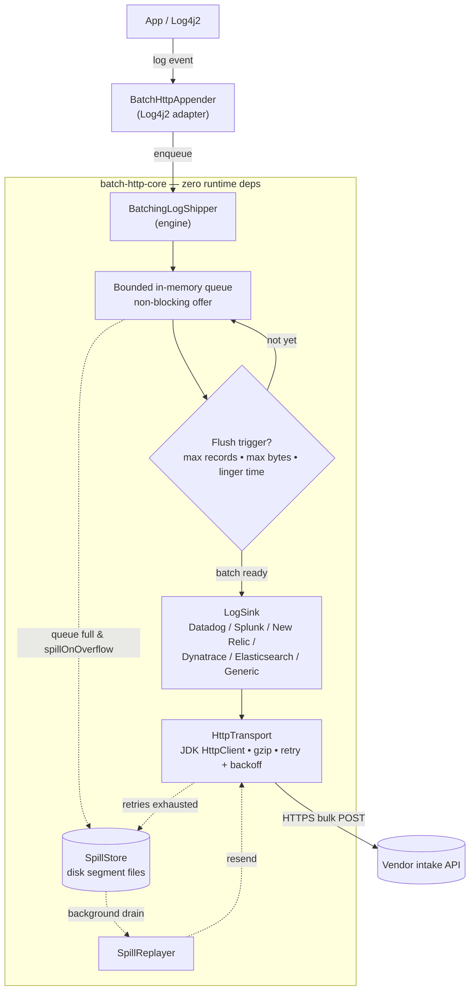
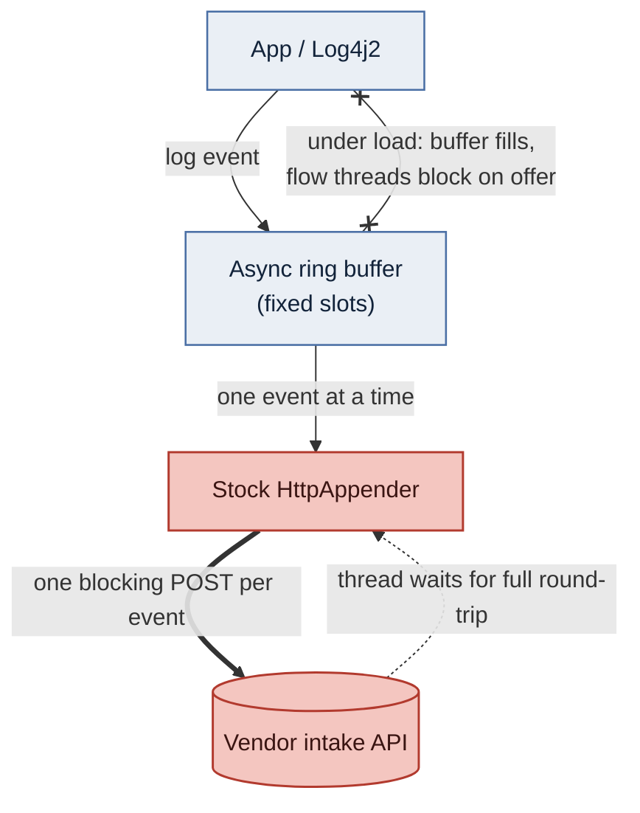

# Architecture

How a log event travels from your application to the vendor's intake, what the stock Log4j2
`<Http>` appender does differently, and which module holds which part. Configuration lives in the
[configuration reference](configuration.md); the failure paths (retry, disk spill, crash recovery)
are covered in [Resilience](resilience.md).

On this page:

- [The batching path](#the-batching-path)
- [The stock appender, for contrast](#the-stock-appender-for-contrast)
- [Modules](#modules)

## The batching path

The solid path is the normal flow from the Log4j2 adapter through the queue to a bulk POST; the
dotted path is the disk-spill detour that only runs on overflow or exhausted retries.

The options behind the diagram's limits:

| What | Option |
|------|--------|
| Flush trigger: max records | [`maxBatchRecords`](configuration.md#opt-maxbatchrecords) |
| Flush trigger: max bytes | [`maxBatchBytes`](configuration.md#opt-maxbatchbytes) |
| Flush trigger: linger time | [`lingerMillis`](configuration.md#opt-lingermillis) |
| Queue bound | [`queueCapacity`](configuration.md#opt-queuecapacity) |

### The crash-resilient disk buffer

The dotted path is the **crash-resilient disk buffer**
([`spillEnabled`](configuration.md#opt-spillenabled), **on by default**). Records are written to
disk as `SpillStore` segment files instead of being dropped when either:

- the in-memory queue overflows, or
- a batch exhausts its HTTP retries.

A background `SpillReplayer` drains them back through the same transport once the endpoint
recovers.

> [!NOTE]
> Because the disk buffer is on by default, the appender also writes to local storage by default.
> See [Disk-spill buffer](resilience.md#disk-spill-buffer) for where, and when to turn it off.

## The stock appender, for contrast

The stock `<Http>` appender has none of the middle: no bounded queue, no batching, no spill. Each
event is one blocking POST. Under load the async ring buffer fills, so the flow thread blocks on
the enqueue and logging turns synchronous.

In the diagram below, look for the red nodes (the stock appender and the intake it waits on, one
blocking POST per event) and the crossed edge back to the app (flow threads blocking once the
buffer fills). A
[rendered PNG of this diagram](img/stock-path-blocking.png) is also available.

The CloudHub benchmark measures exactly this difference with a batch/stock pair per vendor; see
the [benchmark results](benchmark-results.md).

## Modules

| Module | What it is | Contents |
|--------|------------|----------|
| `batch-http-core` | Framework-agnostic engine; **zero runtime dependencies** (uses the JDK 11+ `HttpClient`) | The queue, batching triggers, retry, gzip, lifecycle, and the per-vendor `LogSink` implementations |
| `batch-http-log4j2` | The Log4j2 adapter | The `@Plugin`-annotated `BatchHttpAppender`, usable directly from `log4j2.xml` |
| `demo/java/benchmark` | Runnable benchmark (artifactId `batch-http-demo`) | `BenchmarkDemo` and the example `log4j2-example.xml`; see [Run the benchmark / example](building.md#run-the-benchmark--example) |
| `demo/mule/*` | Sample Mule applications | The batch/stock pairs, one per vendor; see [The sample A/B pairs](mule.md#the-sample-ab-pairs) |

## See also

- [Configuration reference](configuration.md) — every `<BatchHttp>` option.
- [Resilience](resilience.md) — retry, graceful shutdown, disk spill, crash recovery.
- [Troubleshooting](troubleshooting.md) — what the engine reports about itself.
- [Building](building.md) — build, install, verify.

[Docs index](README.md) · [Configuration](configuration.md) · [Resilience](resilience.md) ·
[Building](building.md) · [Troubleshooting](troubleshooting.md)
