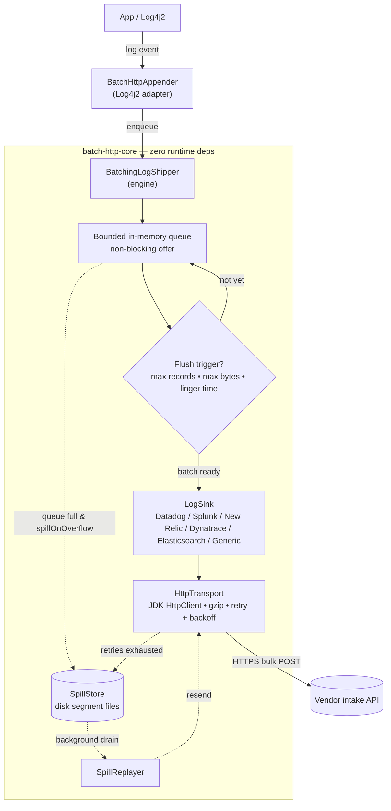
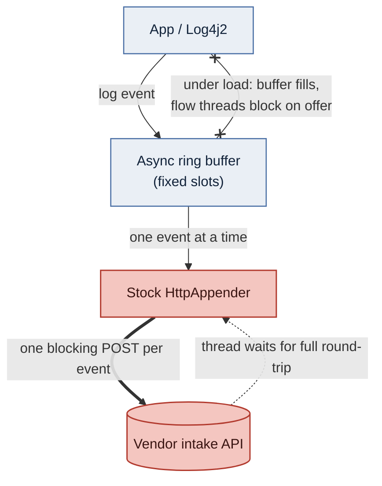

# Architecture

How a log event travels from your application to the vendor's intake, what the stock Log4j2
`<Http>` appender does differently, and which module holds which part. Configuration lives in
[configuration.md](configuration.md); the failure paths (retry, disk spill, crash recovery) are
covered in [resilience.md](resilience.md).

- [The batching path](#the-batching-path)
- [The stock appender, for contrast](#the-stock-appender-for-contrast)
- [Modules](#modules)

## The batching path

The three flush triggers are [`maxBatchRecords`](configuration.md#opt-maxbatchrecords),
[`maxBatchBytes`](configuration.md#opt-maxbatchbytes) and
[`lingerMillis`](configuration.md#opt-lingermillis); the queue is bounded by
[`queueCapacity`](configuration.md#opt-queuecapacity).

The dotted path is the **crash-resilient disk buffer**
([`spillEnabled`](configuration.md#opt-spillenabled), **on by default**): when the in-memory
queue overflows or a batch exhausts its HTTP retries, records are written to disk as
`SpillStore` segment files instead of being dropped, and a background `SpillReplayer` drains
them back through the same transport once the endpoint recovers. Because it is on by default it
also writes to local storage by default — see
[Disk-spill buffer](resilience.md#disk-spill-buffer) for where, and when to turn it off.

## The stock appender, for contrast

The stock `<Http>` appender has none of the middle — no bounded queue, no batching, no spill.
Each event is one blocking POST, and under load the async ring buffer fills, so the flow thread
blocks on the enqueue and logging turns synchronous (a rendered PNG of this sits at
[`img/stock-path-blocking.png`](img/stock-path-blocking.png)):

The CloudHub benchmark measures exactly this difference with a batch/stock pair per vendor —
see [benchmark-results.md](benchmark-results.md).

## Modules

- **`batch-http-core`** — framework-agnostic engine. **Zero runtime dependencies**
  (uses the JDK 11+ `HttpClient`). Contains the queue, batching triggers, retry,
  gzip, lifecycle, and the per-vendor `LogSink` implementations.
- **`batch-http-log4j2`** — the `@Plugin`-annotated `BatchHttpAppender`, usable
  directly from `log4j2.xml`.
- **`demo/java/benchmark`** — runnable benchmark + example `log4j2-example.xml`
  (artifactId `batch-http-demo`). See [building.md](building.md#run-the-benchmark--example).
- **`demo/mule/*`** — the batch/stock sample Mule application pairs, one per vendor. See
  [mule.md](mule.md#the-sample-ab-pairs).

## See also

- [configuration.md](configuration.md) — every `<BatchHttp>` option.
- [resilience.md](resilience.md) — retry, graceful shutdown, disk spill, crash recovery.
- [troubleshooting.md](troubleshooting.md) — what the engine reports about itself.
- [building.md](building.md) — build, install, verify.
- [Docs index](README.md)
