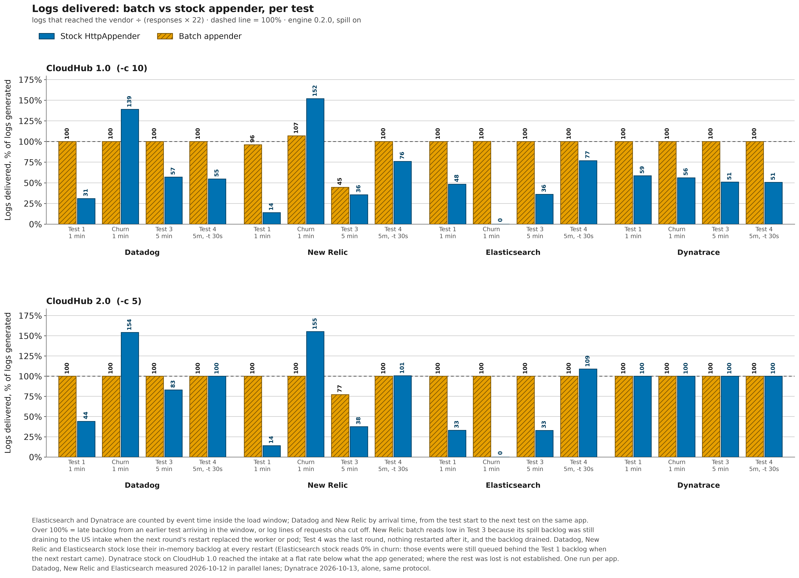

# Batching vs stock HTTP appender — CloudHub load benchmark

_Engine 0.2.0. Datadog, New Relic and Elasticsearch measured 2026-10-12 (tables generated
2026-10-12T09:47:11Z); Dynatrace measured 2026-10-13 and added to the same tables. Worker types
below; hardware specs intentionally omitted._

This page is the cross-vendor overview: what ran, how to read it, the caveats, the charts and
every test for all four vendors. Each vendor's own numbers, charts and what they show are on its
page, next to the vendor's setup and sample Mule project:

- [Datadog](vendors/datadog.md#benchmark-on-cloudhub) (also the ingest-lag screenshots)
- [New Relic](vendors/newrelic.md#benchmark-on-cloudhub)
- [Elasticsearch](vendors/elasticsearch.md#benchmark-on-cloudhub)
- [Dynatrace](vendors/dynatrace.md#benchmark-on-cloudhub)

The styled standalone view of the same results is [index.html](index.html). How to reproduce
them: [benchmark-runbook.md](benchmark-runbook.md).

**Jump to:** [What ran](#what-ran) · [How to read this](#how-to-read-this) ·
[Headline: Test 3](#headline--test-3-5-min) · [Charts](#charts) · [Test 1](#test-1--z1m) ·
[Test 2](#test-2--z1m_churn) · [Test 3](#test-3--z5m) · [Test 4](#test-4--z5m_t30s)

## What ran

- **16 Mule apps** — a batch/stock pair per vendor, each pair deployed to both planes:
  **Datadog** (site `ap2`, Sydney), **New Relic** (US intake, `log-api.newrelic.com`),
  **Elasticsearch** (Elastic Cloud Serverless, Sydney) and **Dynatrace** (Dynatrace SaaS on AWS,
  Sydney). **CloudHub 1.0**: 0.1 vCore worker, `-c 10`, `http`. **CloudHub 2.0**: 0.1 vCore
  replica, `-c 5`, `https` — the replica is a capped-CPU, no-swap worker, held at lower
  concurrency to stay off its OOM ceiling. Every worker and replica runs in Sydney (`ap-southeast-2`). The apps
  are the sample Mule projects in `demo/mule/` (`datadog-*`, `newrelic-*`, `elastic-*`,
  `dynatrace-*`), linked from each vendor page.
- **Batch apps**: `<BatchHttp>` engine 0.2.0, `maxBatchRecords=200`, one flusher
  (`flusherThreads=1`), `gzip="false"`, **disk spill on** (`spillEnabled` defaults to `true`;
  `batch.spillEnabled=false` turns it off). **Stock apps**: Log4j2's `<Http>` appender, one
  synchronous POST per event.
- **Load**: `oha` 1.16 with `-w` against `/log?count=20` — **22 log events per request** (a
  `batch.start`, 20 `order.processed`, a `batch.completed`).
- **Datadog, New Relic and Elasticsearch: three vendor lanes in parallel, one app per vendor at a
  time (2026-10-12).** Each vendor has its own intake, so the three lanes never share one. Within
  a lane the apps run one after another — CH1 batch, CH1 stock, CH2 batch, CH2 stock — with a
  barrier after each step, so at most one app per vendor is under load at any moment.
  **Control:** against a sequential, Elasticsearch-only run of 2026-10-11, Elasticsearch stock
  req/s in these lanes was within 3% on CloudHub 2.0 in the 5-minute rounds (−2.6% in Test 3,
  −2.9% in Test 4). On CloudHub 1.0 it was −3.3% in Test 4 and −14.6% in Test 3; an earlier
  parallel round of the same stock apps read +2.9% and −7.1% there, so a single CloudHub 1.0
  stock run moves that much on its own.
- **Dynatrace: its lane alone, a day later (2026-10-13).** Same protocol, the same app and worker
  sizes, the same region and the same build as the other three.
- **Every test starts on a freshly restarted app.** Restarts are pipelined ahead of each app's
  turn; each test then opens with 5 light warmups (`count=1`) and a 30 s drain. The churn test
  is the exception: it runs 60 s after Test 1 in the same thread, with no restart.

_Tests are numbered by execution order:_

| Test | Label | -z (nominal) | -t (per-req cap) | Kind |
|---|---|---|---|---|
| 1 | `z1m` | 1m | infinite | restart → warmup → load |
| 2 | `z1m_churn` | 1m | infinite | **NO restart** — repeat 60 s after prior test (churn) |
| 3 | `z5m` | 5m | infinite | restart → warmup → load |
| 4 | `z5m_t30s` | 5m | 30s | restart → warmup → load |

## How to read this

- **Numbers are RAW throughput (oha `Requests/sec`)** for the app's HTTP endpoint under load.
  The load is closed-loop (no rate limit), so req/s and mean latency are one measurement, not two.
- **`Delivered`** is the logs that reached the vendor ÷ the logs the measured requests generated
  (HTTP 200 responses × 22). Elasticsearch is counted by **event time** inside the oha window.
  Dynatrace is also counted by **event time** inside the oha window, in Grail with DQL, filtered
  by `log.source` (the app's name). Datadog and New Relic are counted by **arrival time**, from
  the test's start to the next test on the same app (the demos omit the vendors' reserved
  event-time attribute on purpose, so the vendor stamps arrival). **Over 100%** means late
  backlog from an earlier test arrived in the window (churn follows Test 1 with no restart), or
  the app logged requests oha cut off.
- **Batch delivered 100% at Datadog, Elasticsearch and Dynatrace in every round.** At Datadog,
  New Relic and Elasticsearch, **stock delivered 14–83% in Test 1 and Test 3**: its in-memory
  backlog dies at the next restart. Dynatrace stock delivered 50.7–58.5% on CloudHub 1.0 and 100%
  on CloudHub 2.0 (see the Dynatrace bullet below).
- **New Relic results depend on location.** The workers run in Sydney (`ap-southeast-2`), next to
  Datadog's `ap2` site and the Elasticsearch project. New Relic offers only US and EU regions;
  these apps ship to the US endpoint (`log-api.newrelic.com`), so every batch crosses the Pacific
  (on CloudHub 1.0 in Test 3 the backlog drained at about 330 logs/s). `Requests/sec` measures
  how responsive the app stays, not how many logs arrive. New Relic batch delivered about 96–107% in Test 1 and churn,
  **44.5% (CH1) and 77.3% (CH2) in Test 3**, and 100% in Test 4. The Test 3 shortfall is a
  restart, not a drop: the 5-minute burst spilled to disk faster than the US intake took it, and
  the backlog was still draining when the next round's restart replaced the worker (CloudHub 1.0
  restarts onto a new worker, 2.0 onto a new pod), so `/tmp` and the spill files went with it.
  Test 4 was the last round; nothing restarted after it, and its backlog drained in about
  12 minutes. Workers closer to the New Relic region, or `gzip` plus more `flusherThreads`,
  ship faster.
- **Dynatrace was measured a day later, on its own.** Its batch÷stock is only **4.4–6.5×** in
  Test 3 (the other vendors: 28–140×) because a single-record POST to the in-region Dynatrace
  intake takes about 4.4 ms, so the stock appender is penalised far less.
  Batch req/s is about the same as the other vendors' (CH1 ~135, CH2 ~40 in the 5-minute tests),
  so the worker, not the vendor, bounds batch. CloudHub 1.0 stock delivered only 50.7–58.5%: it
  reached the intake at a flat ~225 records/s throughout — the rate of one serialized Log4j2
  background sender — while the app generated more than that. CloudHub 2.0 stock's own load
  (about 220 records/s) sat just under that rate, so it delivered 100%. This is **not** Dynatrace
  throttling: a 914 req/s single-record burst from a laptop got HTTP `204` for every request and
  every record was stored. **Where the undelivered CloudHub 1.0 stock records were lost is not
  established**; the timing points at the async queue rather than a restart (nothing restarted
  after Test 4, and a queued backlog would have drained before it was counted).
- **Spill is on, gzip is off.** Spill costs batch req/s where the queue overflows the whole time
  (New Relic CH1 churn: 42 req/s) but not in the 5-minute tests. Compression is off because the
  stock `<Http>` appender cannot compress, and leaving it on would vary two things at once; a
  production deployment should leave it on.
- **Results depend on the platform, the resources allocated, and the moment of the run.** The
  CloudHub 1.0 apps ran while their worker was in its **post-restart CPU-burst** window — they may
  show different numbers once burst credits are exhausted. Every test starts on a fresh restart,
  so all rows are in-burst; the report is labelled accordingly.
- The two planes use **different concurrency** (0.1 vCore at -c 10, 0.1 vCore at -c 5) because the
  hardware differs — so **do NOT compare a CH1 number to a CH2 number.** Compare only **within a
  plane**: batch vs stock. The `batch÷stock` line is that within-plane ratio.
- **Do not read the tables as a comparison of the vendors.** Each vendor pair ships to a
  different intake over a different network path, and Dynatrace ran on a different day; the
  pairing makes the appender comparison fair within a vendor and says nothing about which
  vendor is faster.
- **`Total` is the ACTUAL measured execution time oha reported, not the nominal `-z`.** Runs use
  `-w` (drain in-flight requests past the deadline), so a nominal 1-min run reads slightly longer —
  and the **stock** appender's one-blocking-POST-per-event tail makes its `Total` drain visibly
  longer than batch. That longer tail is itself a result, not an artifact.
- Log volume is **identical on both planes** (each request emits the same `count=` log lines), so
  the appender does equal work per request; only the transport/concurrency/hardware differ.
- **One run per app.** These are single measurements, not medians: read them as directional.
- **Correction to the 2026-08-04 run.** Its CloudHub 2.0 Datadog stock app carried a leftover
  `AsyncLoggerConfig.RingBufferSize=20000` and `log4j2.debug=true` that no other app had. It
  measured 5.75 req/s with them against 1.46 without, so the published 7.6× is not comparable; a
  re-test without them gave about 31×. This run's app has neither property.
- **Churn test (Test 2):** a repeat of the load run in the SAME per-app thread, 60 s after
  Test 1, **with NO app restart in between** — so it lands while the app is still under Test-1
  pressure. It exposes the **accumulating backlog** the stock `<Http>` appender builds
  up — one blocking POST per event on a single background thread never catches up, so at
  Datadog, New Relic and Elasticsearch its second run degrades versus its own Test 1: lower req/s
  on every one of those six stock apps, and a longer `Total` tail on four of the six. Dynatrace
  stock, whose single-record POST is quick, held its req/s on CloudHub 1.0 (−1.0%) and rose on
  CloudHub 2.0 (+68.4%). The **batch** appender, which coalesces events, holds or rises, except
  New Relic on CloudHub 1.0, where the queue overflows to disk for the whole minute. The Test 2
  section prints a **Δ vs Test 1** (churn drop) per app so the divergence is explicit, not just
  visible.

> ### ⚠ Cold-start caveat — read the 1-minute Test 1 with this in mind
>
> The **batch** appender is CPU/JIT-bound, so it is warmup-sensitive. The warmup before each run is
> deliberately **light** (5 requests at `count=1`, then a 30 s drain) — a heavy warmup would pre-load
> the *stock* appender's flusher backlog and contaminate the start of its measured window. The
> trade-off is that the **batch** JVM is still under-warmed when the 1-minute Test 1 window opens, so
> **Test 1 (1 min) under-reports the batch appender's warm throughput.** The evidence is in the
> `Slowest` column and in the ordering across tests:
>
> - The batch apps' worst-case request in Test 1 is a **cold-start spike** (e.g. CloudHub 1.0 Datadog
>   batch: **4.8 s** Slowest in Test 1 → **0.64 s** in the warm churn window). That outlier lands
>   *inside* the 60 s window and drags the average down — JIT still compiling, TLS sessions not yet
>   reused, connection pools filling.
> - Throughput therefore **rises** from Test 1 to Test 3 for every batch app: e.g. CloudHub 2.0
>   Datadog batch **14.4 → 33.2 → 42.0 req/s** across Test 1, churn and Test 3. The 5-minute **Test 3**
>   amortises the fixed cold-start cost over a longer window, so it is the **better read of sustained
>   warm throughput**. Read Test 3 as the headline; treat Test 1 as the cold-start / short-burst figure.
> - This affects **batch** most; the **stock** appender is bottlenecked on its serial one-POST-per-event
>   flusher, which warmup cannot fix, so at Datadog, New Relic and Elasticsearch stock stays flat or
>   degrades. That is why the batch÷stock *ratio* is larger in the warm windows (at Dynatrace too:
>   2.7× → 6.5× on CloudHub 1.0, 2.8× → 4.4× on CloudHub 2.0).
>
> A heavier, load-shaped warmup would make Test 1 agree with Test 3, at the cost of a stock backlog
> already building when the window opens. This run kept the light warmup, so the caveat stands.

## Headline — Test 3 (5 min)

**Throughput gain, batch versus stock, within each vendor-and-platform pair:**

| Platform | Datadog | New Relic | Elasticsearch | Dynatrace |
|----------|--------:|----------:|--------------:|----------:|
| CloudHub 1.0 — 0.1 vCore worker (`-c 10`) | **53.5×** | **110.8×** | **139.5×** | **6.5×** |
| CloudHub 2.0 — 0.1 vCore replica (`-c 5`) | **28.5×** | **59.5×** | **48.6×** | **4.4×** |

The stock `<Http>` appender ships one synchronous POST per event on a single background
flusher; under sustained concurrency that flusher never catches up, so its throughput
collapses and its tail latency climbs into the multi-second — sometimes tens-of-seconds —
range. The batch appender coalesces events and enqueues non-blocking, so request latency stays
decoupled from intake latency. Every run in the two tables below finished at **100% success**.

**CloudHub 1.0** — 0.1 vCore worker, `-c 10`, 5-minute run:

| App | req/s | Requests | Mean | p50 | p90 | p99 | Delivered |
|-----|------:|---------:|-----:|----:|----:|----:|----------:|
| **Datadog — batch 0.2.0** | **140.24** | **42,080** | **71 ms** | **51 ms** | **128 ms** | **226 ms** | **100.0%** |
| Datadog — stock `<Http>` | 2.62 | 811 | 3,771 ms | 311 ms | 11,025 ms | 13,172 ms | 57.1% |
| **New Relic — batch 0.2.0** | **133.72** | **40,121** | **75 ms** | **53 ms** | **129 ms** | **322 ms** | **44.5%** |
| New Relic — stock `<Http>` | 1.21 | 412 | 7,882 ms | 326 ms | 33,261 ms | 58,127 ms | 35.6% |
| **Elasticsearch — batch 0.2.0** | **136.15** | **40,852** | **73 ms** | **54 ms** | **128 ms** | **270 ms** | **100.0%** |
| Elasticsearch — stock `<Http>` | 0.98 | 353 | 9,432 ms | 348 ms | 39,738 ms | 66,552 ms | 36.1% |
| **Dynatrace — batch 0.2.0** | **134.54** | **40,373** | **74 ms** | **54 ms** | **127 ms** | **304 ms** | **100.0%** |
| Dynatrace — stock `<Http>` | 20.58 | 6,195 | 485 ms | 298 ms | 1,044 ms | 1,259 ms | 50.9% |

**CloudHub 2.0** — 0.1 vCore replica, `-c 5`, 5-minute run:

| App | req/s | Requests | Mean | p50 | p90 | p99 | Delivered |
|-----|------:|---------:|-----:|----:|----:|----:|----------:|
| **Datadog — batch 0.2.0** | **42.03** | **12,610** | **119 ms** | **98 ms** | **203 ms** | **498 ms** | **100.0%** |
| Datadog — stock `<Http>` | 1.48 | 447 | 3,373 ms | 4,979 ms | 5,744 ms | 8,215 ms | 83.0% |
| **New Relic — batch 0.2.0** | **45.09** | **13,529** | **111 ms** | **95 ms** | **196 ms** | **476 ms** | **77.3%** |
| New Relic — stock `<Http>` | 0.76 | 248 | 6,285 ms | 399 ms | 23,575 ms | 35,185 ms | 37.6% |
| **Elasticsearch — batch 0.2.0** | **35.68** | **10,708** | **140 ms** | **107 ms** | **249 ms** | **663 ms** | **100.0%** |
| Elasticsearch — stock `<Http>` | 0.73 | 241 | 6,487 ms | 650 ms | 26,504 ms | 39,651 ms | 32.9% |
| **Dynatrace — batch 0.2.0** | **40.68** | **12,207** | **123 ms** | **96 ms** | **205 ms** | **501 ms** | **100.0%** |
| Dynatrace — stock `<Http>` | 9.18 | 2,756 | 545 ms | 480 ms | 755 ms | 1,429 ms | 100.0% |

Each pair is a batch-versus-stock contrast within one vendor on one platform; the two tables
are not a controlled comparison of each other (different concurrency, different CPU models —
see [How to read this](#how-to-read-this)). Across the six stock runs at Datadog, New Relic and
Elasticsearch the p99 tail lands between **8 s and 67 s**; Dynatrace stock, with its quick
in-region intake, reads 1.3 s (CH1) and 1.4 s (CH2). The batch p99s run from 226 ms to 663 ms
across all eight batch runs.

Every 5-minute run in the tables above validates against Little's Law — requests/sec × mean
latency is within 8% of the plane's concurrency — so the load parameters are corroborated by the
results rather than merely asserted. That does not hold for every run below: where requests fail
or time out (Test 4, New Relic on CloudHub 1.0 in the churn window) or a long stock tail drains
past the deadline (the 1-minute tests), the product falls below `-c`. Latency figures are from
[`oha`](https://github.com/hatoo/oha) 1.16, whose output shows none of the ×10 unit-selection
display glitch of 1.14.0 that the earlier runs had to normalise.

## Charts

Rendered from the raw results below (PNG shown; an SVG twin sits beside each in `docs/img/`).
Each vendor page carries the same charts for its own pair (`docs/img/vendors/`).

### Sustained throughput — Test 3 (5 min), the warm headline number

### Request latency — Test 3 (5 min), log scale

The same latency data as a range (dumbbell) plot — each pair's stock and batch markers joined
by the `N× lower` gap, so the log axis carries no "bar length is meaningless" caveat:

### Warmup / cold-start effect (why Test 1 reads low)

Batch and stock are shown side by side for each phase. The batch bars rise Test 1 → Test 3 as the
cold-start ramp (JIT/TLS/connection pools) is amortised over a longer window, so the 1-minute Test 1
under-reports warm batch throughput; at Datadog, New Relic and Elasticsearch the stock bars stay flat
or fall. Even cold batch (Test 1) already beats warm stock. New Relic batch on CloudHub 1.0 dips in
the churn window, where its queue overflows to disk for the whole minute. Dynatrace stock runs far
faster than the other stock apps (an in-region single-record POST is quick), so its ratio is smaller,
while its batch req/s matches the other vendors'. The two planes ran at different concurrency
(CH1 `-c 10`, CH2 `-c 5`) on different CPU, so each panel is on its own y-scale — compare within a
panel, not across.

### Logs delivered — every test

Batch reaches 100% at Datadog, Elasticsearch and Dynatrace in every test. New Relic batch dips in
Test 3, when the next round's restart replaced the worker or pod while its spill backlog was still
draining to the US intake, and recovers to 100% in Test 4, the last round. At Datadog, New Relic and
Elasticsearch, stock delivers 14–83% in Test 1 and Test 3: what is still queued in memory when the
next restart comes dies with the app. In the churn window, which follows Test 1 with no restart,
Datadog and New Relic stock read 139–155% because they are counted by arrival and Test 1's late
backlog lands there; Elasticsearch stock, counted by event time, reads 0%. Test 4 stock reads 55–77%
on CloudHub 1.0 and 100–109% on CloudHub 2.0 at those three vendors. Dynatrace stock reads
50.7–58.5% on CloudHub 1.0 in every test, at a flat intake rate below what the app generated, and
100% on CloudHub 2.0.

## Test 1 — `z1m`

### CloudHub 1.0 — worker type: **0.1 vCore**  (-c 10, in CPU-burst window)
| App | Requests/sec | Total (actual) | Success | Slowest | Delivered |
|---|---|---|---|---|---|
| Datadog · batch | 75.3480 | 60.0679 sec | 100.00% | 4.8220 sec | 100.0% (99,572 / 99,572) |
| Datadog · stock | 5.1276 | 70.0126 sec | 100.00% | 19.6236 sec | 31.0% (2,449 / 7,898) |
| New Relic · batch | 70.1508 | 60.0706 sec | 100.00% | 3.8847 sec | 96.1% (89,094 / 92,708) |
| New Relic · stock | 2.1233 | 110.2050 sec | 100.00% | 59.2723 sec | 13.9% (715 / 5,148) |
| Elasticsearch · batch | 82.8826 | 60.1332 sec | 100.00% | 6.1271 sec | 100.0% (109,648 / 109,648) |
| Elasticsearch · stock | 2.1078 | 1.9452 min | 100.00% | 1.0865 min | 48.3% (2,614 / 5,412) |
| Dynatrace · batch | 67.1560 | 60.0691 sec | 100.00% | 5.2302 sec | 100.0% (88,748 / 88,748) |
| Dynatrace · stock | 24.6825 | 60.6098 sec | 100.00% | 4.2056 sec | 58.5% (19,268 / 32,912) |

**Within-plane batch÷stock (CH1):**  Datadog 14.69x  ·  New Relic 33.04x  ·  Elasticsearch 39.32x  ·  Dynatrace 2.72x

### CloudHub 2.0 — worker type: **0.1 vCore**  (-c 5)
| App | Requests/sec | Total (actual) | Success | Slowest | Delivered |
|---|---|---|---|---|---|
| Datadog · batch | 14.3541 | 60.2614 sec | 100.00% | 1.7699 sec | 100.0% (19,030 / 19,030) |
| Datadog · stock | 3.4210 | 68.4009 sec | 100.00% | 8.4046 sec | 44.1% (2,270 / 5,148) |
| New Relic · batch | 13.1428 | 60.2610 sec | 100.00% | 2.3111 sec | 100.0% (17,424 / 17,424) |
| New Relic · stock | 2.4368 | 82.4858 sec | 100.00% | 32.7894 sec | 14.0% (621 / 4,422) |
| Elasticsearch · batch | 18.1387 | 60.0926 sec | 100.00% | 1.8099 sec | 100.0% (23,980 / 23,980) |
| Elasticsearch · stock | 2.6835 | 74.1563 sec | 100.00% | 39.4931 sec | 33.1% (1,449 / 4,378) |
| Dynatrace · batch | 17.5799 | 60.0687 sec | 100.00% | 1.8970 sec | 100.0% (23,232 / 23,232) |
| Dynatrace · stock | 6.2784 | 61.3217 sec | 100.00% | 2.7950 sec | 100.0% (8,470 / 8,470) |

**Within-plane batch÷stock (CH2):**  Datadog 4.20x  ·  New Relic 5.39x  ·  Elasticsearch 6.76x  ·  Dynatrace 2.80x

## Test 2 — `z1m_churn`

> **Churn run** — same load as its Test-1 twin (`loadtest-z1m`), fired in the SAME per-app thread 60 s after Test 1 with **no app restart** (so it hits while the app is still under Test-1 pressure). The **Δ vs Test 1** column is the churn drop: at Datadog, New Relic and Elasticsearch stock degrades (backlog), batch holds or rises except where spill overflow is constant. Dynatrace stock holds (CH1) or rises (CH2).

### CloudHub 1.0 — worker type: **0.1 vCore**  (-c 10, in CPU-burst window)
| App | Requests/sec | Total (actual) | Success | Slowest | Delivered | Δ vs Test 1 |
|---|---|---|---|---|---|---|
| Datadog · batch | 146.8532 | 60080.3964 ms | 100.00% | 635.1850 ms | 100.0% (194,130 / 194,106) | +94.9% (75.3→146.9) |
| Datadog · stock | 2.5361 | 70.9748 sec | 100.00% | 13.4594 sec | 139.0% (5,503 / 3,960) | -50.5% (5.1→2.5) |
| New Relic · batch | 42.1739 | 60.1320 sec | 99.61% | 14.1370 sec | 106.9% (59,430 / 55,572) | -39.9% (70.2→42.2) |
| New Relic · stock | 0.6141 | 112.3636 sec | 100.00% | 56.5457 sec | 152.0% (2,307 / 1,518) | -71.1% (2.1→0.6) |
| Elasticsearch · batch | 97.0838 | 61.0297 sec | 100.00% | 13.3997 sec | 100.2% (130,550 / 130,350) | +17.1% (82.9→97.1) |
| Elasticsearch · stock | 0.5246 | 1.9061 min | 100.00% | 1.0857 min | 0.0% (0 / 1,320) | -75.1% (2.1→0.5) |
| Dynatrace · batch | 136.9458 | 60038.3296 ms | 100.00% | 494.7405 ms | 100.0% (180,884 / 180,884) | +103.9% (67.2→136.9) |
| Dynatrace · stock | 24.4447 | 60.7904 sec | 100.00% | 2.0339 sec | 56.2% (18,361 / 32,692) | -1.0% (24.7→24.4) |

**Within-plane batch÷stock (CH1):**  Datadog 57.91x  ·  New Relic 68.68x  ·  Elasticsearch 185.06x  ·  Dynatrace 5.60x

### CloudHub 2.0 — worker type: **0.1 vCore**  (-c 5)
| App | Requests/sec | Total (actual) | Success | Slowest | Delivered | Δ vs Test 1 |
|---|---|---|---|---|---|---|
| Datadog · batch | 33.2101 | 60.1322 sec | 100.00% | 1.3592 sec | 100.1% (43,958 / 43,934) | +131.4% (14.4→33.2) |
| Datadog · stock | 1.7530 | 63.3202 sec | 100.00% | 8.5304 sec | 154.1% (3,762 / 2,442) | -48.8% (3.4→1.8) |
| New Relic · batch | 29.7319 | 60.0365 sec | 100.00% | 1.3912 sec | 100.1% (39,294 / 39,270) | +126.2% (13.1→29.7) |
| New Relic · stock | 0.3463 | 89.5289 sec | 100.00% | 32.0383 sec | 155.3% (1,059 / 682) | -85.8% (2.4→0.3) |
| Elasticsearch · batch | 46.7465 | 60.1115 sec | 100.00% | 1.1793 sec | 100.0% (61,820 / 61,820) | +157.7% (18.1→46.7) |
| Elasticsearch · stock | 0.2658 | 97.8012 sec | 100.00% | 39.7903 sec | 0.0% (0 / 572) | -90.1% (2.7→0.3) |
| Dynatrace · batch | 41.6854 | 60.1170 sec | 100.00% | 1.2917 sec | 100.0% (55,132 / 55,132) | +137.1% (17.6→41.7) |
| Dynatrace · stock | 10.5712 | 60.7313 sec | 100.00% | 1.6864 sec | 100.0% (14,124 / 14,124) | +68.4% (6.3→10.6) |

**Within-plane batch÷stock (CH2):**  Datadog 18.94x  ·  New Relic 85.86x  ·  Elasticsearch 175.87x  ·  Dynatrace 3.94x

> Requests without a response, per app: New Relic CH1 batch: [10] connection closed before message completed.

## Test 3 — `z5m`

### CloudHub 1.0 — worker type: **0.1 vCore**  (-c 10, in CPU-burst window)
| App | Requests/sec | Total (actual) | Success | Slowest | Delivered |
|---|---|---|---|---|---|
| Datadog · batch | 140.2397 | 300.0577 sec | 100.00% | 6.3941 sec | 100.0% (925,784 / 925,760) |
| Datadog · stock | 2.6192 | 309.6348 sec | 100.00% | 15.8467 sec | 57.1% (10,182 / 17,842) |
| New Relic · batch | 133.7193 | 300.0390 sec | 100.00% | 7.5502 sec | 44.5% (393,034 / 882,662) |
| New Relic · stock | 1.2068 | 341.3951 sec | 100.00% | 59.2074 sec | 35.6% (3,231 / 9,064) |
| Elasticsearch · batch | 136.1512 | 300.0489 sec | 100.00% | 5.3876 sec | 100.0% (898,744 / 898,744) |
| Elasticsearch · stock | 0.9758 | 6.0289 min | 100.00% | 1.1205 min | 36.1% (2,806 / 7,766) |
| Dynatrace · batch | 134.5408 | 300.0800 sec | 100.00% | 7.4310 sec | 100.0% (888,206 / 888,206) |
| Dynatrace · stock | 20.5791 | 301.0329 sec | 100.00% | 5.2232 sec | 50.9% (69,375 / 136,290) |

**Within-plane batch÷stock (CH1):**  Datadog 53.54x  ·  New Relic 110.80x  ·  Elasticsearch 139.53x  ·  Dynatrace 6.54x

### CloudHub 2.0 — worker type: **0.1 vCore**  (-c 5)
| App | Requests/sec | Total (actual) | Success | Slowest | Delivered |
|---|---|---|---|---|---|
| Datadog · batch | 42.0320 | 300.0096 sec | 100.00% | 1.7783 sec | 100.0% (277,444 / 277,420) |
| Datadog · stock | 1.4772 | 302.6008 sec | 100.00% | 8.4779 sec | 83.0% (8,161 / 9,834) |
| New Relic · batch | 45.0884 | 300.0547 sec | 100.00% | 1.6968 sec | 77.3% (230,040 / 297,638) |
| New Relic · stock | 0.7572 | 327.5188 sec | 100.00% | 36.2146 sec | 37.6% (2,054 / 5,456) |
| Elasticsearch · batch | 35.6817 | 300.0979 sec | 100.00% | 2.7645 sec | 100.0% (235,576 / 235,576) |
| Elasticsearch · stock | 0.7341 | 328.3002 sec | 100.00% | 40.0631 sec | 32.9% (1,744 / 5,302) |
| Dynatrace · batch | 40.6780 | 300.0884 sec | 100.00% | 13.4341 sec | 100.0% (268,554 / 268,554) |
| Dynatrace · stock | 9.1782 | 300.2763 sec | 100.00% | 2.1617 sec | 100.0% (60,632 / 60,632) |

**Within-plane batch÷stock (CH2):**  Datadog 28.45x  ·  New Relic 59.55x  ·  Elasticsearch 48.61x  ·  Dynatrace 4.43x

## Test 4 — `z5m_t30s`

### CloudHub 1.0 — worker type: **0.1 vCore**  (-c 10, in CPU-burst window)
| App | Requests/sec | Total (actual) | Success | Slowest | Delivered |
|---|---|---|---|---|---|
| Datadog · batch | 125.4734 | 300.1354 sec | 100.00% | 11.2952 sec | 100.0% (828,498 / 828,498) |
| Datadog · stock | 2.7006 | 311.0383 sec | 100.00% | 13.3200 sec | 54.7% (10,116 / 18,480) |
| New Relic · batch | 114.8289 | 300.1509 sec | 100.00% | 10.7942 sec | 100.1% (758,652 / 758,252) |
| New Relic · stock | 1.2851 | 323.7042 sec | 80.77% | 24.5293 sec | 75.9% (5,611 / 7,392) |
| Elasticsearch · batch | 148.4997 | 300.0545 sec | 100.00% | 5.4201 sec | 100.0% (980,276 / 980,276) |
| Elasticsearch · stock | 1.2557 | 326.5127 sec | 76.59% | 26.6980 sec | 76.9% (5,314 / 6,908) |
| Dynatrace · batch | 139.0204 | 300.0639 sec | 100.00% | 6.6919 sec | 100.0% (917,730 / 917,730) |
| Dynatrace · stock | 24.8540 | 300.6352 sec | 100.00% | 8.0091 sec | 50.7% (83,291 / 164,384) |

**Within-plane batch÷stock (CH1):**  Datadog 46.46x  ·  New Relic 89.35x  ·  Elasticsearch 118.26x  ·  Dynatrace 5.59x

### CloudHub 2.0 — worker type: **0.1 vCore**  (-c 5)
| App | Requests/sec | Total (actual) | Success | Slowest | Delivered |
|---|---|---|---|---|---|
| Datadog · batch | 35.6281 | 300.0999 sec | 100.00% | 1.9041 sec | 100.0% (235,224 / 235,224) |
| Datadog · stock | 1.4794 | 303.4955 sec | 100.00% | 8.4027 sec | 100.0% (9,878 / 9,878) |
| New Relic · batch | 47.1919 | 300.0303 sec | 100.00% | 2.1864 sec | 100.0% (311,498 / 311,498) |
| New Relic · stock | 0.7634 | 324.8810 sec | 95.56% | 29.9884 sec | 100.5% (5,241 / 5,214) |
| Elasticsearch · batch | 38.0475 | 300.0200 sec | 100.00% | 2.6783 sec | 100.0% (251,130 / 251,130) |
| Elasticsearch · stock | 0.7559 | 321.4537 sec | 91.77% | 29.4090 sec | 109.0% (5,346 / 4,906) |
| Dynatrace · batch | 37.2043 | 300.0996 sec | 100.00% | 2.9058 sec | 100.0% (245,630 / 245,630) |
| Dynatrace · stock | 10.2592 | 300.6091 sec | 100.00% | 2.5958 sec | 100.0% (67,848 / 67,848) |

**Within-plane batch÷stock (CH2):**  Datadog 24.08x  ·  New Relic 61.82x  ·  Elasticsearch 50.33x  ·  Dynatrace 3.63x

> ⚠ 4 file(s) show `timeout` entries — requests that hit the -t per-request cap (the 30s-cap test, by design).
>
> Requests without a response, per app: Elasticsearch CH1 stock: [96] timeout; Elasticsearch CH2 stock: [20] timeout; New Relic CH1 stock: [80] timeout; New Relic CH2 stock: [11] timeout.

---
_Concurrency, count=, and warmup/drain method are identical across all tests and all four vendors;
only -z / -t vary. Latency figures are from oha 1.16, whose output shows none of the 1.14.0 ÷10 unit
glitch; throughput (Requests/sec) and Delivered are what this report compares. See also:
[Docs index](README.md)._
