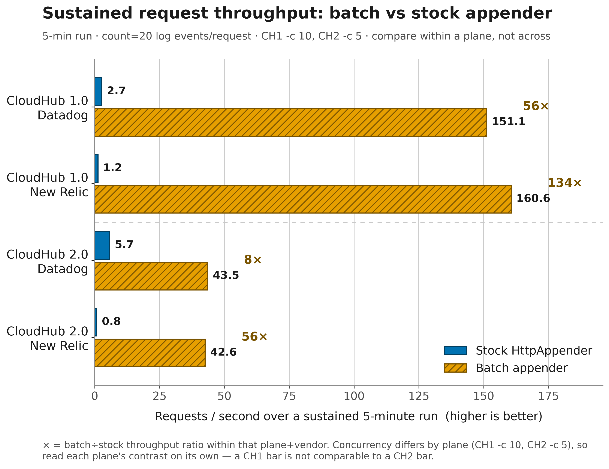
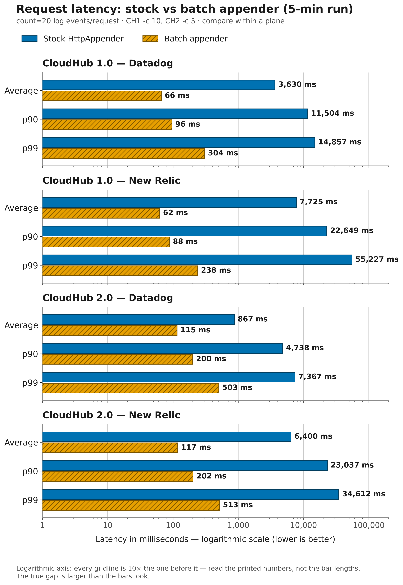
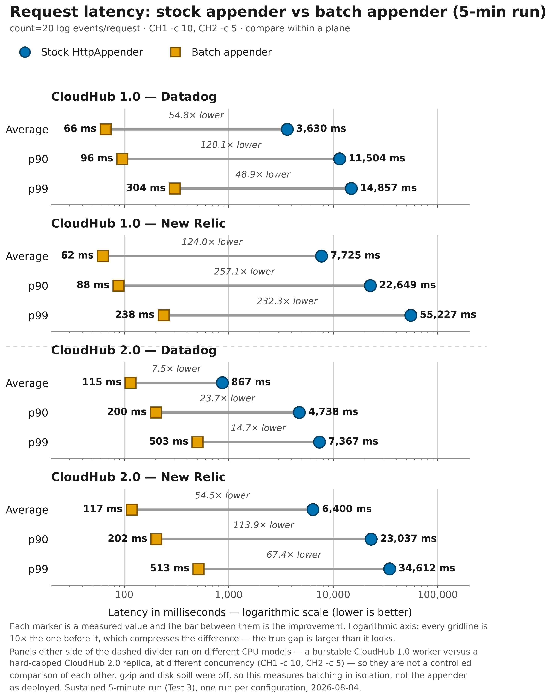
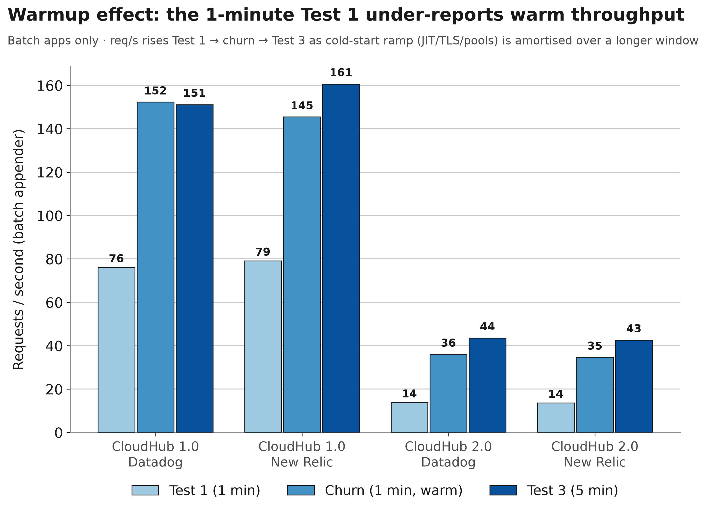

# Batching vs stock HTTP appender — CloudHub load benchmark

_Generated 2026-08-04T09:44:24Z. Worker types below; hardware specs intentionally omitted._

## How to read this

- **Numbers are RAW throughput (oha `Requests/sec`)** for the app's HTTP endpoint under load.
- **Results depend on the platform, the resources allocated, and the moment of the run.** The
  CloudHub 1.0 apps ran while their worker was in its **post-restart CPU-burst** window — they may
  show different numbers once burst credits are exhausted. Every app was **restarted and warmed up
  before every run**, so all rows are in-burst; the report is labelled accordingly.
- The two planes use **different concurrency** (0.1 vCore at -c 10, 0.1 vCore at -c 5) because the
  hardware differs — so **do NOT compare a CH1 number to a CH2 number.** Compare only **within a
  plane**: batch vs stock. The `batch÷stock` column is that within-plane ratio.
- **`Total` is the ACTUAL measured execution time oha reported, not the nominal `-z`.** Runs use
  `-w` (drain in-flight requests past the deadline), so a nominal 1-min run reads slightly longer —
  and the **stock** appender's one-blocking-POST-per-event tail makes its `Total` drain visibly
  longer than batch. That longer tail is itself a result, not an artifact.
- Log volume is **identical on both planes** (each request emits the same `count=` log lines), so
  the appender does equal work per request; only the transport/concurrency/hardware differ.
- **Churn test (Test 2):** a repeat of the load run in the SAME per-app thread, a short pause after
  Test 1, **with NO app restart in between** — so it lands while the app is still under Test-1
  pressure. It exposes the **accumulating backlog** the stock `<Http>` appender builds
  up — one blocking POST per event on a single background thread never catches up, so its second
  run degrades (lower req/s, longer `Total` tail) versus its own Test 1. The **batch** appender,
  which coalesces events, holds steady — most visibly on CloudHub 2.0. The Test 2 section prints a
  **Δ vs Test 1** (churn drop) per app so the divergence is explicit, not just visible.

> ### ⚠ Cold-start caveat — read the 1-minute Test 1 with this in mind
>
> The **batch** appender is CPU/JIT-bound, so it is warmup-sensitive. The warmup before each run is
> deliberately **light** (5 requests at `count=1`, then a 30 s drain) — a heavy warmup would pre-load
> the *stock* appender's flusher backlog and contaminate the start of its measured window. The
> trade-off is that the **batch** JVM is still under-warmed when the 1-minute Test 1 window opens, so
> **Test 1 (1 min) under-reports the batch appender's warm throughput.** The evidence is in the
> `Slowest` column and in the ordering across tests:
>
> - The batch apps' worst-case request in Test 1 is a **cold-start spike** (e.g. CloudHub 2.0 Datadog
>   batch: **2.0 s** Slowest in Test 1 → **0.69 s** in the warm churn window). That 2 s outlier lands
>   *inside* the 60 s window and drags the average down — JIT still compiling, TLS sessions not yet
>   reused, connection pools filling.
> - Throughput therefore **rises** Test 1 → churn → Test 3: e.g. CloudHub 2.0 Datadog batch
>   **13.8 → 36.1 → 43.5 req/s**. The 5-minute **Test 3** amortises the fixed cold-start cost over a
>   longer window, so it is the **better read of sustained warm throughput**. Read Test 3 as the
>   headline; treat Test 1 as the cold-start / short-burst figure.
> - This affects **batch** most; the **stock** appender is bottlenecked on its serial one-POST-per-event
>   flusher, which warmup cannot fix, so stock stays flat or degrades. That is why the batch÷stock
>   *ratio* is larger in the warm windows.
>
> **Next round** will use a heavier, load-shaped warmup (200 requests at `-c 5`, `count=25`, then a
> 5-minute flush pause) plus even concurrency across planes, so Test 1 starts warm and agrees with
> Test 3. Until then, this caveat stands.

## Charts

Rendered from the raw results below (PNG shown; an SVG twin sits beside each in `docs/img/`).

### Sustained throughput — Test 3 (5 min), the warm headline number

### Request latency — Test 3 (5 min), log scale

The same latency data as a range (dumbbell) plot — each pair's stock and batch markers joined
by the `N× lower` gap, so the log axis carries no "bar length is meaningless" caveat:

### Warmup / cold-start effect (why Test 1 reads low)

_Tests are numbered by execution order (the order below)._

| Test | Label | -z (nominal) | -t (per-req cap) | Kind |
|---|---|---|---|---|
| 1 | `z1m` | 1m | infinite | restart → warmup → load |
| 2 | `z1m_churn` | 1m | infinite | **NO restart** — repeat ~1 min after prior test (churn) |
| 3 | `z5m` | 5m | infinite | restart → warmup → load |
| 4 | `z5m_t30s` | 5m | 30s | restart → warmup → load |

## Test 1 — `z1m`

### CloudHub 1.0 — worker type: **0.1 vCore**  (-c 10, in CPU-burst window)
| App | Requests/sec | Total (actual) | Success | Slowest |
|---|---|---|---|---|
| DataDog · batch | 76.0477 | 60.0675 sec | 100.00% | 6.4917 sec |
| DataDog · stock | 4.9769 | 7.2937 10 sec | 100.00% | 2.1179 10 sec |
| New Relic · batch | 79.0921 | 60.0818 sec | 100.00% | 5.0045 sec |
| New Relic · stock | 2.1976 | 1.6761 min | 100.00% | 1.0845 min |

**Within-plane batch÷stock (CH1):**  DataDog 15.28x  ·  New Relic 35.99x

### CloudHub 2.0 — worker type: **0.1 vCore**  (-c 5)
| App | Requests/sec | Total (actual) | Success | Slowest |
|---|---|---|---|---|
| DataDog · batch | 13.7895 | 60.1181 sec | 100.00% | 2.0042 sec |
| DataDog · stock | 13.1746 | 60.1918 sec | 100.00% | 2.5408 sec |
| New Relic · batch | 13.6334 | 60.1463 sec | 100.00% | 2.5116 sec |
| New Relic · stock | 2.2865 | 8.8343 10 sec | 100.00% | 3.3182 10 sec |

**Within-plane batch÷stock (CH2):**  DataDog 1.05x  ·  New Relic 5.96x

## Test 2 — `z1m_churn`

> **Churn run** — same load as its Test-1 twin (`loadtest-z1m`), fired in the SAME per-app thread a short pause after Test 1 with **no app restart** (so it hits while the app is still under Test-1 pressure). The **Δ vs Test 1** column is the churn drop: stock degrades (backlog), batch holds.

### CloudHub 1.0 — worker type: **0.1 vCore**  (-c 10, in CPU-burst window)
| App | Requests/sec | Total (actual) | Success | Slowest | Δ vs Test 1 |
|---|---|---|---|---|---|
| DataDog · batch | 152.3402 | 60043.2438 ms | 100.00% | 731.5998 ms | +100.3% (76.0→152.3) |
| DataDog · stock | 3.3434 | 6.9391 10 sec | 100.00% | 1.2379 10 sec | -32.8% (5.0→3.3) |
| New Relic · batch | 145.4746 | 60.0586 sec | 100.00% | 5.4016 sec | +83.9% (79.1→145.5) |
| New Relic · stock | 1.0335 | 10.4503 10 sec | 100.00% | 4.4830 10 sec | -53.0% (2.2→1.0) |

**Within-plane batch÷stock (CH1):**  DataDog 45.56x  ·  New Relic 140.76x

### CloudHub 2.0 — worker type: **0.1 vCore**  (-c 5)
| App | Requests/sec | Total (actual) | Success | Slowest | Δ vs Test 1 |
|---|---|---|---|---|---|
| DataDog · batch | 36.0544 | 60131.3693 ms | 100.00% | 693.3875 ms | +161.5% (13.8→36.1) |
| DataDog · stock | 13.2741 | 62.6784 sec | 100.00% | 8.1546 sec | +0.8% (13.2→13.3) |
| New Relic · batch | 34.6839 | 60172.0731 ms | 100.00% | 894.7918 ms | +154.4% (13.6→34.7) |
| New Relic · stock | 0.3548 | 8.4555 10 sec | 100.00% | 3.3499 10 sec | -84.5% (2.3→0.4) |

**Within-plane batch÷stock (CH2):**  DataDog 2.72x  ·  New Relic 97.76x

## Test 3 — `z5m`

### CloudHub 1.0 — worker type: **0.1 vCore**  (-c 10, in CPU-burst window)
| App | Requests/sec | Total (actual) | Success | Slowest |
|---|---|---|---|---|
| DataDog · batch | 151.1182 | 300.0498 sec | 100.00% | 5.8838 sec |
| DataDog · stock | 2.7223 | 30.8566 10 sec | 100.00% | 1.9594 10 sec |
| New Relic · batch | 160.5972 | 300.0674 sec | 100.00% | 6.0865 sec |
| New Relic · stock | 1.2000 | 35.0820 10 sec | 100.00% | 5.5555 10 sec |

**Within-plane batch÷stock (CH1):**  DataDog 55.51x  ·  New Relic 133.83x

### CloudHub 2.0 — worker type: **0.1 vCore**  (-c 5)
| App | Requests/sec | Total (actual) | Success | Slowest |
|---|---|---|---|---|
| DataDog · batch | 43.5284 | 300.0339 sec | 100.00% | 2.2028 sec |
| DataDog · stock | 5.7469 | 302.9460 sec | 100.00% | 8.0045 sec |
| New Relic · batch | 42.5743 | 300.0398 sec | 100.00% | 1.9821 sec |
| New Relic · stock | 0.7610 | 32.5879 10 sec | 100.00% | 4.4389 10 sec |

**Within-plane batch÷stock (CH2):**  DataDog 7.57x  ·  New Relic 55.95x

## Test 4 — `z5m_t30s`

### CloudHub 1.0 — worker type: **0.1 vCore**  (-c 10, in CPU-burst window)
| App | Requests/sec | Total (actual) | Success | Slowest |
|---|---|---|---|---|
| DataDog · batch | 148.2557 | 300.0424 sec | 100.00% | 7.7738 sec |
| DataDog · stock | 2.8710 | 31.1047 10 sec | 100.00% | 1.2631 10 sec |
| New Relic · batch | 150.0223 | 300.0620 sec | 100.00% | 5.1443 sec |
| New Relic · stock | 1.1879 | 32.4936 10 sec | 74.61% | 2.7869 10 sec |

**Within-plane batch÷stock (CH1):**  DataDog 51.64x  ·  New Relic 126.29x

### CloudHub 2.0 — worker type: **0.1 vCore**  (-c 5)
| App | Requests/sec | Total (actual) | Success | Slowest |
|---|---|---|---|---|
| DataDog · batch | 41.2091 | 300.0552 sec | 100.00% | 2.2057 sec |
| DataDog · stock | 5.7311 | 304.1314 sec | 100.00% | 7.8285 sec |
| New Relic · batch | 44.6142 | 300.0837 sec | 100.00% | 2.6844 sec |
| New Relic · stock | 0.7882 | 31.4628 10 sec | 93.95% | 2.8956 10 sec |

**Within-plane batch÷stock (CH2):**  DataDog 7.19x  ·  New Relic 56.60x

> ⚠ 2 file(s) show `timeout` entries — requests that hit the -t per-request cap (the 30s-cap test, by design). Count them per app.

---
_Concurrency, count=, and warmup/drain method are identical across all tests; only -z / -t vary.
Latency figures from oha 1.14.0 may carry a ÷10 display glitch — throughput (Requests/sec) is reliable
and is what this report compares._
