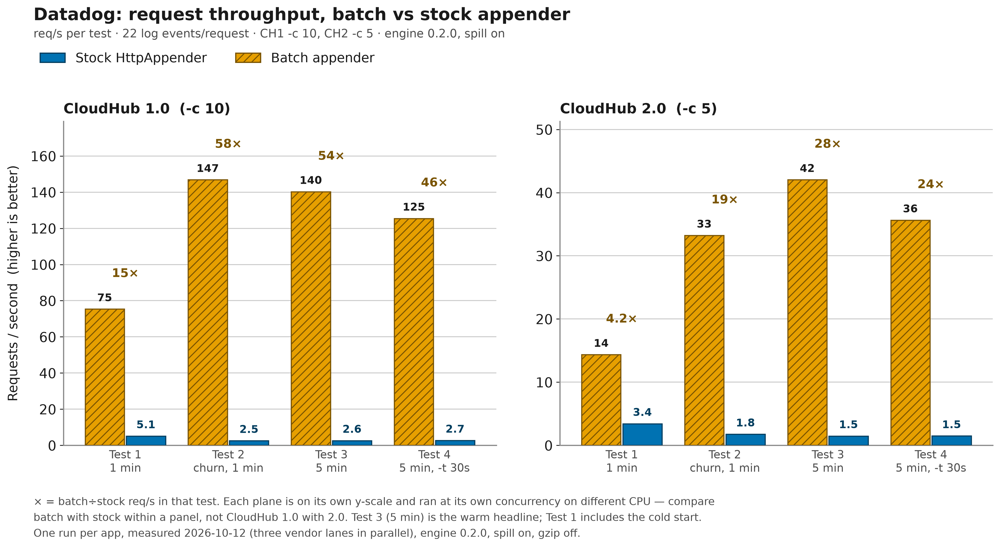
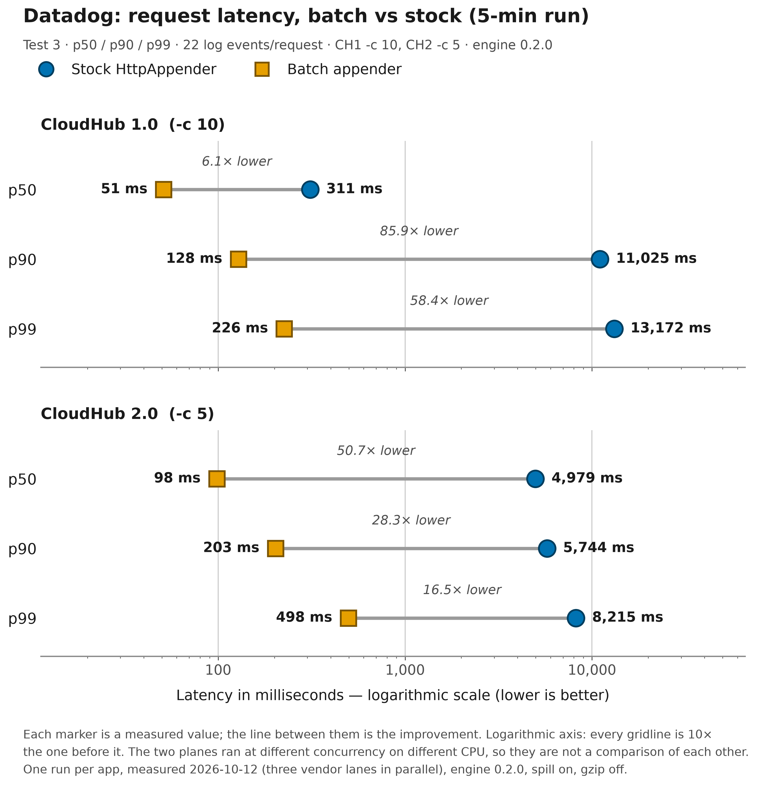
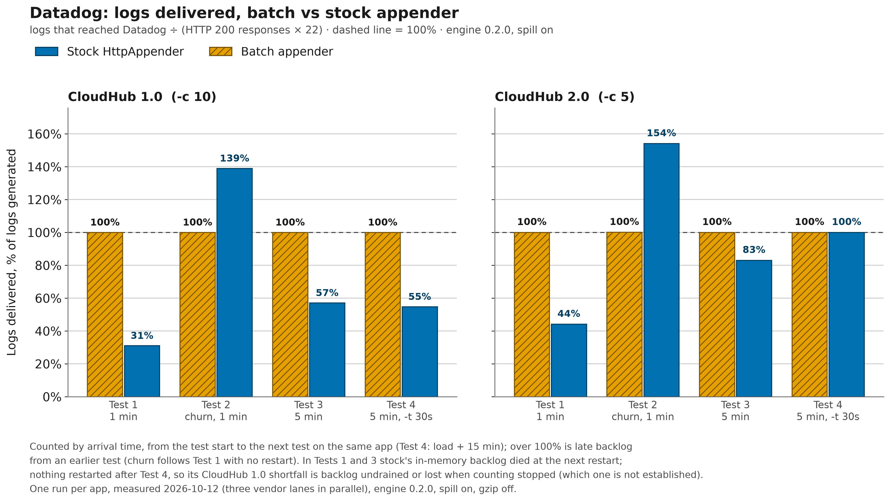

# Datadog

With `vendor="datadog"`, `<BatchHttp>` collects log events into batches and POSTs each batch as
one JSON array to the Datadog Logs intake (v2). Every record carries Datadog's reserved attributes
plus the logger, the thread and any MDC entries, so logs arrive already faceted in the Log
Explorer.

> [!TIP]
> **Sample Mule project:** [`demo/mule/datadog-batch-http`](../../demo/mule/datadog-batch-http/)
> is a Mule 4.9 app (Java 17) that ships its application logs to Datadog through `<BatchHttp>`.
> Its control sibling [`demo/mule/datadog-stock-http`](../../demo/mule/datadog-stock-http/) runs
> the same flow and workload through Log4j2's stock `<Http>` appender, one synchronous POST per
> event. The pair is an A/B test where only the appender changes: it shows the difference in
> request throughput, latency, logs delivered and ingest lag, on your machine or on CloudHub
> ([results below](#benchmark-on-cloudhub)).

| At a glance | Datadog |
|---|---|
| Endpoint | `https://<site>/api/v2/logs` |
| Authentication | Datadog API key in the `DD-API-KEY` header |
| Required options | [`apiKey`](../configuration.md#opt-apikey); set [`site`](../configuration.md#opt-site) unless your org is on the default site |
| Sample Mule project | [datadog-batch-http](../../demo/mule/datadog-batch-http/) / [datadog-stock-http](../../demo/mule/datadog-stock-http/) |
| Benchmarked on CloudHub | Yes, 2026-10-12 (engine 0.2.0) |

On this page:

- [Set up Datadog](#set-up-datadog)
- [Configuration](#configuration)
- [What gets sent](#what-gets-sent)
- [Verify delivery](#verify-delivery)
- [Benchmark on CloudHub](#benchmark-on-cloudhub)
- [Troubleshooting](#troubleshooting)

## Set up Datadog

1. Pick your site. A Datadog organization lives on exactly one site (US1, EU, AP2, and so on), and
   its API keys only work against that site. Look up the site's **log-intake host** in
   [Datadog's site documentation](https://docs.datadoghq.com/getting_started/site/) and set it as
   [`site`](../configuration.md#opt-site). The set of sites changes over time, so this repo does
   not restate it. If you leave `site` unset, the sink uses Datadog's default site host, which
   rejects keys from any other site.
2. Create an API key under *Organization Settings → API Keys*. It must be an **API key**, not an
   Application key. Log intake needs no extra scopes, and a trial account is enough.
3. No index or pipeline setup is required. Datadog parses a JSON-string `message`
   into top-level attributes on its own.
4. Keep Datadog's reserved names out of your JSON message, because they override the fields the
   appender sets: `status`, `host`, `service`, `message`, `ddsource`, `ddtags`, `date`, `source`,
   `trace_id`. The demo flow calls its order state `orderStatus` for this reason: a `status` key
   would put `SHIPPED` in the level column. Its messages do carry `"source": "mule"`, which is
   harmless only because it equals the appender's `source="mule"`.
5. Expect throttling under heavy load. Datadog rate-limits Logs intake per organization and key.
   An HTTP 429 in the appender's diagnostics means the appender is backing off as told (see
   [which responses retry](#which-responses-retry-or-drop)).

## Configuration

`log4j2.xml` is read by Log4j2, not by Mule's property resolver. Supply the API key only through
Log4j2 lookups such as `${env:DD_API_KEY}` or `${sys:datadog.apiKey}`; Mule `${...}` and
`secure::` placeholders do not resolve in this file. For the details, see
[Using it from a Mule app](../mule.md).

### Java application

A minimal configuration. `site` falls back to the default site host when `DD_SITE` is unset:

```xml
<Configuration status="WARN" packages="com.mulesoft.support.batchhttp.log4j2">
    <Appenders>
        <!-- site: the log-intake host of your Datadog site;
             the sink appends /api/v2/logs -->
        <BatchHttp name="datadog" vendor="datadog"
                   site="${env:DD_SITE:-http-intake.logs.datadoghq.com}"
                   apiKey="${env:DD_API_KEY}"
                   service="orders-api"
                   host="${env:HOSTNAME:-${hostName}}"
                   source="java">
            <PatternLayout pattern="%m"/>
        </BatchHttp>
    </Appenders>
    <Loggers>
        <Root level="INFO">
            <AppenderRef ref="datadog"/>
        </Root>
    </Loggers>
</Configuration>
```

[`log4j2-example.xml`](../../demo/java/benchmark/src/main/resources/log4j2-example.xml) has the
same Datadog block alongside the other vendors.

### Mule application

Simplified from the demo's
[`log4j2.xml`](../../demo/mule/datadog-batch-http/src/main/resources/log4j2.xml). The `packages`
attribute is required: without it, Log4j2 does not know `<BatchHttp>` inside the Mule app's
classloader.

```xml
<Configuration status="INFO" packages="com.mulesoft.support.batchhttp.log4j2">
    <Properties>
        <Property name="app.service">${sys:app.service:-datadog-batch-http}</Property>
        <Property name="app.platform">${sys:app.platform:-${env:APP_PLATFORM:-unspecified}}</Property>
        <Property name="dd.host">${sys:domain:-${env:HOSTNAME:-${hostName}}}</Property>
        <Property name="dd.site">${sys:dd.site:-${env:DD_SITE:-http-intake.logs.datadoghq.com}}</Property>
    </Properties>
    <Appenders>
        <!-- "FILE" is the CloudHub 1.0 RollingFile, defined in the full file -->
        <!-- full tuning: see the demo's log4j2.xml -->
        <BatchHttp name="datadog"
                   vendor="datadog"
                   site="${dd.site}"
                   apiKey="${sys:DD_API_KEY:-${sys:datadog.apiKey:-${env:DD_API_KEY:-MISSING_KEY}}}"
                   service="${app.service}"
                   host="${dd.host}"
                   source="mule"
                   gzip="false"
                   includeTimestamp="false"
                   spillEnabled="${sys:batch.spillEnabled:-true}">
            <!-- Adds the platform facet; collapses the JSON message to one line -->
            <PatternLayout pattern="{&quot;platform&quot;:&quot;${app.platform}&quot;,%replace{%m}{^\x7B\s*|[\r\n]+\s*}{}"/>
        </BatchHttp>
    </Appenders>
    <Loggers>
        <AsyncLogger name="com.mulesoft.support.batchhttp.muledemo"
                     level="INFO"
                     additivity="false">
            <AppenderRef ref="datadog"/>
            <AppenderRef ref="FILE"/>
        </AsyncLogger>
        <!-- Root: FILE only; framework lines are not shipped to Datadog -->
        <AsyncRoot level="INFO">
            <AppenderRef ref="FILE"/>
        </AsyncRoot>
    </Loggers>
</Configuration>
```

The full file also sets every spill and crash-resilience option explicitly and documents each one
inline, plus CloudHub's framework noise-reduction loggers. What the demo does, and why:

- **Key chain.** The key comes from `-DDD_API_KEY`, `-Ddatadog.apiKey` or the `DD_API_KEY`
  environment variable, ending in the visible sentinel `MISSING_KEY`: a missing key fails loudly
  with HTTP 403 instead of shipping the literal lookup text. On CloudHub 1.0, application
  properties surface as JVM system properties, so a `datadog.apiKey` property set in Runtime
  Manager resolves through `${sys:datadog.apiKey}`. On standalone Mule, only `-M-D...` wrapper
  arguments become JVM system properties; a bare `-D` is swallowed.
- **Facets.** `service` is the app's own name (override it with `-Dapp.service`); `host` is the
  CloudHub 1.0 domain, or else the container hostname. The layout adds a `platform` field
  (`-Dapp.platform` or `APP_PLATFORM`) that separates CloudHub 1.0 from 2.0. See
  [Splitting CloudHub 1.0 from CloudHub 2.0](../mule.md#splitting-cloudhub-10-from-cloudhub-20)
  for how the two facets are meant to be used.
- **Two divergences exist only for the A/B**; the other non-default values are sizing choices.
  [`gzip`](../configuration.md#opt-gzip) is off because the stock `<Http>` appender cannot
  compress, so leaving it on would vary two things at once.
  [`includeTimestamp`](../configuration.md#opt-includetimestamp) is off so that Datadog stamps
  arrival time, which makes ingest lag measurable (see [Timestamp](#timestamp)). Production should
  turn compression back on and usually wants its own event time.
- **Only application logs ship.** Root keeps framework lines in the local file (`FILE`). The
  vendor layout wraps the flow's JSON message, so a plain-text framework line would arrive as a
  mangled `message`.

<details>
<summary>The <code>FILE</code> appender (CloudHub 1.0 log file)</summary>

As the custom-log-appender documentation prescribes:

```xml
<RollingFile name="FILE"
             fileName="/opt/mule/mule-CURRENT/logs/mule-${sys:domain}.log"
             filePattern="/opt/mule/mule-CURRENT/logs/mule-${sys:domain}-%i.log">
    <PatternLayout pattern="[%d{MM-dd HH:mm:ss.SSS}] %-5p %c{1} [%t]: %m%n"/>
    <DefaultRolloverStrategy max="10"/>
    <Policies>
        <SizeBasedTriggeringPolicy size="10 MB"/>
    </Policies>
</RollingFile>
```

</details>

<details>
<summary>Build, run and deploy the demo</summary>

1. Build with `mvn install -DskipTests` at the repo root, then
   `cd demo/mule/datadog-batch-http && mvn clean package`. The HTTP listener is on port 8083.
2. Watch the spill buffer work (the *Watch it work* walkthrough in the module's
   [README](../../demo/mule/datadog-batch-http/README.md#watch-it-work)): point `dd.site` at an
   unreachable intake, watch `/tmp/batch-http-spill/Datadog/` fill, restart with the real site
   and watch it drain. A connection error is retryable, while a bad key's 403 is dropped and never
   spilled.
3. The stock sibling listens on port 8084. Its
   [README](../../demo/mule/datadog-stock-http/README.md) has the A/B measurement guide (local
   mock intake or real Datadog).
4. Deploy both to CloudHub 1.0 with `scripts/deploy-ch1.sh --datadog` (the default selection). It
   needs `DD_KEY` and passes only `datadog.apiKey`, so add `app.platform` (and `dd.site` if your
   org is not on the default site) in Runtime Manager *Properties* and restart.
5. CloudHub 2.0 deployment is manual; see [the benchmark runbook](../benchmark-runbook.md).

</details>

### Recommended production settings

The library defaults are a reasonable start. Each value below departs from a default for a
Datadog-specific reason. Use this `<BatchHttp>` in place of the one in the
[Java application](#java-application) sample:

```xml
<BatchHttp name="datadog" vendor="datadog"
           site="${env:DD_SITE:-http-intake.logs.datadoghq.com}"
           apiKey="${env:DD_API_KEY}"
           service="orders-api"
           host="${env:HOSTNAME:-${hostName}}"
           source="java"
           queueCapacity="25000"
           maxRetries="5"
           maxRetryBackoffMillis="30000"
           spillInstanceId="orders-api"
           maxTotalSpillBytes="268435456">
    <PatternLayout pattern="%m"/>
</BatchHttp>
```

- [`gzip`](../configuration.md#opt-gzip) and
  [`includeTimestamp`](../configuration.md#opt-includetimestamp) are **left out on purpose**.
  Compression stays on, which the Datadog intake accepts, and every record keeps its own event
  time in `date`.
- [`queueCapacity`](../configuration.md#opt-queuecapacity) `25000`: at roughly 2 KB retained per
  record, that is about 50 MB of heap. It gives a burst tens of seconds of headroom on a
  fractional-vCore worker, and the spill buffer takes anything beyond it.
- [`maxRetries`](../configuration.md#opt-maxretries) `5` and
  [`maxRetryBackoffMillis`](../configuration.md#opt-maxretrybackoffmillis) `30000`: Datadog
  answers throttling with 429 and a `Retry-After` header. The appender honours `Retry-After` but
  caps it at `maxRetryBackoffMillis`, so a higher cap lets it wait as long as Datadog asked
  instead of retrying early. A batch that still fails goes to disk, not to the floor.
- [`spillInstanceId`](../configuration.md#opt-spillinstanceid): it defaults to the appender name.
  Name it after the app, so that two apps on one host that both call their appender `datadog`
  keep separate spill files and locks.
- [`maxTotalSpillBytes`](../configuration.md#opt-maxtotalspillbytes) `268435456` (256 MiB):
  Datadog discards logs older than its maximum accepted age. Past that window a larger backlog
  only costs disk, so size the buffer to the outage you expect to ride out, not to "everything".
  On hosts that may come back with an old spill directory, consider
  [`spillRecoveryMode`](../configuration.md#opt-spillrecoverymode) `DELETE` or `IGNORE` (see
  [Resilience](../resilience.md)).
- Heartbeat: with `status="WARN"` as shown you see failures only. For a once-a-minute heartbeat,
  so "is it still shipping?" is answered by a log line, opt in with
  [`diagnosticsLevel`](../configuration.md#opt-diagnosticslevel) `INFO` and
  [`statsIntervalMillis`](../configuration.md#opt-statsintervalmillis) `60000`, and also set
  `<Configuration status="INFO">`. The heartbeat prints only when both allow INFO.

### Options with a Datadog-specific meaning

| Option | Meaning for Datadog |
|---|---|
| [`vendor`](../configuration.md#opt-vendor) | `datadog` selects this sink (case-insensitive). |
| [`site`](../configuration.md#opt-site) | Log-intake **host** of your Datadog site: host only, no scheme or path (note 1). |
| [`apiKey`](../configuration.md#opt-apikey) | **Required.** Sent as the `DD-API-KEY` header (note 2). |
| [`service`](../configuration.md#opt-service) | Reserved `service` attribute, a top-level field on every record (note 3). |
| [`host`](../configuration.md#opt-host) | Reserved `host` attribute; when unset or blank it is omitted and Datadog infers the host. |
| [`source`](../configuration.md#opt-source) | Sent as `ddsource`, the source facet. `java` when unset; the Mule demo sets `mule`. |
| [`includeTimestamp`](../configuration.md#opt-includetimestamp) | Controls the reserved `date` attribute (see [Timestamp](#timestamp)). |
| [`includeStackTrace`](../configuration.md#opt-includestacktrace) | Puts the event's `Throwable` in `error.stack`. |
| [`maxBatchRecords`](../configuration.md#opt-maxbatchrecords), [`maxBatchBytes`](../configuration.md#opt-maxbatchbytes) | Also capped by the sink's [per-request limits](#per-request-limits-and-gzip). |
| [`maxMessageBytes`](../configuration.md#opt-maxmessagebytes) | Truncates long messages. Datadog also caps the size of a single log. |
| [`Layout`](../configuration.md#opt-layout) | Renders `message`. Its charset has no effect (note 4). |
| [`url`](../configuration.md#opt-url), [`hostname`](../configuration.md#opt-hostname), [`token`](../configuration.md#opt-token), [`index`](../configuration.md#opt-index), [`sourcetype`](../configuration.md#opt-sourcetype) | Ignored for Datadog. Use `site`, not `url`. |

1. The endpoint is always `https://<site>/api/v2/logs`. Unset uses Datadog's default site host.
2. Marked sensitive, so Log4j2 masks it in status and debug output.
3. Omitted when unset. An empty string is still sent as `""`.
4. Bodies are always UTF-8 JSON.

Every other option (batching, queue, retries, spill, TLS, diagnostics) applies unchanged; see the
[configuration reference](../configuration.md).

`ddtags` cannot be set from `log4j2.xml`; there is no such attribute. To tag logs, put the values
in the message, the MDC, or `service`/`source`.

## What gets sent

Each request is a UTF-8 JSON array of records, `[{...},{...}]`, with
`Content-Type: application/json`, plus `Content-Encoding: gzip` when compression is on. Each
record holds:

- Datadog's reserved attributes: `message` (the rendered layout), `status` (the level),
  `ddsource`, and optionally `service`, `host` and `date`;
- `logger.name` and `logger.thread_name`;
- `error.stack` when a `Throwable` is logged with `includeStackTrace` on;
- every MDC entry as a top-level attribute.

<details>
<summary>Full field mapping</summary>

| From | Datadog field |
|---|---|
| Rendered layout output (or the formatted message when there is no layout) | `message` (reserved; note 1) |
| Event level (`INFO`, `WARN`, `ERROR`, and so on) | `status` (reserved log level) |
| `source` attribute | `ddsource` |
| `service` attribute, if set | `service` (reserved) |
| `host` attribute, if not blank | `host` (reserved) |
| Logger name (`""` if none) | `logger.name` |
| Thread name (`""` if none) | `logger.thread_name` |
| Event time, when `includeTimestamp` is on | `date` (reserved event time) |
| The event's `Throwable`, when `includeStackTrace` is on and the event has one | `error.stack` |
| Each MDC / ThreadContext entry with a non-null value | Top-level attribute, same key, after the fixed fields |

1. Datadog parses a JSON-string message into top-level attributes, and the Mule demo relies on
   that.

</details>

MDC keys are not de-duplicated. An MDC key named `service`, `host`, `status`, `message` or `date`
produces a duplicate JSON key, so keep Datadog's reserved names out of the MDC. The Mule demo's
`correlationId` and `processorPath` arrive through this path.

### Timestamp

With [`includeTimestamp`](../configuration.md#opt-includetimestamp) on, each record carries
`date`: the Log4j event time as an ISO-8601 UTC instant, such as `2023-11-14T22:13:20.123Z`.
Datadog stores it as the log's official time. This is what a production app usually wants, but
it makes shipping delay invisible by construction.

With it off, `date` is omitted and Datadog stamps the **arrival** time. The Mule demos do this on
purpose, so that arrival minus `generatedAt` (a field the flow writes into its own JSON message)
is the ingest lag. The stock sibling's layout has no `date` key either, so both halves of the A/B
are measured the same way.

> [!WARNING]
> Datadog rejects logs older than its
> [published maximum age](https://docs.datadoghq.com/logs/log_collection/). A stale spill backlog
> replayed after a long outage is accepted at the HTTP level, then discarded on Datadog's side,
> and still counted in `sentRecords`. See [Resilience](../resilience.md).

### Stack traces

When [`includeStackTrace`](../configuration.md#opt-includestacktrace) is on and the event carries
a `Throwable`, the full `printStackTrace` text goes into `error.stack`. Mule's `<logger>` never
attaches a `Throwable`; it logs a string. So the demo's `/boom` endpoint exercises ERROR-level
routing and the flow's own `errorType`/`reason` fields, not `error.stack`.

### Per-request limits and gzip

The Datadog sink caps each request at **1000 records and 5 MiB of uncompressed body**, which stays
just under Datadog's documented ceilings. Datadog's
[API reference](https://docs.datadoghq.com/api/latest/logs/#send-logs) is authoritative for the
current values.

The engine flushes at whichever of
[`maxBatchRecords`](../configuration.md#opt-maxbatchrecords)/[`maxBatchBytes`](../configuration.md#opt-maxbatchbytes)
and the sink cap is lower, so raising either option above the sink cap has no effect. Size is
estimated in UTF-8 bytes.

With [`gzip`](../configuration.md#opt-gzip) on, each batch is compressed once and the compressed
body is reused across retries. Datadog measures its per-request ceilings uncompressed, so
compression changes the bytes on the wire, not how many records fit in a batch.

### Which responses retry or drop

| Response | Outcome |
|---|---|
| Any 2xx (Datadog answers `202 Accepted`) | Success. The body is not inspected. |
| 408, 429, any 5xx, a network error or a timeout | Retried, then spilled (note 1). |
| Any other status (note 2) | Fatal: never retried and never spilled; the records count as `dropped` (note 3). |

1. Retried up to [`maxRetries`](../configuration.md#opt-maxretries) times with exponential backoff
   from [`initialRetryBackoffMillis`](../configuration.md#opt-initialretrybackoffmillis), capped
   at [`maxRetryBackoffMillis`](../configuration.md#opt-maxretrybackoffmillis). A `Retry-After`
   header takes precedence, and the same cap applies to it. When the retries run out, the batch
   goes to the spill buffer. With spill off it is dropped, with:

   ```text
   batch-http[Datadog] dropped N record(s) — send failed after <maxRetries> retries (HTTP xxx) and spill is disabled
   ```

2. 400 malformed, 401/403 bad or wrong-site key, 413 too large, and 1xx/3xx (redirects are not
   followed).
3. The appender logs the line below. If this happens during spill replay, the segment is deleted
   and its records count as dropped.

   ```text
   batch-http[Datadog] dropped N record(s) — endpoint rejected the batch (HTTP 403); check credentials/endpoint, retrying will not help
   ```

## Verify delivery

### In Datadog

Open *Logs → Search* (Log Explorer) and query by service:

```text
service:orders-api
service:(datadog-batch-http OR datadog-stock-http)
@platform:cloudhub-2.0 @logger.name:com.mulesoft.support.batchhttp.muledemo
```

The first line is the Java sample. The second is the demo pair; group it by `service` in a count
or timeseries view to compare volumes. The third splits a plane and narrows to the demo's
application logs.

Attribute search takes the `@` prefix, and `source:mule` or `source:java` matches `ddsource`.

Each event should show `status`, `service`, `host`, `ddsource`, `logger.name`,
`logger.thread_name`, any MDC keys (such as `correlationId`), and `error.stack` when a `Throwable`
was logged. Events from the demo also show `platform` and `generatedAt`. To see ingest lag, open
an event and compare `generatedAt` with the Datadog timestamp (with `includeTimestamp` off).

### From the app

Set [`statsIntervalMillis`](../configuration.md#opt-statsintervalmillis) with
[`diagnosticsLevel`](../configuration.md#opt-diagnosticslevel) `INFO` (and
`<Configuration status="INFO">`), then watch `sentRecords` climb in the heartbeat lines prefixed
`batch-http[Datadog]`. Under load, an empty `${java.io.tmpdir}/batch-http-spill/Datadog/` is the
healthy state.

### With the demo

```bash
# 52 events: a batch.start, 50 order.processed and a batch.completed WARN
curl "http://localhost:8083/log?count=50"
# one ERROR event
curl "http://localhost:8083/boom"
```

## Benchmark on CloudHub

Run on 2026-10-12 with engine 0.2.0 and the batch app's disk spill on, on 0.1 vCore workers in
Sydney (`ap-southeast-2`), next to Datadog's AP2 site. The test protocol, the delivery counting
and the cross-vendor tables are in [benchmark-results.md](../benchmark-results.md).

**In Test 3 (5 minutes), batch served 53.5× the stock request rate on CloudHub 1.0 (140.24
against 2.62 req/s) and 28.5× on CloudHub 2.0 (42.03 against 1.48), delivering 100% of its logs
on both planes against 57.1% and 83.0% for stock.** On CloudHub 1.0, batch p90 latency was
0.128 s against 11.02 s for stock.

<details>
<summary>Test setup</summary>

- The Datadog lane ran in parallel with the New Relic and Elasticsearch lanes, one app per vendor
  at a time.
- Load was `/log?count=20`, which is 22 log events per request.
- CloudHub 1.0 ran at `oha -c 10` over http, CloudHub 2.0 at `-c 5` over https.
- Every test except the churn test starts on a freshly restarted app.

</details>

> [!NOTE]
> Compare batch with stock **within a plane** only. The two planes ran at different concurrency
> on different hardware.

### CloudHub 1.0 (0.1 vCore, `-c 10`)

| Test | Req/s (batch / stock) | Batch÷stock | p90 s (batch / stock) | Delivered (batch / stock) |
|---|---|---|---|---|
| 1 (1 min) | 75.35 / 5.13 | 14.7× | 0.211 / 7.09 | 100.0% / 31.0% |
| 2 (churn) | 146.85 / 2.54 | 57.9× | 0.124 / 10.94 | 100.0% / 139.0% |
| 3 (5 min) | 140.24 / 2.62 | 53.5× | 0.128 / 11.02 | 100.0% / 57.1% |
| 4 (5 min, `-t 30s`) | 125.47 / 2.70 | 46.5× | 0.137 / 10.70 | 100.0% / 54.7% |

### CloudHub 2.0 (0.1 vCore, `-c 5`)

| Test | Req/s (batch / stock) | Batch÷stock | p90 s (batch / stock) | Delivered (batch / stock) |
|---|---|---|---|---|
| 1 (1 min) | 14.35 / 3.42 | 4.2× | 0.587 / 5.37 | 100.0% / 44.1% |
| 2 (churn) | 33.21 / 1.75 | 18.9× | 0.251 / 5.79 | 100.1% / 154.1% |
| 3 (5 min) | 42.03 / 1.48 | 28.5× | 0.203 / 5.74 | 100.0% / 83.0% |
| 4 (5 min, `-t 30s`) | 35.63 / 1.48 | 24.1× | 0.247 / 5.68 | 100.0% / 100.0% |

### Charts

Throughput per test: the batch bars dwarf stock on both planes, with the ratio printed above each
pair.



Test 3 latency on a log scale: the gap between each batch and stock marker (p50, p90, p99) is the
improvement; stock p90 is 11 s against 0.128 s for batch on CloudHub 1.0.



Logs delivered as a share of logs generated: batch holds at 100% in every test, stock does not.



### What the Datadog numbers show

- **Batch delivered 100% in every test on both planes.** In Tests 1 and 3, stock delivered 31–57%
  on CloudHub 1.0 and 44–83% on CloudHub 2.0: whatever stock still holds in memory when the next
  restart comes dies with the app. Test 4 was the last round and nothing restarted after it, so
  CloudHub 1.0 stock's 54.7% there is a backlog still undrained, or lost, when counting stopped;
  which of the two is not established.
- Delivery is counted by arrival time. The demos omit `date`, so Datadog stamps arrival. Each
  test's window runs from its start to the next test on the same app; for Test 4 it is the load
  plus 15 minutes. Readings over 100% (stock churn: 139% and 154%) are Test 1's late backlog
  landing in the churn window, which follows Test 1 with no restart.
- Test 1 under-reports warm batch throughput, because the batch JVM is still warming up when the
  1-minute window opens. On CloudHub 2.0, batch rose from 14.4 to 33.2 to 42.0 req/s across
  Test 1, churn and Test 3, and the CloudHub 1.0 batch app's slowest request fell from 4.8 s in
  Test 1 to 0.64 s in churn. Read Test 3 as the headline.
- Batch req/s is about the same at every vendor. On CloudHub 1.0, Test 3 batch was 140 for
  Datadog against 134–136 for New Relic and Elasticsearch, so the worker bounds batch throughput,
  not the intake.
- Gzip was off on both sides for the A/B (see [Mule application](#mule-application)). A
  production configuration that leaves compression on sends fewer bytes per batch.

> [!IMPORTANT]
> **Correction to the 2026-08-04 run.** In that run, the CloudHub 2.0 Datadog stock app carried a
> leftover `AsyncLoggerConfig.RingBufferSize=20000` and `log4j2.debug=true` that no other app
> had. It measured 5.75 req/s with them against 1.46 without, so the 7.6× published then is not
> comparable. A re-test without them gave about 31×. The app in this run has neither property.

### Ingest lag: generation to arrival

Under load, the clearest real-world symptom of per-event shipping is **ingest lag**: the gap
between when the app generated an event and when Datadog received it. In an earlier session,
batch events arrived at the same instant they were generated, while stock events trailed by about
3 minutes.

<details>
<summary>Screenshots: ingest lag and log volume, batch vs stock (earlier session)</summary>

Each demo event carries `generatedAt`, written by the flow itself, and Datadog stamps the arrival
time. The screenshots below come from the CloudHub 2.0 pair in an **earlier session** than the
tables above. The times displayed are the deployment's local time, UTC+10.

Batch, negligible lag: an event with `generatedAt` `…T23:27:09.999Z` arrives at `09:27:09.999`
local time (`23:27:09.999Z`), the same instant.


Stock, minutes behind: an event with `generatedAt` `…T23:26:11.753Z` is not received until
`09:29:14.813` local time (`23:29:14.813Z`). The synchronous sends queue up behind each other, a
backlog of about 3 minutes.


The backlog is also a volume gap. Over one Datadog query window covering both apps, the batch app
delivered **84.7K** events and the stock app **5.66K**. That window is wider than any measured run
and comes from the same earlier session. It spans warmups, the measured minutes and the backlog
draining afterwards, so neither total reconciles with the tables above.


</details>

## Troubleshooting

For general diagnostics (the stats heartbeat, the spill directory, startup messages), see
[troubleshooting.md](../troubleshooting.md).

| Symptom | Likely cause | Fix |
|---|---|---|
| Startup: `DatadogSink requires an apiKey` (note 1) | `apiKey` is missing or blank. | Set it with `${env:DD_API_KEY}` or `${sys:datadog.apiKey}`. |
| `dropped N record(s) — endpoint rejected the batch (HTTP 403)` | A literal `${env:DD_API_KEY}` (or `MISSING_KEY`) was sent (note 2). | Provide the variable or property; end the chain in a visible sentinel, as the demo does. |
| HTTP 403 with a valid-looking key | The key belongs to a different site than `site`; the default site host rejects other sites' keys. | Set `site` to your org's host from [Datadog's site list](https://docs.datadoghq.com/getting_started/site/). |
| Appender disabled at startup: `Illegal character in authority` | `site="${env:DD_SITE}"` with `DD_SITE` unset leaves the literal lookup in the URI. | Add a fallback (`${env:DD_SITE:-http-intake.logs.datadoghq.com}`) or leave `site` out. |
| HTTP 429 in the diagnostics, `spilledRecords` rising | Datadog throttles Logs intake per org and key. | Nothing is lost while spill is on (note 3). |
| Nothing ships from a Mule app and the key looks right | Mule `${...}`/`secure::` placeholders don't resolve in `log4j2.xml`, or a bare `-D` never reached the Mule JVM. | Use `${sys:...}` or `${env:...}` (note 4). |
| `BatchHttp` is unknown and nothing ships | `packages="com.mulesoft.support.batchhttp.log4j2"` is missing on `<Configuration>`. | Add it. Every Mule app needs it. |
| Level column shows a business value (`SHIPPED`), or `service`/`host` is wrong | A Datadog reserved key in the JSON message or the MDC overrides the appender's field (note 5). | Rename the key in the payload, for example `orderStatus`. |
| The `SERVICE` column is empty (demo) | A present-but-empty `-Dapp.service=` beats the `${sys:app.service:-default}` default. | Delete the override; don't clear it. Same for `app.platform` and `APP_PLATFORM`. |
| `platform` reads `unspecified` on CloudHub 1.0 (demo) | `scripts/deploy-ch1.sh` only passes `datadog.apiKey`. | Add `app.platform` in Runtime Manager *Properties* on both apps of the pair, then restart. |
| A local http mock receives nothing | The sink always calls `https://<site>/api/v2/logs` and ignores `url`, so it tries TLS against the mock. | Use `vendor="generic"` with `url="http://localhost:9098/api/v2/logs"` (note 6). |
| Logs accepted (2xx) after a long outage but not searchable | Replayed spill records older than Datadog's maximum accepted age are discarded on Datadog's side (note 7). | Consider [`spillRecoveryMode`](../configuration.md#opt-spillrecoverymode) `DELETE` or `IGNORE`. |
| A backlog disappears after a CloudHub restart | A restart onto a new worker (1.0) or pod (2.0) loses `/tmp`, where spill lives (note 8). | Expected on CloudHub. Elsewhere, point [`spillDirectory`](../configuration.md#opt-spilldirectory) at a durable volume. |

1. The full startup message, which prints only when `<Configuration status>` is not `OFF`:

   ```text
   BatchHttp appender 'datadog' could not build its 'datadog' sink: DatadogSink requires an apiKey. Required log4j2.xml attributes for vendor 'datadog': apiKey. This appender is disabled and will ship no logs.
   ```

2. Log4j2 leaves an unresolved lookup in place rather than emptying it. A visible sentinel makes
   the cause obvious.
3. The appender honours `Retry-After` up to
   [`maxRetryBackoffMillis`](../configuration.md#opt-maxretrybackoffmillis) and then spills.
   Raise that cap if the waits are being cut short.
4. On CloudHub 1.0, set `datadog.apiKey` as an application property. On standalone Mule, pass
   `-M-Ddatadog.apiKey=...`. See [mule.md](../mule.md).
5. The reserved keys: `status`, `service`, `host`, `message`, `date`, `ddsource`, `ddtags`.
6. For mock runs only; see the
   [stock sibling's README](../../demo/mule/datadog-stock-http/README.md).
7. Those records are still counted in `sentRecords`. Use `DELETE` or `IGNORE` on hosts that may
   present old spill directories.
8. The spill directory is `${java.io.tmpdir}/batch-http-spill/Datadog/`; the demo's segments are
   `spill-datadog-batch-http-<seq>.log`. Use a durable volume on hosts with persistent storage.

---

[Docs index](../README.md) · [Configuration reference](../configuration.md) · Other vendors:
[New Relic](newrelic.md) · [Elasticsearch](elasticsearch.md) · [Dynatrace](dynatrace.md) ·
[Splunk](splunk.md) · [Generic HTTP](generic.md)
