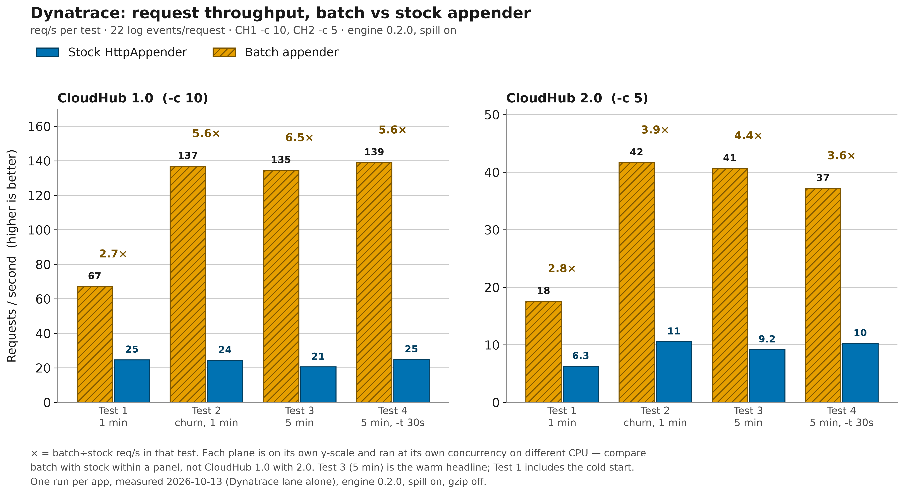
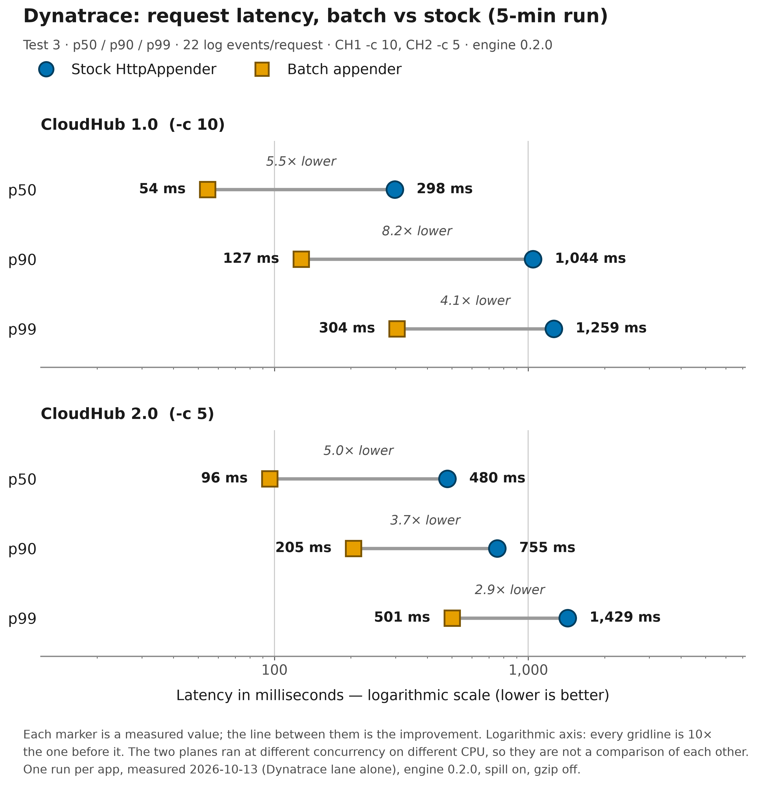
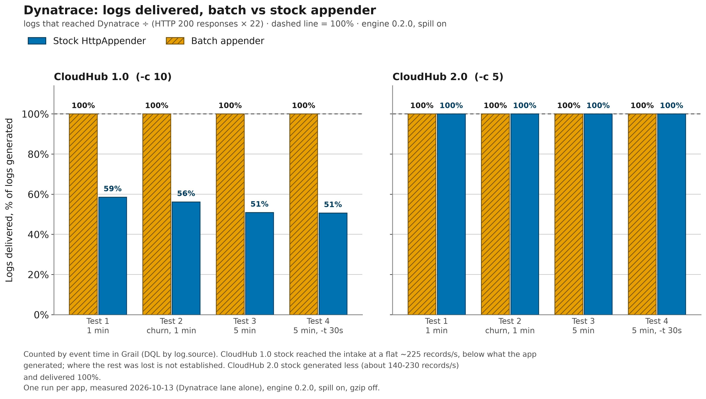

# Dynatrace

With `vendor="dynatrace"`, the `<BatchHttp>` appender batches log events and POSTs each batch as
one JSON array to the Dynatrace **Log Monitoring API v2**. Each event becomes one Dynatrace log
record. It works with Dynatrace SaaS and with an ActiveGate.

> [!TIP]
> **Sample Mule project:** [`demo/mule/dynatrace-batch-http`](../../demo/mule/dynatrace-batch-http/)
> is a Mule 4.9 (Java 17) app that ships its logs to Dynatrace through this appender. Its control,
> [`demo/mule/dynatrace-stock-http`](../../demo/mule/dynatrace-stock-http/), runs the same flows
> and record shape through Log4j2's built-in `<Http>` appender, one synchronous POST per event.
> The pair isolates the effect of batching: both store byte-identical `content`, and their records
> differ only in `log.source`. Both apps are configured through `log4j2.xml` alone, and the
> [benchmark below](#benchmark-on-cloudhub) was measured with them.

| At a glance | Dynatrace |
| --- | --- |
| Endpoint | `{url}/api/v2/logs/ingest`, where `url` is the environment URL (SaaS or ActiveGate) |
| Authentication | `Authorization: Api-Token <token>`; an access token with only the `logs.ingest` scope |
| Required options | [`url`](../configuration.md#opt-url), [`token`](../configuration.md#opt-token) (or [`apiKey`](../configuration.md#opt-apikey)) |
| Sample Mule project | [dynatrace-batch-http](../../demo/mule/dynatrace-batch-http/) / [dynatrace-stock-http](../../demo/mule/dynatrace-stock-http/) |
| Benchmarked on CloudHub | Yes, 2026-10-13 (engine 0.2.0) |

On this page:

- [Set up Dynatrace](#set-up-dynatrace)
- [Configuration](#configuration)
- [What gets sent](#what-gets-sent)
- [Verify delivery](#verify-delivery)
- [Benchmark on CloudHub](#benchmark-on-cloudhub)
- [Troubleshooting](#troubleshooting)

## Set up Dynatrace

1. **Find the environment URL.** Use the API address of the environment, not the address of the
   platform UI.
   - SaaS: if the Logs app opens at `https://<environment-id>.apps.dynatrace.com/…`, ingest lives
     at `https://<environment-id>.live.dynatrace.com`.
   - ActiveGate: `https://<activegate>:9999/e/<environment-id>`.
   - A URL that already ends in `/api/v2/logs/ingest` is accepted too. The sink adds the path only
     when it is missing.
2. **Create an access token.** In Dynatrace, open **Access Tokens** and generate a token with only
   the `logs.ingest` scope (*Ingest logs*). It starts with `dt0c01.` and is shown only once. A
   token with this scope can write log records and do nothing else.
3. **Optional: create a platform token for counting.** To read records back over the API (for
   example, to count what arrived after a load test), you need a separate *platform* token
   (`dt0s16.…`) with `storage:logs:read` and `storage:buckets:read`. The appender never uses it,
   so keep it out of the app's configuration.

You don't have to create anything else first, because records land in the default logs bucket.
To get the JSON fields inside `content` as attributes, you can add an OpenPipeline processing rule
(see [Parse `content` into attributes](#optional-parse-content-into-attributes)).

## Configuration

Dynatrace needs [`vendor`](../configuration.md#opt-vendor)`="dynatrace"`,
[`url`](../configuration.md#opt-url) (the environment URL) and
[`token`](../configuration.md#opt-token). [`apiKey`](../configuration.md#opt-apikey) is accepted
as an alias for `token`. Like every Log4j2 appender, it also needs a
[`name`](../configuration.md#opt-name). Supply the token only through a `${env:...}` or
`${sys:...}` lookup.

### Java application

Put `com.mulesoft.support.batchhttp:batch-http-log4j2` on the classpath (see
[Building](../building.md)), then add:

```xml
<?xml version="1.0" encoding="UTF-8"?>
<!-- Minimal log4j2.xml for a plain Java app shipping to Dynatrace.
     Set DT_ENVIRONMENT_URL (the environment URL; the sink appends /api/v2/logs/ingest)
     and DT_API_TOKEN (an access token with only the logs.ingest scope) in the environment. -->
<Configuration status="WARN" packages="com.mulesoft.support.batchhttp.log4j2">
    <Appenders>
        <BatchHttp name="dynatrace"
                   vendor="dynatrace"
                   url="${env:DT_ENVIRONMENT_URL}"
                   token="${env:DT_API_TOKEN}"
                   source="orders-api">
            <PatternLayout pattern="%m"/>
        </BatchHttp>
        <Console name="console" target="SYSTEM_OUT">
            <PatternLayout pattern="%d{HH:mm:ss.SSS} [%t] %-5level %logger{36} - %msg%n"/>
        </Console>
    </Appenders>
    <Loggers>
        <Root level="INFO">
            <AppenderRef ref="dynatrace"/>
            <AppenderRef ref="console"/>
        </Root>
    </Loggers>
</Configuration>
```

Keep `status` at `WARN` or `INFO`. With `status="OFF"`, the appender's own diagnostics (startup
errors, drops) are suppressed. The repo's Java example config,
[`log4j2-example.xml`](../../demo/java/benchmark/src/main/resources/log4j2-example.xml), also
defines a Dynatrace appender next to the other vendors.

### Mule application

> [!IMPORTANT]
> Log4j2 parses `log4j2.xml`, not Mule, so Mule `${...}` placeholders and `config.properties`
> values do **not** resolve in it. Pass the URL and token as system properties or environment
> variables and read them with `${sys:...}` / `${env:...}` lookups.

| Where the app runs | URL | Token |
| --- | --- | --- |
| CloudHub | Application property `dynatrace.url` | **Secure** application property `dynatrace.token` |
| Mule standalone wrapper (local) | `-M-Ddynatrace.url=...` | `-M-Ddynatrace.token=...` |
| Any (environment variables) | `DT_ENVIRONMENT_URL` | `DT_API_TOKEN` |

CloudHub application properties arrive as system properties. Under the standalone wrapper, a bare
`-D` doesn't reach the Mule JVM. [Using it from a Mule app](../mule.md) covers packaging and secret
injection in general.

An excerpt of the sample app's
[`log4j2.xml`](../../demo/mule/dynatrace-batch-http/src/main/resources/log4j2.xml). The `packages`
attribute is required: without it, Log4j2 does not know `<BatchHttp>` inside the Mule app's
classloader. The loggers also reference `FILE`, the CloudHub 1.0 custom log appender file shown in
the collapsed block below.

```xml
<!-- Excerpt of demo/mule/dynatrace-batch-http/src/main/resources/log4j2.xml.
     On CloudHub set dynatrace.url as an application property
     and dynatrace.token as a SECURE one. -->
<Configuration status="INFO" packages="com.mulesoft.support.batchhttp.log4j2">
    <Properties>
        <Property name="dt.source">${sys:domain:-dynatrace-batch-http}</Property>
        <Property name="app.platform">${sys:app.platform:-${env:APP_PLATFORM:-unspecified}}</Property>
        <Property name="dt.url">${sys:DT_ENVIRONMENT_URL:-${sys:dynatrace.url:-${env:DT_ENVIRONMENT_URL:-https://set-dynatrace-url.invalid}}}</Property>
    </Properties>
    <Appenders>
        <!-- RollingFile "FILE" (the CloudHub 1.0 log file) is shown below -->
        <BatchHttp name="dynatrace" vendor="dynatrace" url="${dt.url}"
                   token="${sys:DT_API_TOKEN:-${sys:dynatrace.token:-${env:DT_API_TOKEN:-MISSING_TOKEN}}}"
                   source="${dt.source}" includeStackTrace="true" gzip="false"
                   maxBatchRecords="200" maxBatchBytes="900000" lingerMillis="2000"
                   queueCapacity="25000" overflowPolicy="DROP_NEWEST" flusherThreads="1"
                   maxRetries="3" requestTimeoutMillis="10000" shutdownDrainTimeoutMillis="5000"
                   diagnosticsLevel="INFO" statsIntervalMillis="60000"
                   spillEnabled="${sys:batch.spillEnabled:-true}" spillInstanceId="dynatrace-batch-http"
                   spillReplayIntervalMillis="10000" spillReplayThreads="2" spillReplayMaxBytesPerSec="0"
                   maxSpillFileBytes="16777216" maxTotalSpillBytes="536870912" minFreeDiskBytes="268435456"
                   spillOnOverflow="true" spillFormat="BINARY" spillRecoveryMode="ADOPT"
                   spillStartupReconcile="true" spillBacklogOrder="DUAL_STREAM">
            <!-- content = the flow's pretty JSON collapsed to one line,
                 with the platform facet prepended. -->
            <PatternLayout pattern="{&quot;platform&quot;:&quot;${app.platform}&quot;,%replace{%m}{^\x7B\s*|[\r\n]+\s*}{}"/>
        </BatchHttp>
    </Appenders>
    <Loggers>
        <!-- Application logs ship to Dynatrace and the local file. -->
        <AsyncLogger name="com.mulesoft.support.batchhttp.muledemo" level="INFO" additivity="false">
            <AppenderRef ref="dynatrace"/>
            <AppenderRef ref="FILE"/>
        </AsyncLogger>
        <AsyncLogger name="org.mule" level="INFO"/>
        <AsyncLogger name="com.mulesoft" level="INFO"/>
        <!-- Root carries the FILE appender only: framework lines are not shipped. -->
        <AsyncRoot level="INFO">
            <AppenderRef ref="FILE"/>
        </AsyncRoot>
    </Loggers>
</Configuration>
```

<details>
<summary>The demo's <code>FILE</code> appender (CloudHub 1.0 custom log file)</summary>

```xml
<!-- CloudHub 1.0 custom log appender file, as documented by MuleSoft. -->
<RollingFile name="FILE"
             fileName="/opt/mule/mule-CURRENT/logs/mule-${sys:domain}.log"
             filePattern="/opt/mule/mule-CURRENT/logs/mule-${sys:domain}-%i.log">
    <PatternLayout pattern="[%d{MM-dd HH:mm:ss.SSS}] %-5p %c{1} [%t]: %m%n"/>
    <DefaultRolloverStrategy max="10"/>
    <Policies>
        <SizeBasedTriggeringPolicy size="10 MB"/>
    </Policies>
</RollingFile>
```

</details>

What is Dynatrace-specific in this demo:

- **`log.source` is the identity.** The Dynatrace sink sends no service or host field. The demo
  sets `source` to `${sys:domain}`, the CloudHub application name, so that one attribute tells the
  batch app, the stock app, and their CloudHub 1.0 and 2.0 deployments apart.
  - CloudHub 1.0 sets `domain` automatically.
  - CloudHub 2.0 doesn't: add an application property `domain=<app-name>`.
  - Locally, the value falls back to `dynatrace-batch-http`.
- **The platform facet travels inside `content`.** The layout prepends `"platform":"…"` to the
  flow's JSON; `app.platform` is not a separate attribute.
- **The URL fallback fails loudly.** With no URL supplied, the reserved `.invalid` host fails DNS.
- **`gzip="false"` is for the A/B comparison only.** The stock `<Http>` appender can't compress,
  so the demo turns compression off to vary only batching. A real deployment should omit the
  attribute and keep compression on.
- **`includeTimestamp` is not set, and would have no effect.** The Datadog and New Relic batch
  demos set `includeTimestamp="false"` so the vendor stamps arrival time. The Dynatrace sink
  always sends the event time (see [Timestamp](#timestamp)).
- **Ports and endpoints.** The batch app listens on port 8087 and the stock app on 8088.
  `GET /log?count=N` emits N+2 events (`batch.start`, N `order.processed`, `batch.completed`), and
  `GET /boom` logs one ERROR event.

<details>
<summary>Build, run and deploy the demo pair</summary>

#### Build and run locally

1. Install the appender: run `mvn install -DskipTests` at the repo root (the demos are not modules
   of the root build).
2. Package each module:

   ```bash
   cd demo/mule/dynatrace-batch-http && mvn clean package
   cd ../dynatrace-stock-http && mvn clean package
   ```

3. Run the jar in Anypoint Code Builder, or deploy it to a standalone Mule runtime with the URL and
   token passed as `-M-D` arguments.
4. Exercise it:

   ```bash
   curl "http://localhost:8087/log?count=50&level=info"
   curl "http://localhost:8087/boom"
   ```

The batch module's [README](../../demo/mule/dynatrace-batch-http/README.md) covers the Dynatrace
setup, the DQL counting and the record shape. The stock module's
[README](../../demo/mule/dynatrace-stock-http/README.md) has the A/B comparison guide.

#### Deploy to CloudHub

- **CloudHub 1.0:** export `DT_ENVIRONMENT_URL` and `DT_API_TOKEN`, then run
  `scripts/deploy-ch1.sh --dynatrace`. It deploys `dynatrace-batch-http` and
  `dynatrace-stock-http` (with `CH1_APP_SUFFIX` appended), passing `dynatrace.url` as an
  application property and `dynatrace.token` as a masked one. It does not set `app.platform`: add
  `app.platform=cloudhub-1.0` to both apps in Runtime Manager and restart them.
- **CloudHub 2.0:** there is no script. Deploy the same jars and set `dynatrace.url`, a secure
  `dynatrace.token`, `domain` and `app.platform` as application properties.

See [Using it from a Mule app](../mule.md) for the platform facet and the property rules both
planes share.

</details>

### Recommended production settings

This is a starting point for a service that logs at a steady rate and must not lose records during
a short Dynatrace or network outage:

```xml
<!-- Production-leaning Dynatrace appender. Secrets come from lookups only. -->
<BatchHttp name="dynatrace"
           vendor="dynatrace"
           url="${env:DT_ENVIRONMENT_URL}"
           token="${env:DT_API_TOKEN}"
           source="orders-api"
           queueCapacity="25000"
           maxRetries="5"
           spillDirectory="${sys:batch.spillDir:-/var/lib/orders-api/batch-http-spill}"
           spillInstanceId="orders-api-1"
           maxTotalSpillBytes="268435456"
           diagnosticsLevel="INFO"
           statsIntervalMillis="60000">
    <PatternLayout pattern="%m"/>
</BatchHttp>
```

| Option | Why this value |
| --- | --- |
| [`source`](../configuration.md#opt-source) | The only identity field Dynatrace receives; use a stable service name and filter on `log.source` |
| [`queueCapacity`](../configuration.md#opt-queuecapacity) | 25000 records is tens of seconds of buffer at a few hundred records/s, covering a slow flush before overflow |
| [`maxRetries`](../configuration.md#opt-maxretries) | More retries ride out a brief `429` or `5xx` from the intake before a batch goes to disk (note 1) |
| [`spillDirectory`](../configuration.md#opt-spilldirectory) | A disk that survives a restart, so a backlog is replayed after one (note 2) |
| [`spillInstanceId`](../configuration.md#opt-spillinstanceid) | Stable across restarts of one instance; distinct between instances that share the directory |
| [`maxTotalSpillBytes`](../configuration.md#opt-maxtotalspillbytes) | Bounds the backlog's disk use; size it to the outage you want to survive at your log rate |
| [`diagnosticsLevel`](../configuration.md#opt-diagnosticslevel), [`statsIntervalMillis`](../configuration.md#opt-statsintervalmillis) | A one-line delivery heartbeat (accepted, sent, dropped, queue depth, spill) to the StatusLogger every minute |

1. Backoff is capped by [`maxRetryBackoffMillis`](../configuration.md#opt-maxretrybackoffmillis),
   and a `Retry-After` header is honoured.
2. Spill is already on (see [`spillEnabled`](../configuration.md#opt-spillenabled)). On CloudHub,
   `/tmp` is lost when a restart moves the app to a new worker or pod.

[`gzip`](../configuration.md#opt-gzip) is left out on purpose so compression stays on.
[Resilience](../resilience.md) explains spill, replay, and crash recovery.

### Options with a Dynatrace-specific meaning

| Option | Meaning for Dynatrace |
| --- | --- |
| [`vendor`](../configuration.md#opt-vendor) | `dynatrace`; trimmed and lowercased, no alias (note 1) |
| [`url`](../configuration.md#opt-url) | **Required.** The environment URL, with no built-in default (note 2) |
| [`token`](../configuration.md#opt-token) | **Required** (or `apiKey`). A `logs.ingest` access token, sent as `Authorization: Api-Token <token>` |
| [`apiKey`](../configuration.md#opt-apikey) | Alias for `token`, used only when `token` is absent; when both are set, `token` wins |
| [`source`](../configuration.md#opt-source) | Optional. Sent as `log.source` on every record, omitted when unset; the only identity field sent |
| [`includeStackTrace`](../configuration.md#opt-includestacktrace) | When true and the event has a throwable, the rendered stack trace goes in `error.stack` |
| [`Layout`](../configuration.md#opt-layout) | Renders `content` (note 3) |
| [`Filter`](../configuration.md#opt-filter) | A standard Log4j2 filter; nothing vendor-specific |
| [`service`](../configuration.md#opt-service), [`host`](../configuration.md#opt-host), [`hostname`](../configuration.md#opt-hostname), [`site`](../configuration.md#opt-site), [`index`](../configuration.md#opt-index), [`sourcetype`](../configuration.md#opt-sourcetype) | Ignored; for a service-like facet, use the layout or MDC |
| [`includeTimestamp`](../configuration.md#opt-includetimestamp) | Ignored; `timestamp` is always sent |
| [`maxBatchRecords`](../configuration.md#opt-maxbatchrecords), [`maxBatchBytes`](../configuration.md#opt-maxbatchbytes) | Capped by the sink ceiling (see [Per-request limits](#per-request-limits-and-gzip)) |

1. Diagnostics name the sink `batch-http[Dynatrace]`.
2. SaaS `https://<environment-id>.live.dynatrace.com` or ActiveGate
   `https://<activegate>:9999/e/<environment-id>`. Whitespace and trailing slashes are trimmed, and
   `/api/v2/logs/ingest` is appended unless the URL already ends with it.
3. Without a layout, `content` is the formatted message. A single trailing newline (from `%n`) is
   stripped.

Every other option (batching, queue, retries, spill, TLS, diagnostics) applies unchanged; see
[the configuration reference](../configuration.md).

## What gets sent

Each batch is one POST to `{url}/api/v2/logs/ingest` with these headers:

- `Content-Type: application/json; charset=utf-8`
- `Authorization: Api-Token <token>`
- `Content-Encoding: gzip`, when compression is on

The body is one JSON array, `[{…},{…},…]`, with one object per event. Each object carries the
reserved `content`, `loglevel` and `timestamp` attributes, plus `logger.name`, `thread.name`, an
optional `log.source`, an optional `error.stack`, and one attribute per MDC entry.

<details>
<summary>Full field mapping (in the order the fields are sent)</summary>

| Dynatrace attribute | Comes from |
| --- | --- |
| `content` (reserved) | The layout output, or the formatted message when there is no layout |
| `loglevel` (reserved) | The event level, for example `INFO` or `WARN` |
| `timestamp` (reserved) | The event time as an ISO-8601 UTC instant with milliseconds, for example `2023-11-14T22:13:20.123Z` |
| `logger.name` | The logger name (empty string if none) |
| `thread.name` | The thread name (empty string if none) |
| `log.source` | The `source` attribute, only when set |
| `error.stack` | The rendered throwable, when `includeStackTrace` is true and the event has one |
| one attribute per key | Each non-null MDC (ThreadContext) entry, as a string. Mule sets `correlationId` and `processorPath`. |

</details>

MDC keys are not de-duplicated against the fixed fields. A key named `content`, `loglevel`,
`timestamp`, `logger.name`, `thread.name`, `log.source` or `error.stack` would produce a duplicate
JSON key, so avoid them.

### Timestamp

The event time is **always** sent as `timestamp`, and `includeTimestamp` is ignored for Dynatrace.
The sink sends an ISO string rather than an epoch number on purpose, because Dynatrace reads bare
epoch numbers as seconds in some places and as milliseconds in others.

As a result, Dynatrace stores the time the event was generated, not the time it arrived. Unlike the
Datadog and New Relic demos, you can't read ingest lag off the stored timestamp.

### Stack traces

When `includeStackTrace` is on and the event carries a throwable, the rendered stack trace is in
`error.stack`. The demo's `/boom` flow logs a string through Mule's `<logger>`, which attaches no
throwable, so the demo never produces an `error.stack`.

A `<PatternLayout>` also appends the stack trace to `content` unless it sets
`alwaysWriteExceptions="false"`. Log4j2's default is true, even for a bare `%m` pattern.

### Per-request limits and gzip

The Dynatrace sink caps a request at **5000 records** and about **4 MiB** of uncompressed body.

- The byte cap applies to the engine's per-record estimate (UTF-8 bytes of the fields plus a fixed
  allowance, before JSON escaping), so a body of quote-heavy `content` can be somewhat larger.
- Dynatrace answers `413` when a payload is too large but doesn't publish an exact ceiling, so the
  sink stays under the commonly cited ~5 MB.
- The engine uses the smaller of these values and
  [`maxBatchRecords`](../configuration.md#opt-maxbatchrecords) /
  [`maxBatchBytes`](../configuration.md#opt-maxbatchbytes). With the library defaults, your own
  settings are what limit a batch; the ceiling only matters if you raise them above it.

With [`gzip`](../configuration.md#opt-gzip) on, the body is compressed once per batch and the
compressed bytes are reused on every retry. The limits always apply to the uncompressed size.

### Which responses retry or drop

| Response | Outcome |
| --- | --- |
| Any `2xx` | Success for the whole batch; Dynatrace answers `204` when it accepted every record |
| `200` with rejected records | Also counted as fully delivered (note 1) |
| `408`, `429`, `5xx`, network error or timeout | Retried, then spilled to disk (note 2) |
| Any other status (`400`, `401`, `403`, `413`, …, and `1xx`/`3xx`) | Fatal: no retry, records counted `dropped` (note 3) |

1. The sink doesn't parse the body, where Dynatrace reports a partial ingest.
2. Retried up to [`maxRetries`](../configuration.md#opt-maxretries) times with jittered
   exponential backoff, starting at
   [`initialRetryBackoffMillis`](../configuration.md#opt-initialretrybackoffmillis) and capped at
   [`maxRetryBackoffMillis`](../configuration.md#opt-maxretrybackoffmillis). A `Retry-After`
   header takes precedence, also capped. When retries run out, the batch goes to the disk spill
   buffer and is replayed later. With spill off, it is counted `dropped`.
3. Redirects are not followed. The same rule applies to replayed spill segments. The ERROR reads,
   for example:

   ```text
   batch-http[Dynatrace] dropped N record(s) — endpoint rejected the batch (HTTP 401); check credentials/endpoint, retrying will not help
   ```

## Verify delivery

### In Dynatrace

Open the **Logs** app and filter on `log.source`, which holds the value of your `source`
attribute. You can also run DQL in a notebook:

```text
fetch logs
| filter log.source == "dynatrace-batch-http"
| sort timestamp desc
```

To count arrivals, for example to compare against what a load test emitted:

```text
fetch logs, from:now()-1h
| filter log.source == "dynatrace-batch-http"
| summarize count()
```

For the demos, filter on the name the deployment actually carries: the CloudHub 1.0 app name, the
value of the `domain` property on CloudHub 2.0, or `dynatrace-batch-http` locally.

### Over the API

This is a Grail query against the platform address of the environment. It is authenticated with
the **platform** token, not the ingest token:

```bash
curl -s -X POST \
  "https://<environment-id>.apps.dynatrace.com/platform/storage/query/v1/query:execute" \
  -H "Authorization: Bearer $DT_PLATFORM_TOKEN" \
  -H "Content-Type: application/json" \
  -d '{"query":"fetch logs, from:now()-1h | filter log.source == \"dynatrace-batch-http\" | summarize count()"}'
```

If the query doesn't finish within the request, the response has `"state":"RUNNING"` and a
`requestToken`. Fetch the result with `GET …/query:poll?request-token=<token>`.

### On the appender side

Set [`diagnosticsLevel`](../configuration.md#opt-diagnosticslevel)`="INFO"` and
[`statsIntervalMillis`](../configuration.md#opt-statsintervalmillis) to print the stats heartbeat
(accepted, sentRecords, dropped, queueDepth, spill) to the StatusLogger. Keep
`<Configuration status>` at `INFO` or `WARN`. If the DQL count falls short of `sentRecords` while
nothing was dropped, look for `200` partial-ingest replies.

### Optional: parse `content` into attributes

Dynatrace stores `content` as text. To get the JSON fields inside it (`event`, `orderId`,
`platform`, …) as attributes, add an OpenPipeline processing rule for records with the matching
`log.source`:

1. Add a DQL processor such as `parse content, "JSON:mule"`. That puts the parsed object into one
   record field named `mule` (`mule[event]`, `mule[orderId]`, …).
2. Optionally add a `fieldsFlatten mule` step if you want them as top-level attributes.

When comparing an A/B pair, apply the rule to both apps.

## Benchmark on CloudHub

The Dynatrace pair was measured on 2026-10-13 with engine 0.2.0 and disk spill on, on 0.1 vCore
workers in Sydney. [Benchmark results](../benchmark-results.md) describes the method and the
cross-vendor comparison.

**In Test 3 (5 minutes), batch delivered 100% on both planes at 6.5× (CloudHub 1.0) and 4.4×
(CloudHub 2.0) the stock appender's request rate.** That is 888,206 of 888,206 records at
134.54 req/s on CloudHub 1.0 and 268,554 of 268,554 at 40.68 req/s on 2.0. On CloudHub 1.0, stock
delivered only 50.9%.

Test 1 is a cold 1-minute run. Test 2 (churn) repeats it 60 s later with no restart. Test 3 is the
warm 5-minute headline. Test 4 is Test 3 with a 30 s per-request cap (`-t 30s`).

<details>
<summary>Test setup</summary>

| Setting | Value |
| --- | --- |
| Date and engine | 2026-10-13, engine 0.2.0; the Dynatrace lane ran on its own (other three vendors: 2026-10-12) |
| Appender | Disk spill on, `gzip="false"` (see [Mule application](#mule-application)) |
| Workload | `/log?count=20` (22 log events per request), same protocol as the other vendors |
| Load | CloudHub 1.0 at `oha -c 10` over http; CloudHub 2.0 at `-c 5` over https |
| Workers | 0.1 vCore in Sydney (`ap-southeast-2`) |
| Intake | Dynatrace SaaS environment on AWS Sydney, in the same region as the workers |
| Restarts | Fresh restart before every test except Test 2 (churn), which runs 60 s after Test 1 |
| Delivery count | Grail, by `log.source` and by event time inside the load window |

</details>

### CloudHub 1.0 (0.1 vCore, `-c 10`)

| Test | Req/s (batch / stock) | Batch÷stock | p90 s (batch / stock) | Delivered (batch / stock) |
|---|---|---|---|---|
| 1 (1 min) | 67.16 / 24.68 | 2.7× | 0.256 / 0.80 | 100.0% / 58.5% |
| 2 (churn) | 136.95 / 24.44 | 5.6× | 0.125 / 0.98 | 100.0% / 56.2% |
| 3 (5 min) | 134.54 / 20.58 | 6.5× | 0.127 / 1.04 | 100.0% / 50.9% |
| 4 (5 min, `-t 30s`) | 139.02 / 24.85 | 5.6× | 0.124 / 0.84 | 100.0% / 50.7% |

### CloudHub 2.0 (0.1 vCore, `-c 5`)

| Test | Req/s (batch / stock) | Batch÷stock | p90 s (batch / stock) | Delivered (batch / stock) |
|---|---|---|---|---|
| 1 (1 min) | 17.58 / 6.28 | 2.8× | 0.428 / 1.31 | 100.0% / 100.0% |
| 2 (churn) | 41.69 / 10.57 | 3.9× | 0.197 / 0.79 | 100.0% / 100.0% |
| 3 (5 min) | 40.68 / 9.18 | 4.4× | 0.205 / 0.76 | 100.0% / 100.0% |
| 4 (5 min, `-t 30s`) | 37.20 / 10.26 | 3.6× | 0.229 / 0.68 | 100.0% / 100.0% |

### Charts

Requests per second in every test; compare batch with stock within a plane (each plane has its own
scale):



Test 3 latency on a log scale; batch p90 is 8.2× lower than stock on CloudHub 1.0 and 3.7× lower on
2.0:



Logs delivered as a share of logs generated; only CloudHub 1.0 stock falls short of 100%:



### What the Dynatrace numbers show

- **Batch is bounded by the worker, not by Dynatrace.** Batch req/s matches the other vendors on
  the same workers (about 135 on CloudHub 1.0 and 40 on CloudHub 2.0 in the 5-minute tests), and
  batch delivered 100% in every test.
- The batch÷stock gap is much smaller than elsewhere: 4.4–6.5× in Test 3, against 28–140× for
  the other vendors. A single-record POST to the in-region Dynatrace intake takes about 4.4 ms, so
  the stock appender pays far less per event than it does against a distant intake.
- CloudHub 1.0 stock lost about half its records (50.7–58.5% delivered); CloudHub 2.0 stock
  delivered 100%.

> [!NOTE]
> The intake was in the same region as the workers. If your Dynatrace environment is in a
> different region from your workers, expect a wider batch÷stock gap.

> [!IMPORTANT]
> **Where the undelivered CloudHub 1.0 stock records were lost is not established**, but the
> timing points at the in-app async logging queue rather than a restart. The benchmark didn't
> measure queue drops directly. What was measured:
>
> - CloudHub 1.0 stock records arrived at a flat ~225 records/s for the whole run, the rate of one
>   serialized Log4j2 background sender.
> - The app generated about 450–550 records/s: 453/s in Test 3, about 540/s in Tests 1, 2 and 4.
> - On CloudHub 2.0, the stock app's own load was about 220 records/s, just under that rate, and
>   it delivered 100%.
> - Nothing restarted after Test 4. Its shortfall (81,093 records) would have drained at
>   ~225 records/s in about 6 minutes, well before it was counted about 15 minutes after the load
>   ended.
> - It is not Dynatrace throttling: a 914 req/s single-record burst from a laptop got HTTP `204`
>   for every request, and 100% of the records were stored.

## Troubleshooting

| Symptom | Likely cause | Fix |
| --- | --- | --- |
| Startup ERROR `DynatraceSink requires an environmentUrl` (or `an apiToken`), then no logs | `url` or `token` missing, blank or malformed; the appender is disabled (note 1) | Set `url` and `token` (or `apiKey`) |
| Appender disabled although `apiKey` is set | `token=""` is present but empty (for example, a lookup that resolved to empty); it still wins over `apiKey` | Use only one of the two attributes |
| ERROR `… (HTTP 401) …`, records `dropped` | The token is bad, expired, or missing; the demos ship the literal `MISSING_TOKEN` when it is unset | Generate a new `logs.ingest` token and check the lookup resolves |
| ERROR `… (HTTP 403) …` | The token lacks the `logs.ingest` scope | Create a token with **Ingest logs** |
| `404` or a wrong-host error | The URL is the `*.apps.dynatrace.com` UI address | Use `*.live.dynatrace.com` (SaaS) or the ActiveGate `/e/<environment-id>` form |
| DNS errors naming `set-dynatrace-url.invalid`, then spill or drops | The demo's URL fallback: no URL was supplied | Set `dynatrace.url` or `DT_ENVIRONMENT_URL` |
| ERROR `… (HTTP 413) …` | Request too large: `maxBatchBytes` or `maxBatchRecords` raised above the sink ceiling | Lower them (see [limits](#per-request-limits-and-gzip)) |
| Fewer records in Dynatrace than `sentRecords`, no drops reported | A `200` partial ingest is counted as full success | Compare the DQL count with the heartbeat; check the rejected records' format |
| `service` or `host` doesn't show up | The sink has no such fields; see [ignored options](#options-with-a-dynatrace-specific-meaning) | Use `source` (`log.source`), the layout, or MDC |
| `${...}` values in `log4j2.xml` don't resolve in Mule | Log4j2 parses the file, so Mule properties and `config.properties` aren't visible | Use `${sys:...}` or `${env:...}`; see [Mule application](#mule-application) |
| `log.source` is the module name or empty on CloudHub 2.0 | `domain` isn't set automatically on CloudHub 2.0, or was set empty | Add `domain=<app-name>` (note 2) |
| Duplicate keys in stored records | An MDC key collides with a fixed field (see [What gets sent](#what-gets-sent)) | Rename the MDC key |
| Stock `<Http>` sibling posts to a wrong path or loses events | The stock appender doesn't normalize the URL and never retries; any non-2xx loses the event | Give it the bare environment URL with no trailing slash; read the StatusLogger |

1. The full message is
   `could not build its 'dynatrace' sink: DynatraceSink requires an environmentUrl`
   (or `requires an apiToken`). The URL is checked first, and the message's
   required-attributes list always names both. A malformed `url` is reported the same way. If you
   see no startup ERROR at all, check that `<Configuration status>` is not `OFF`.
2. To remove an override, delete the property rather than clearing it. The same applies to
   `app.platform`.

For the general diagnostics (stats heartbeat fields, spill warnings, shutdown drain), see
[Troubleshooting & diagnostics](../troubleshooting.md).

---

[Docs index](../README.md) · [Configuration reference](../configuration.md) · Other vendors:
[Datadog](datadog.md) · [New Relic](newrelic.md) · [Elasticsearch](elasticsearch.md) ·
[Splunk](splunk.md) · [Generic HTTP](generic.md)
