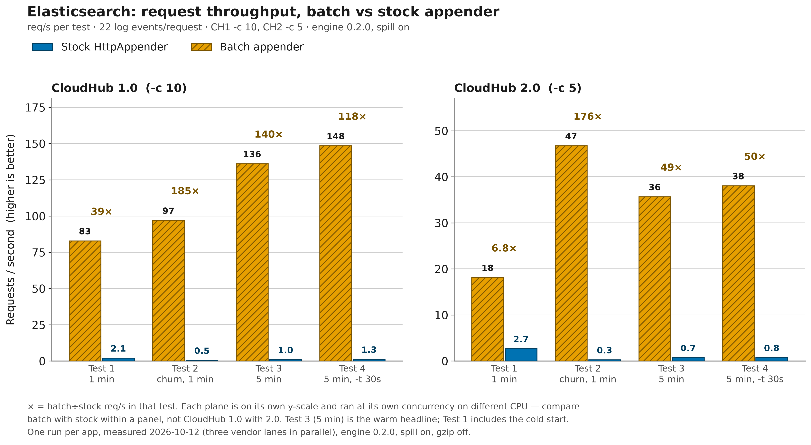
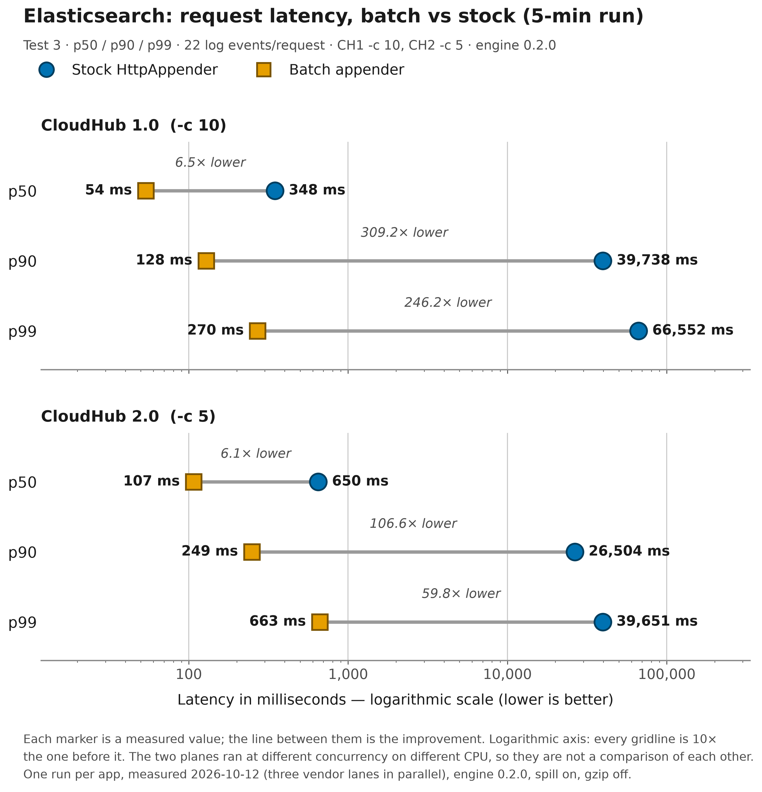
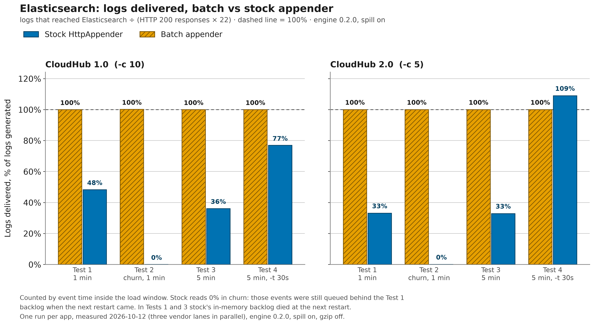

# Elasticsearch

With `vendor="elasticsearch"` (aliases `elastic` and `elk`), the `<BatchHttp>` appender sends
each batch as one Bulk API request: a `create` action plus an
[ECS](https://www.elastic.co/docs/reference/ecs) document per event. The target is a **data
stream** ([`index`](../configuration.md#opt-index)) whose default name matches Elasticsearch's
built-in `logs-*-*` index template, so it is created on the first write with the logs mappings
and lifecycle.

> [!TIP]
> Sample Mule project: [`demo/mule/elastic-batch-http`](../../demo/mule/elastic-batch-http/)
> ships its logs through this appender. Its sibling
> [`demo/mule/elastic-stock-http`](../../demo/mule/elastic-stock-http/) ships the same logs
> through Log4j2's built-in `<Http>` appender, one POST per event to `/<data-stream>/_doc`.
> The pair shows the wiring for a Mule 4.9 app (Java 17), how the endpoint and key are injected
> on CloudHub, and what batching changes under load.

| At a glance | Elasticsearch |
| --- | --- |
| Endpoint | Bulk API: `POST <url>/<index>/_bulk` with an NDJSON body |
| Authentication | Elasticsearch API key, sent as `Authorization: ApiKey <apiKey>` |
| Required options | [`url`](../configuration.md#opt-url), [`apiKey`](../configuration.md#opt-apikey) |
| Sample Mule project | [elastic-batch-http](../../demo/mule/elastic-batch-http/) / [elastic-stock-http](../../demo/mule/elastic-stock-http/) |
| Benchmarked on CloudHub | Yes, 2026-10-12 (engine 0.2.0); CloudHub 2.0 batch re-checked 2026-10-19 (0.2.2) |

On this page:

- [Set up Elasticsearch](#set-up-elasticsearch)
- [Configuration](#configuration)
- [What gets sent](#what-gets-sent)
- [Verify delivery](#verify-delivery)
- [Benchmark on CloudHub](#benchmark-on-cloudhub)
- [Troubleshooting](#troubleshooting)

## Set up Elasticsearch

The same sink works with Elastic Cloud Hosted, Elastic Cloud Serverless and self-managed
clusters. It first shipped in 0.1.5 and has been a first-class vendor since 0.2.0.

1. **Endpoint.** In Kibana, open the deployment's or project's connection details and copy the
   *Elasticsearch endpoint*. This value is [`url`](../configuration.md#opt-url).
   - On Serverless it looks like `https://<project>.es.<region>.<csp>.elastic.cloud:443`.
   - On a self-managed cluster it is the cluster's HTTPS URL.
   - It must start with `https://` or `http://`.
   - If you can, pick a project or cluster in the same cloud region as your workers, because
     every batch pays that round trip.
2. **API key.** In Kibana, go to *API keys* and create a key restricted to what the appender
   needs:

   ```json
   {
     "mule-log-shipper": {
       "indices": [
         { "names": ["logs-mule*"], "privileges": ["create_doc", "auto_configure"] }
       ]
     }
   }
   ```

   - `create_doc` lets the key append documents and nothing else.
   - `auto_configure` lets the first write create the data stream.
   - Widen `names` if your data stream uses a different pattern.

   Copy the **encoded** value: Kibana shows it only once, and it is the single base64 string,
   not the id/secret pair. This value is [`apiKey`](../configuration.md#opt-apikey).
3. **Data stream.** You don't need to create anything if the name matches `logs-*-*`. That
   covers `logs-mule-default` and any `logs-<dataset>-<namespace>` name such as
   `logs-orders-prod`. A name outside that pattern needs your own index template. A plain index
   needs the key to have privileges on it.
4. **Optional: parse the JSON inside `message`.** Elasticsearch stores `message` as text and
   does not lift JSON fields out of it. To get those fields as real fields, add a `logs@custom`
   ingest pipeline; the built-in `logs-*-*` template runs it on every write:

   ```text
   PUT _ingest/pipeline/logs@custom
   {
     "processors": [
       { "json": { "field": "message", "target_field": "mule", "ignore_failure": true } }
     ]
   }
   ```

## Configuration

Two attributes are required: [`url`](../configuration.md#opt-url) and
[`apiKey`](../configuration.md#opt-apikey). Pass both through `${env:...}` or `${sys:...}`
lookups and never write them into the file.

### Java application

```xml
<Configuration status="WARN" packages="com.mulesoft.support.batchhttp.log4j2">
    <Appenders>
        <!-- url: the Elasticsearch endpoint (scheme, host, optional port);
             the sink appends /<index>/_bulk.
             apiKey: the "encoded" API key Kibana shows once at creation. -->
        <BatchHttp name="elastic" vendor="elasticsearch"
                   url="${env:ELASTIC_URL}"
                   apiKey="${env:ELASTIC_API_KEY}"
                   index="logs-mule-default"
                   service="orders-api"
                   host="${hostName}">
            <PatternLayout pattern="%m"/>
        </BatchHttp>
        <Console name="console" target="SYSTEM_OUT">
            <PatternLayout pattern="%d{HH:mm:ss.SSS} [%t] %-5level %logger{36} - %msg%n"/>
        </Console>
    </Appenders>
    <Loggers>
        <Root level="info">
            <AppenderRef ref="elastic"/>
            <AppenderRef ref="console"/>
        </Root>
    </Loggers>
</Configuration>
```

The multi-vendor Java example
[`log4j2-example.xml`](../../demo/java/benchmark/src/main/resources/log4j2-example.xml)
contains the same block next to the other vendors.

### Mule application

Simplified from the sample app's
[`log4j2.xml`](../../demo/mule/elastic-batch-http/src/main/resources/log4j2.xml): the framework
noise-reduction loggers, most comments and the sample's tuning attributes are left out.
`packages="com.mulesoft.support.batchhttp.log4j2"` is **required in every Mule app**, because the
jar sits on the application classloader.

```xml
<Configuration status="INFO" packages="com.mulesoft.support.batchhttp.log4j2">
    <Properties>
        <Property name="app.service">${sys:app.service:-elastic-batch-http}</Property>
        <Property name="app.platform">${sys:app.platform:-${env:APP_PLATFORM:-unspecified}}</Property>
        <Property name="es.host">${sys:domain:-${env:HOSTNAME:-${hostName}}}</Property>
        <Property name="es.url">${sys:ELASTIC_URL:-${sys:elastic.url:-${env:ELASTIC_URL:-https://set-elastic-url.invalid}}}</Property>
        <Property name="es.dataStream">${sys:elastic.dataStream:-logs-mule-default}</Property>
    </Properties>
    <Appenders>
        <!-- RollingFile "FILE" (the CloudHub 1.0 log file) is shown below -->
        <!-- full tuning: see the demo's log4j2.xml -->
        <BatchHttp name="elastic"
                   vendor="elasticsearch"
                   url="${es.url}"
                   apiKey="${sys:ELASTIC_API_KEY:-${sys:elastic.apiKey:-${env:ELASTIC_API_KEY:-MISSING_KEY}}}"
                   index="${es.dataStream}"
                   service="${app.service}"
                   host="${es.host}"
                   gzip="false"
                   spillEnabled="${sys:batch.spillEnabled:-true}">
            <!-- Prepend the platform facet; collapse the flow's JSON to one line. -->
            <PatternLayout pattern="{&quot;platform&quot;:&quot;${app.platform}&quot;,%replace{%m}{^\x7B\s*|[\r\n]+\s*}{}"/>
        </BatchHttp>
    </Appenders>
    <Loggers>
        <AsyncLogger name="com.mulesoft.support.batchhttp.muledemo"
                     level="INFO"
                     additivity="false">
            <AppenderRef ref="elastic"/>
            <AppenderRef ref="FILE"/>
        </AsyncLogger>
        <AsyncRoot level="INFO">
            <AppenderRef ref="FILE"/>
        </AsyncRoot>
    </Loggers>
</Configuration>
```

<details>
<summary>The sample's <code>FILE</code> appender (CloudHub 1.0 custom log file)</summary>

```xml
<!-- CloudHub 1.0 custom-log-appender file, as documented by MuleSoft. -->
<RollingFile name="FILE"
             fileName="/opt/mule/mule-CURRENT/logs/mule-${sys:domain}.log"
             filePattern="/opt/mule/mule-CURRENT/logs/mule-${sys:domain}-%i.log">
    <PatternLayout pattern="[%d{MM-dd HH:mm:ss.SSS}] %-5p %c{1} [%t]: %m%n"/>
    <DefaultRolloverStrategy max="10"/>
    <Policies>
        <SizeBasedTriggeringPolicy size="10 MB"/>
    </Policies>
</RollingFile>
```

</details>

Things to know about this sample:

- **Injection.** Log4j2 parses `log4j2.xml`, so Mule `${...}` placeholders and `secure::`
  properties do not resolve there.
  - On CloudHub 1.0 or 2.0, set `elastic.url` as an application property and `elastic.apiKey`
    as a **secure** application property. CloudHub passes both to the JVM as system properties.
  - Locally under the Mule standalone wrapper, pass `-M-Delastic.url=...` and
    `-M-Delastic.apiKey=...` (a bare `-D` never reaches the Mule JVM), or export `ELASTIC_URL`
    and `ELASTIC_API_KEY`.
  - [Using it from a Mule app](../mule.md) covers this in detail.
- **Visible fallbacks.** If nothing is set, `url` falls back to a reserved `.invalid` host and
  `apiKey` to `MISSING_KEY`. A misconfigured app then fails loudly in the appender diagnostics
  instead of shipping logs somewhere.
- **Only the app's logger ships.** `AsyncRoot` writes to `FILE` only, so framework lines stay
  in the CloudHub log and are not sent to Elasticsearch.
- **One divergence for the A/B test:** `gzip="false"`, because the stock sibling cannot
  compress; the [sample README](../../demo/mule/elastic-batch-http/README.md) explains it.
- **Sample tuning.** The other non-default values (spill sizes, `spillBacklogOrder`,
  `spillReplayThreads`, `maxBatchBytes`, `lingerMillis`, `queueCapacity`) are sample tuning, set
  in the demo's
  [`log4j2.xml`](../../demo/mule/elastic-batch-http/src/main/resources/log4j2.xml); each is
  described in the [configuration reference](../configuration.md).
- **Discriminator.** The two apps run an identical flow and write identical ECS documents into
  the same data stream. `service.name` is the intended discriminator (`host.name` also differs,
  because it is each app's own name or pod).

<details>
<summary>Build, run and deploy the sample</summary>

1. Build: run `mvn install -DskipTests` at the repo root, then `mvn clean package` in
   `demo/mule/elastic-batch-http`. The app listens on port 8085; the stock sibling on 8086.
2. Emit events:

   ```bash
   curl "http://localhost:8085/log?count=50&level=info"   # emits 52 events
   curl http://localhost:8085/boom                         # emits one ERROR event
   ```

3. To deploy the pair to CloudHub 1.0, copy each module's `target/*-mule-application.jar` to
   `demo/mule/deployable/<module>.jar`
   ([runbook §2](../benchmark-runbook.md#2-build-the-artifacts)).
4. Export `ELASTIC_URL`, `ELASTIC_KEY`, `ANYPOINT_CLIENT_ID`, `ANYPOINT_CLIENT_SECRET`,
   `ANYPOINT_ORG`, `ANYPOINT_ENV` and `REGION`. `ELASTIC_KEY` is the encoded key; the script
   reads this name, not `ELASTIC_API_KEY`.
5. Run [`scripts/deploy-ch1.sh --elastic`](../../scripts/deploy-ch1.sh). Add `--dry-run` to
   print the commands with secrets masked.
6. The script sets `elastic.url` and the secure `elastic.apiKey`, but not `app.platform`. Add
   `app.platform=cloudhub-1.0` to both apps in Runtime Manager, or their events arrive as
   `platform: unspecified`.

</details>

### Recommended production settings

```xml
<BatchHttp name="elastic" vendor="elasticsearch"
           url="${env:ELASTIC_URL}"
           apiKey="${env:ELASTIC_API_KEY}"
           index="logs-orders-prod"
           service="orders-api"
           host="${env:HOSTNAME}"
           maxBatchRecords="500"
           maxBatchBytes="4194304"
           queueCapacity="25000"
           spillInstanceId="orders-api"
           maxSpillFileBytes="16777216"
           maxTotalSpillBytes="536870912"
           diagnosticsLevel="INFO"
           statsIntervalMillis="60000">
    <PatternLayout pattern="%m"/>
</BatchHttp>
```

| Setting | Value | Why |
| --- | --- | --- |
| [`index`](../configuration.md#opt-index) | `logs-orders-prod` | Matches `logs-*-*`; keeps one app's data separate (note 1) |
| [`maxBatchRecords`](../configuration.md#opt-maxbatchrecords) / [`maxBatchBytes`](../configuration.md#opt-maxbatchbytes) | 500 records / 4 MiB | Fewer, larger requests (note 2) |
| [`gzip`](../configuration.md#opt-gzip) | left unset (on) | Elasticsearch accepts gzip bodies; log text compresses well (note 3) |
| [`queueCapacity`](../configuration.md#opt-queuecapacity) | `25000` | Holds tens of seconds of a burst in memory before overflow goes to disk (note 4) |
| [`spillInstanceId`](../configuration.md#opt-spillinstanceid) | `orders-api` | A restart on the same host adopts its own backlog (note 5) |
| [`maxSpillFileBytes`](../configuration.md#opt-maxspillfilebytes) / [`maxTotalSpillBytes`](../configuration.md#opt-maxtotalspillbytes) | 16 MiB / 512 MiB | 512 MiB of on-disk backlog rides out a longer intake outage (note 6) |
| [`diagnosticsLevel`](../configuration.md#opt-diagnosticslevel) + [`statsIntervalMillis`](../configuration.md#opt-statsintervalmillis) | `INFO` + `60000` | A one-line delivery heartbeat every minute (note 7) |

1. A `logs-<dataset>-<namespace>` name still matches the built-in `logs-*-*` template, so you
   get the logs mappings and lifecycle without creating a template.
2. Elasticsearch has no per-request document cap and works best with bulk bodies of a few MiB.
   4 MiB is well under the sink's 10 MiB ceiling. These values are not what the benchmark ran
   (it used the sample's settings).
3. The sample turns gzip off only to keep the A/B comparison fair.
4. About 50 MB at roughly 2 KB retained per record.
5. The id stays the same across restarts of this app and is unique per running instance.
6. Check that the volume has room. If the JVM temp dir is memory-backed, point
   [`spillDirectory`](../configuration.md#opt-spilldirectory) at real storage
   ([Resilience](../resilience.md)).
7. The heartbeat is logged through `com.mulesoft.support.batchhttp.diagnostics.<appender name>`
   and so reaches the application log. `diagnosticsLevel` `INFO` with
   `<Configuration status="INFO">` also prints it on the console.

> [!WARNING]
> The API key's `names` must cover your `index`, for example `logs-orders-*`. The key from
> [Set up](#set-up-elasticsearch) covers only `logs-mule*`. Otherwise every batch is rejected
> with 403 and dropped.

### Options with an Elasticsearch-specific meaning

| Option | Meaning for Elasticsearch |
| --- | --- |
| [`vendor`](../configuration.md#opt-vendor) | `elasticsearch`, or the alias `elastic` or `elk` (case-insensitive, trimmed) |
| [`url`](../configuration.md#opt-url) | **Required.** The endpoint: `https://` or `http://`, host, optional port (note 1) |
| [`apiKey`](../configuration.md#opt-apikey) | **Required.** The encoded API key, sent as `Authorization: ApiKey <apiKey>` (note 2) |
| [`index`](../configuration.md#opt-index) | The target data stream (or index); `logs-mule-default` when unset or blank |
| [`service`](../configuration.md#opt-service) | Written to ECS `service.name` on every document; omitted when unset or blank |
| [`host`](../configuration.md#opt-host) | Written to ECS `host.name` on every document; omitted when unset or blank |
| [`deduplicate`](../configuration.md#opt-deduplicate) | On by default: each document carries an appender-assigned `_id`, so a re-sent copy is refused instead of stored twice (note 4) |
| [`token`](../configuration.md#opt-token) | Not read. Use `apiKey`. |
| [`site`](../configuration.md#opt-site), [`hostname`](../configuration.md#opt-hostname), [`source`](../configuration.md#opt-source), [`sourcetype`](../configuration.md#opt-sourcetype) | Ignored |
| [`includeTimestamp`](../configuration.md#opt-includetimestamp) | Ignored: `@timestamp` is always sent, because data streams require it |
| [`includeStackTrace`](../configuration.md#opt-includestacktrace) | Honoured: a Throwable's stack trace goes into ECS `error.stack_trace` |
| [`Layout`](../configuration.md#opt-layout) | Its output becomes the document's `message` (note 3) |

1. The sink appends `/<index>/_bulk` and strips one trailing slash. A URL without a scheme is
   rejected at startup.
2. Surrounding whitespace, such as a trailing newline from a secret file, is trimmed. Log4j2
   masks the value in its status output.
3. The trailing newline is stripped and the size is capped by
   [`maxMessageBytes`](../configuration.md#opt-maxmessagebytes).
4. `deduplicate="false"` lets Elasticsearch generate the ids, which indexes slightly faster but
   lets a re-sent batch be stored twice. See [Which responses retry or drop](#request).

Every other option (batching, queue, retries, spill, TLS, diagnostics) applies unchanged; see
the [configuration reference](../configuration.md).

## What gets sent

Each event becomes two NDJSON lines in the bulk body: the action, then the document. The action
is `{"create":{"_id":"<id>"}}`: `create` is the only action a data stream accepts, and the `_id`
is a 22-character id the appender gave the record when it accepted it. The same id is sent on
every retry and replay, which is what lets Elasticsearch refuse a copy it already stores. With
[`deduplicate="false"`](../configuration.md#opt-deduplicate) the action is `{"create":{}}` and
Elasticsearch generates the ids. The body ends with the trailing newline that `_bulk` requires.

<a id="request"></a>

```text
POST <url>/<index>/_bulk?filter_path=errors,items.*.status,items.*.error.type,items.*.error.reason
Content-Type: application/x-ndjson
Authorization: ApiKey <apiKey>
```

`filter_path` trims the response down to the per-item status and error, so reading the response
for a clean batch costs only a few bytes per document.

MDC entries go under ECS `labels`, because a bare key such as `host` or `log` would collide with
an ECS object field, and Elasticsearch would refuse the whole document as a mapping conflict.

<details>
<summary>Full field mapping</summary>

| Source | Document field |
| --- | --- |
| Event time | `@timestamp`: ISO-8601 UTC instant with milliseconds, e.g. `2023-11-14T22:13:20.123Z` |
| Layout output | `message` |
| Event level | `log.level` |
| Logger name | `log.logger` |
| Thread name | `process.thread.name` |
| [`service`](../configuration.md#opt-service) (config) | `service.name`, only when set |
| [`host`](../configuration.md#opt-host) (config) | `host.name`, only when set |
| Throwable, when [`includeStackTrace`](../configuration.md#opt-includestacktrace) is on | `error.stack_trace` |
| Each MDC / ThreadContext entry `<key>` | `labels.<key>` (Mule sets `correlationId` and `processorPath`) |

</details>

### Timestamp

`@timestamp` is always the event's own time, so the stored time equals the time the event was
generated. Shipping delay therefore does not show in `@timestamp`; to see it you need
`event.ingested`, which an ingest pipeline can add.

### Stack traces

Stack traces go to `error.stack_trace`, but only when the Log4j2 event carries a Java Throwable. A
Mule `<logger>` attaches none, so the sample's `/boom` flow does not exercise this field; its
error type and description travel as JSON inside `message`.

### Per-request limits and gzip

The sink has no per-request document cap. The engine flushes when its per-record size estimate
(the UTF-8 bytes of the message and fields plus a fixed allowance per record) reaches the
smaller of 10 MiB and [`maxBatchBytes`](../configuration.md#opt-maxbatchbytes). It uses your
own [`maxBatchRecords`](../configuration.md#opt-maxbatchrecords) as the record cap.

The serialized bulk body is somewhat larger than the estimate: the `create` action lines, ECS
field names, `@timestamp`, the `labels.` prefix and JSON escaping are not counted. The 10 MiB
ceiling matters only if you set `maxBatchBytes` above it.

When [`gzip`](../configuration.md#opt-gzip) is on, the body is compressed once per batch and
sent with `Content-Encoding: gzip`.

### Which responses retry or drop

This happens at two levels: the HTTP status of the request, then the status of each document.

#### HTTP status of the request

- `2xx` is success.
- `408`, `429`, `5xx` and network errors (connection reset, timeout, DNS) are retried, up to
  [`maxRetries`](../configuration.md#opt-maxretries) times with exponential backoff. The sink
  honours `Retry-After`, capped by
  [`maxRetryBackoffMillis`](../configuration.md#opt-maxretrybackoffmillis).
- Any other status is fatal: a bad key or missing privilege as `401`/`403`, `404`, `413`, and
  `1xx`/`3xx` (redirects are not followed). The batch is dropped at once with
  `ERROR ... dropped N record(s) — endpoint rejected the batch (HTTP 4xx); check
  credentials/endpoint, retrying will not help`.
- When retries run out, the batch goes to the disk spill buffer if spill is on, and is dropped
  if it is off ([Resilience](../resilience.md)).

#### Status of each document

`_bulk` answers `200` even when it refused some of the
documents, so this sink reads the response body. If it says `"errors":false`, the whole batch
was accepted. Otherwise each item is classified:

| Item status | Outcome |
| --- | --- |
| `2xx` | Delivered |
| `409` (version conflict on `create`) | Elasticsearch already stores a document with this `_id`: a re-sent copy. Counted as delivered and in `duplicatesSuppressed`, not re-sent |
| `429` or `5xx` | Only these documents are re-sent, as a smaller batch on the normal backoff schedule |
| Any other `4xx` (mapping conflict, `document_parsing_exception`, …) | Permanent: counted in `dropped`, with an ERROR that quotes the first reason (note 1) |

1. The ERROR reads `dropped N of M record(s) — the intake accepted the request but refused them
   (status 400 document_parsing_exception: …); retrying will not help`, quoting the first reason
   Elasticsearch gave.

If the response body cannot be parsed, the batch counts as accepted, so the sink never re-sends
on a guess.

> [!IMPORTANT]
> **Re-sent batches are stored once.** Delivery is at-least-once: a batch is sent again after a
> timeout or a lost response, on a spill replay, or when a segment exhausts its retries. With
> [`deduplicate`](../configuration.md#opt-deduplicate) on (the default), every document carries
> an `_id` the appender assigned when it accepted the record, so Elasticsearch refuses a second
> copy with 409 and stores each record once. The stats line counts these as
> `duplicatesSuppressed`. A copy re-sent after a data stream rollover lands in the new backing
> index and can still be stored twice.

## Verify delivery

### In Kibana

Open *Discover*, select the `logs-*` data view, and filter with KQL:

```text
service.name : "elastic-batch-http"
```

### Count with ES|QL

This is how the benchmark counted delivery. The shipping key from
[Set up](#set-up-elasticsearch) is deliberately write-only, so the count needs a separate key or
user with `read` (and `view_index_metadata`) on `logs-mule*`, for example a second, read-only
API key. Send the query to the same endpoint with it (`jq` builds the JSON body):

```bash
QUERY='FROM logs-mule-default
| WHERE service.name == "elastic-batch-http"
    AND @timestamp >= "2026-10-12T00:00:00Z"
| STATS n = COUNT(*)'
jq -n --arg query "$QUERY" '{$query}' |
  curl -s -X POST "$ELASTIC_URL/_query?format=json" \
    -H "Authorization: ApiKey $ELASTIC_READ_KEY" \
    -H "Content-Type: application/json" \
    --data-binary @-
```

### Quick connectivity check without the appender

Post a single document. A `200` response with `"errors":false` proves that the endpoint, the
key and its privileges all work:

```bash
printf '%s\n' '{"create":{}}' \
  '{"@timestamp":"2026-10-13T00:00:00.000Z","message":"connectivity check"}' |
  curl -s -X POST "$ELASTIC_URL/logs-mule-default/_bulk" \
    -H "Authorization: ApiKey $ELASTIC_API_KEY" \
    -H "Content-Type: application/x-ndjson" \
    --data-binary @-
```

### On the appender side

Set [`statsIntervalMillis`](../configuration.md#opt-statsintervalmillis) to get a heartbeat
with `accepted`, `sentRecords`, `dropped`, `queueDepth` and the spill counters in the
application log (and on the console with
[`diagnosticsLevel`](../configuration.md#opt-diagnosticslevel) `INFO` and
`<Configuration status="INFO">`; see
[Where the messages go](../troubleshooting.md#where-the-messages-go)).

A non-zero `dropped` together with the "intake accepted the request but refused them" ERROR
means Elasticsearch refused documents on mapping grounds.

### Check for duplicates

A document stored twice has the same timestamp, logger, thread and message as its copy. This
query counts such groups in a time window (same read key as above):

```text
FROM logs-mule-default
| WHERE @timestamp >= "2026-10-18T23:00:00Z" AND @timestamp <= "2026-10-18T23:40:00Z"
| STATS c = COUNT(*) BY @timestamp, log.logger, process.thread.name, message
| WHERE c > 1
| STATS duplicate_groups = COUNT(*), extra_documents = SUM(c) - COUNT(*)
```

Keep `message` in the grouping: without it, separate events logged by one thread in the same
millisecond (a loop, a batch of lines per request) count as copies. With `deduplicate` on, the
result is 0 apart from any copy re-sent across a data stream rollover.

## Benchmark on CloudHub

One run on 2026-10-12 with engine 0.2.0 and disk spill on, on 0.1 vCore workers in Sydney; for
the method, the other vendors and the raw tables, see
[Benchmark results](../benchmark-results.md).

**In Test 3 (5 min) the batch appender served 136.15 req/s against 0.98 for stock on CloudHub
1.0 (139.5×), and 35.68 against 0.73 on CloudHub 2.0 (48.6×).** Batch delivered 100% of its logs
on both planes; stock delivered 36.1% and 32.9%.

<details>
<summary>Test setup</summary>

- Each request emitted 22 log events (`count=20`).
- CloudHub 1.0 ran at `oha -c 10` over `http`; CloudHub 2.0 at `-c 5` over `https`.
- Both used 0.1 vCore workers in Sydney (`ap-southeast-2`), next to an Elastic Cloud Serverless
  project in the same region.
- Every test started on a freshly restarted app, except Test 2, which ran 60 s after Test 1
  with no restart.
- Elasticsearch ran as one of three vendor lanes in parallel, with one app per vendor under load
  at a time.
- To reproduce it, see the [runbook](../benchmark-runbook.md).

</details>

The two planes ran at different concurrency on different hardware, so compare batch with stock
within one table, not CloudHub 1.0 with 2.0.

### CloudHub 1.0 (0.1 vCore, `-c 10`)

| Test | Req/s (batch / stock) | Batch÷stock | p90 s (batch / stock) | Delivered (batch / stock) |
| --- | --- | --- | --- | --- |
| 1 (1 min) | 82.88 / 2.11 | 39.3× | 0.192 / 13.25 | 100.0% / 48.3% |
| 2 (churn) | 97.08 / 0.52 | 185.1× | 0.130 / 51.59 | 100.2% / 0.0% |
| 3 (5 min) | 136.15 / 0.98 | 139.5× | 0.128 / 39.74 | 100.0% / 36.1% |
| 4 (5 min, `-t 30s`) | 148.50 / 1.26 | 118.3× | 0.124 / 0.50 | 100.0% / 76.9% |

### CloudHub 2.0 (0.1 vCore, `-c 5`)

| Test | Req/s (batch / stock) | Batch÷stock | p90 s (batch / stock) | Delivered (batch / stock) |
| --- | --- | --- | --- | --- |
| 1 (1 min) | 18.14 / 2.68 | 6.8× | 0.443 / 1.30 | 100.0% / 33.1% |
| 2 (churn) | 46.75 / 0.27 | 175.9× | 0.186 / 26.65 | 100.0% / 0.0% |
| 3 (5 min) | 35.68 / 0.73 | 48.6× | 0.249 / 26.50 | 100.0% / 32.9% |
| 4 (5 min, `-t 30s`) | 38.05 / 0.76 | 50.3× | 0.224 / 26.09 | 100.0% / 109.0% |

### 0.2.2 check on CloudHub 2.0

On 2026-10-19 the CloudHub 2.0 batch app was rebuilt with 0.2.2 (`deduplicate` on) and run
through the same four tests, alone. Every document carried an appender-assigned `_id`, and
delivery was exact: no record lost and none stored twice.

| Test | Req/s (0.2.0 / 0.2.2) | p90 s (0.2.0 / 0.2.2) | Delivered with 0.2.2 |
| --- | --- | --- | --- |
| 1 (1 min) | 18.14 / 14.74 | 0.443 / 0.517 | 100.0% (19,558) |
| 2 (churn) | 46.75 / 36.68 | 0.186 / 0.235 | 100.0% (48,466) |
| 3 (5 min) | 35.68 / 38.45 | 0.249 / 0.249 | 100.0% (253,792) |
| 4 (5 min, `-t 30s`) | 38.05 / 42.75 | 0.224 / 0.210 | 100.0% (282,238) |

These are single runs six days apart; read the 1-minute differences as directional. The 0.2.0
run above shows what deduplication removes: CloudHub 1.0 batch delivered 100.2% in Test 2,
consistent with a few re-sent batches stored twice.

### Charts

Throughput: look at the batch÷stock ratio printed above each pair of bars.



Latency in Test 3, on a log scale: compare batch's p50, p90 and p99 with stock's on each plane.



Delivery: batch holds at 100% in every test; stock's share varies by test and plane.



### What the Elasticsearch numbers show

- How delivery is counted. Elasticsearch delivery is counted by **event time** inside the
  load window: the documents whose `@timestamp` falls in the test, divided by HTTP 200
  responses × 22. A backlog that lands late still counts, as long as it lands. Datadog and New
  Relic are counted by arrival time instead, so their churn and Test 4 percentages are not
  comparable one for one.
- **Batch lost nothing.** Batch delivered 100% in every test on both planes. Test 2 on
  CloudHub 1.0 reads 100.2% because the app also logged requests that oha cut off at its
  deadline.
- Stock loses its in-memory backlog at the next restart. The stock `<Http>` appender sends
  one blocking POST per event on a single background thread. Under load it falls behind, and
  whatever is still queued when the next restart comes dies with the app: 33–48% delivered in
  Test 1 and Test 3.
- Stock reads 0% in the churn test (no restart) on both planes. Its events were still
  queued behind Test 1's backlog when the next restart came.
- Test 4 caps each request at 30 s. Stock had 96 requests time out on CloudHub 1.0 (76.59%
  success) and 20 on CloudHub 2.0 (91.77% success). That cap is also why stock p90 on
  CloudHub 1.0 drops to 0.50 s. The 109.0% on CloudHub 2.0 is over 100% because the requests
  that timed out still logged their events, but they are not in the expected count.
- Test 1 under-reports warm batch throughput. The batch JVM is still warming up in the
  1-minute test. Read Test 3 as the sustained figure.
- gzip was off for both apps to keep the comparison fair. A production deployment with gzip
  on sends fewer bytes per batch.

> [!NOTE]
> **Variance between runs.** Each figure is one run per app: read it as directional. A
> sequential, Elasticsearch-only control run on 2026-10-11 was compared with these parallel
> lanes. On CloudHub 2.0, stock req/s agreed within 3% in the 5-minute tests (−2.6% in Test 3,
> −2.9% in Test 4). On CloudHub 1.0 the difference was −3.3% in Test 4 and −14.6% in Test 3; an
> earlier parallel round of the same stock apps read +2.9% and −7.1%, so a single CloudHub 1.0
> stock run moves that much on its own.

## Troubleshooting

| Symptom | Likely cause | Fix |
| --- | --- | --- |
| Startup ERROR `ElasticsearchSink requires a url` (or `requires an apiKey`) (note 1) | `url` or `apiKey` is explicitly empty or blank | Check that the lookup resolves (note 2) |
| Startup ERROR `ElasticsearchSink url must start with https:// or http://` | The endpoint has no scheme (note 3) | Use the full endpoint as Kibana shows it |
| Mule app ships nothing; DNS failures for `set-elastic-url.invalid` | The sample's fallback URL: `elastic.url` was never set | Set `elastic.url` (note 4) |
| `ERROR ... endpoint rejected the batch (HTTP 401)` or `(HTTP 403)` | Wrong, revoked or missing key, or missing privileges (note 5) | Recreate the key as in [Set up](#set-up-elasticsearch) (note 6) |
| `ERROR ... dropped N of M record(s) — the intake accepted the request but refused them` (note 7) | A field-mapping conflict (note 8) | Fix or rename the conflicting field, or the pipeline's `target_field` (note 8) |
| Duplicate documents after a timeout, a restart or a spill replay | `deduplicate="false"`, a version before 0.2.2, or a data stream rollover between the first send and the re-send | Leave [`deduplicate`](../configuration.md#opt-deduplicate) on (the default); `duplicatesSuppressed` in the stats line shows the re-sends it absorbed |
| `message` shows the JSON as one text string | Elasticsearch does not parse JSON inside `message` | Add the `logs@custom` pipeline from [Set up](#set-up-elasticsearch) |
| `includeTimestamp="false"` has no effect | The sink always sends `@timestamp`; data streams require it | By design |
| Writes fail for a custom `index` name | A name outside `logs-*-*` has no matching template, so no auto-created data stream | Use a `logs-<dataset>-<namespace>` name, or create your own index template |
| Backlog gone after a CloudHub restart | The spill buffer lives in the JVM temp dir (note 9) | Expected on CloudHub; see [Resilience](../resilience.md) |

1. The full message: `BatchHttp appender '<name>' could not build its 'elasticsearch' sink:
   ElasticsearchSink requires a url` (or `requires an apiKey`) `... Required log4j2.xml
   attributes for vendor 'elasticsearch': url, apiKey. This appender is disabled and will ship
   no logs.` It names the vendor as written, trimmed and lower-cased (e.g. `'elastic'` for the
   alias). The scheme error in the next row arrives in the same startup ERROR.
2. In Mule, use `${sys:...}`/`${env:...}`, not Mule `${...}` or `secure::`. This message is
   hidden under `<Configuration status="OFF">`.
3. For example it was copied without `https://`, or `url` is an unresolved `${env:ELASTIC_URL}`:
   Log4j2 leaves an unresolved lookup in place as literal text.
4. On CloudHub, set the `elastic.url` application property. Locally, use `-M-Delastic.url=...`
   (not a bare `-D`) or `ELASTIC_URL`.
5. Wrong key format (the id or secret instead of the encoded value), a revoked key, the sample's
   `MISSING_KEY` fallback, a literal `${env:ELASTIC_API_KEY}` sent because the variable is
   unset, or a key missing `create_doc`/`auto_configure` on the target name.
6. Copy the encoded value. Check that the role's `names` pattern covers your data stream. On
   CloudHub, set `elastic.apiKey` as a secure property.
7. The message continues `(status 400 document_parsing_exception: …)`; a
   `mapper_parsing_exception` has the same cause.
8. Typically an MDC key, or a field an ingest pipeline adds, colliding with an existing mapping.
   MDC is already namespaced under `labels.*` to avoid collisions such as `host` or `log`.
   Retrying will not help.
9. On CloudHub, a restart moves the app to a new worker (1.0) or pod (2.0), and the backlog
   stays behind. [Resilience](../resilience.md) covers what survives which restart.

For general diagnostics (StatusLogger, the stats heartbeat, the counters), see
[Troubleshooting & diagnostics](../troubleshooting.md).

---

[Docs index](../README.md) · [Configuration reference](../configuration.md) · Other vendors:
[Datadog](datadog.md) · [New Relic](newrelic.md) · [Dynatrace](dynatrace.md) ·
[Splunk](splunk.md) · [Generic HTTP](generic.md)
