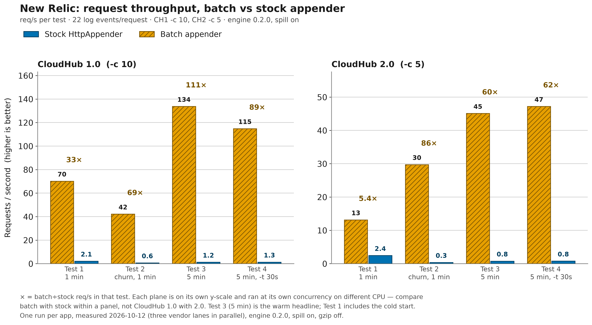
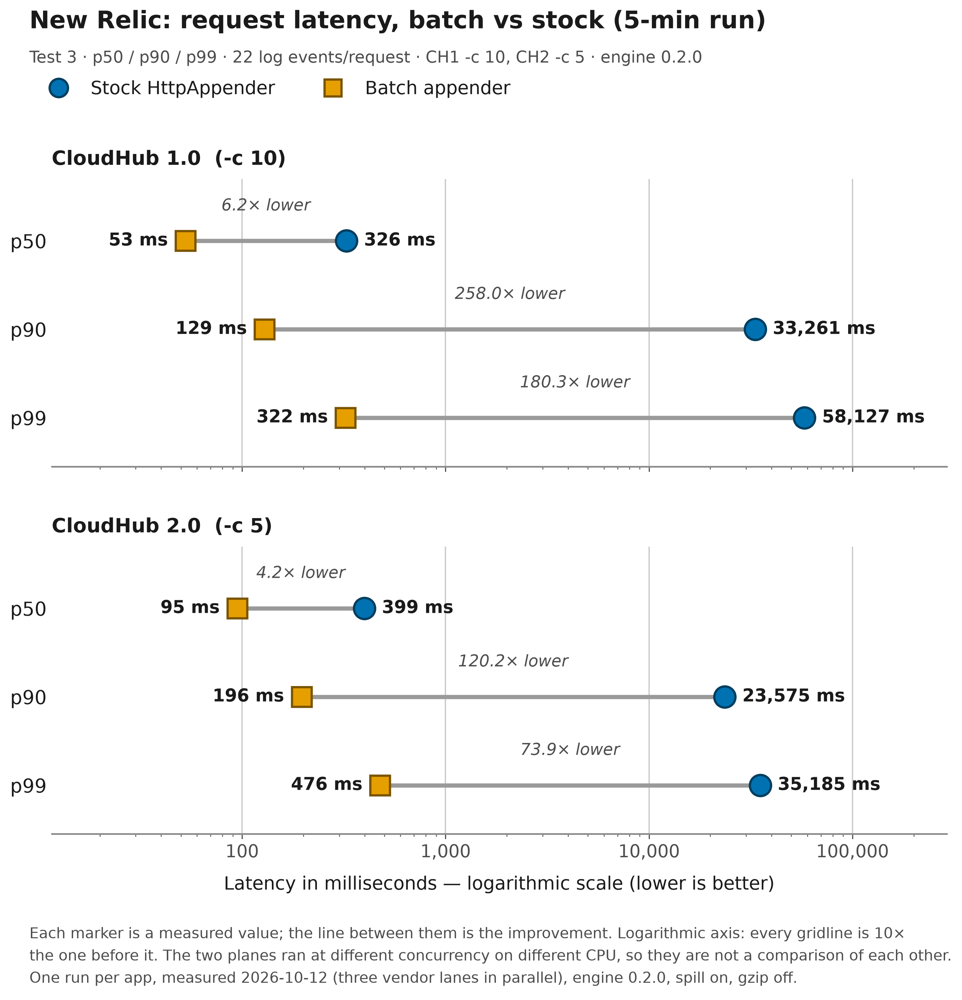
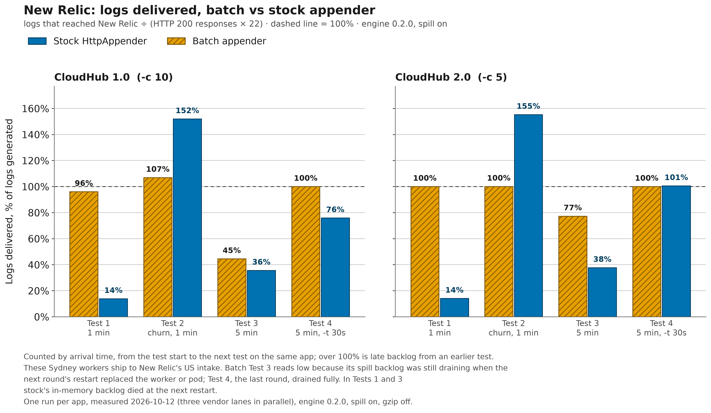

# New Relic

With `vendor="newrelic"`, `<BatchHttp>` sends your Log4j2 events to the
[New Relic Log API](https://docs.newrelic.com/docs/logs/log-api/introduction-log-api/). Events
are batched into a JSON array, gzipped, and posted over HTTPS to `https://<host>/log/v1`, with a
New Relic license (ingest) key in the `Api-Key` header. Everything on this page applies to New
Relic only; the options themselves are all described in one place,
[configuration.md](../configuration.md).

> [!TIP]
> **Sample Mule project:** [`demo/mule/newrelic-batch-http`](../../demo/mule/newrelic-batch-http/)
> is a Mule 4.9 app (Java 17) that bundles this appender and ships its application logs to New
> Relic. Its control sibling [`demo/mule/newrelic-stock-http`](../../demo/mule/newrelic-stock-http/)
> runs the same flows and workload through Log4j2's built-in `<Http>` appender, which makes one
> synchronous POST per event. The pair is an A/B where only the appender changes, and the
> [CloudHub benchmark](#benchmark-on-cloudhub) below was measured with these two apps.

| At a glance | New Relic |
|---|---|
| Endpoint | `https://<host>/log/v1` (default host `log-api.newrelic.com`, US) |
| Authentication | `Api-Key` header with a license (ingest) key |
| Required options | [`apiKey`](../configuration.md#opt-apikey) |
| Sample Mule project | [newrelic-batch-http](../../demo/mule/newrelic-batch-http/) / [newrelic-stock-http](../../demo/mule/newrelic-stock-http/) |
| Benchmarked on CloudHub | Yes, 2026-10-12 (engine 0.2.0) |

On this page:

- [Set up New Relic](#set-up-new-relic)
- [Configuration](#configuration)
- [What gets sent](#what-gets-sent)
- [Verify delivery](#verify-delivery)
- [Benchmark on CloudHub](#benchmark-on-cloudhub)
- [Troubleshooting](#troubleshooting)

## Set up New Relic

1. **Get a license (ingest) key.** In New Relic's API keys UI, create or copy a key of type
   `INGEST - LICENSE` for the account that should receive the logs. The appender sends it as the
   `Api-Key` header. Treat it as a secret: pass it in through `${env:...}` or `${sys:...}`, never
   as a literal in `log4j2.xml`.
2. **Pick the region host.** Every New Relic account lives in either the US or the EU data
   centre, and each region has its own Log API host. Take your account's host from
   [New Relic's Log API documentation](https://docs.newrelic.com/docs/logs/log-api/introduction-log-api/)
   and set it as [`host`](../configuration.md#opt-host). If you leave `host` unset, the sink uses
   `log-api.newrelic.com`, the US host. A key is only valid in its own region, so New Relic
   rejects a key sent to the wrong region's host.
3. **Decide on the identity attributes (optional).** [`service`](../configuration.md#opt-service)
   names the application. [`hostname`](../configuration.md#opt-hostname) names the machine,
   container or CloudHub app, and New Relic's Logs UI shows it as the host.
4. **If your app logs JSON, give it a `message` key.** When a `message` contains JSON, New Relic
   parses it into attributes and replaces the original text. If that JSON has no `message` key
   of its own, the message column in the Logs UI is blank, which is why the demo flows start
   every event with a human-readable `message` summary. You can also emit `logtype` (New Relic's
   well-known classifier) from the layout, as the demos do with `logtype=mule`; `<BatchHttp>` has
   no `logtype` attribute.

You don't need to create an index, a dataset or a pipeline. Logs land in New Relic's `Log` event
type as they arrive.

## Configuration

Required: [`name`](../configuration.md#opt-name), [`vendor`](../configuration.md#opt-vendor)`="newrelic"`
and [`apiKey`](../configuration.md#opt-apikey). Everything else is optional.

### Java application

Add the appender jar to the classpath and put the plugin package in `packages` so Log4j2 can find
`<BatchHttp>`. Set `NEW_RELIC_LICENSE_KEY`, plus `NEW_RELIC_LOG_HOST` if your account is not in
the US region:

```xml
<Configuration status="WARN" packages="com.mulesoft.support.batchhttp.log4j2">
    <Appenders>
        <!-- New Relic Log API: the sink posts to https://<host>/log/v1.
             Set NEW_RELIC_LICENSE_KEY (and NEW_RELIC_LOG_HOST for a non-US account). -->
        <BatchHttp name="newrelic" vendor="newrelic"
                   host="${env:NEW_RELIC_LOG_HOST:-log-api.newrelic.com}"
                   apiKey="${env:NEW_RELIC_LICENSE_KEY}"
                   service="orders-api"
                   hostname="${env:HOSTNAME:-${hostName}}">
            <PatternLayout pattern="%m"/>
        </BatchHttp>
    </Appenders>
    <Loggers>
        <Root level="info">
            <AppenderRef ref="newrelic"/>
        </Root>
    </Loggers>
</Configuration>
```

> [!IMPORTANT]
> Give the `host` lookup a `:-` default. Log4j2 leaves an unresolved lookup as literal text, so an
> unset `NEW_RELIC_LOG_HOST` with no default would become part of the endpoint URI and disable the
> appender at startup (see [Troubleshooting](#troubleshooting)).

The key is deliberately left without a default: an unset `NEW_RELIC_LICENSE_KEY` then shows up as
`dropped ... (HTTP 403)` on every batch, not as a startup error. The all-vendors Java example,
[`log4j2-example.xml`](../../demo/java/benchmark/src/main/resources/log4j2-example.xml), also
contains a minimal New Relic appender (no `service`, `hostname` or Layout).

### Mule application

This is the core of the demo app's configuration. Only the application's own logger ships to New
Relic; framework logs stay in the CloudHub log file. The full file is
[`demo/mule/newrelic-batch-http/src/main/resources/log4j2.xml`](../../demo/mule/newrelic-batch-http/src/main/resources/log4j2.xml).

```xml
<Configuration status="INFO" packages="com.mulesoft.support.batchhttp.log4j2">
    <Properties>
        <!-- service facet: defaults to the app name. Delete an override; don't clear it. -->
        <Property name="app.service">${sys:app.service:-newrelic-batch-http}</Property>
        <!-- platform facet: -Dapp.platform=cloudhub-1.0 or APP_PLATFORM=cloudhub-2.0 -->
        <Property name="app.platform">${sys:app.platform:-${env:APP_PLATFORM:-unspecified}}</Property>
        <!-- reserved hostname: CloudHub 1.0 app name, else the container or machine hostname -->
        <Property name="nr.hostname">${sys:domain:-${env:HOSTNAME:-${hostName}}}</Property>
        <!-- Log API host for the account's region; the stock sibling uses the identical chain -->
        <Property name="nr.logHost">${sys:nr.logHost:-${env:NEW_RELIC_LOG_HOST:-log-api.newrelic.com}}</Property>
    </Properties>
    <Appenders>
        <!-- The RollingFile "FILE" appender (CloudHub 1.0 log file) is in the full file. -->
        <!-- gzip="false" and includeTimestamp="false" are A/B choices, not production advice -->
        <BatchHttp name="newrelic" vendor="newrelic"
                   host="${nr.logHost}"
                   apiKey="${sys:NEW_RELIC_API_KEY:-${sys:newrelic.apiKey:-${env:NEW_RELIC_API_KEY:-MISSING_KEY}}}"
                   service="${app.service}"
                   hostname="${nr.hostname}"
                   gzip="false"
                   includeTimestamp="false"
                   spillEnabled="${sys:batch.spillEnabled:-true}"
                   spillInstanceId="newrelic-batch-http"
                   statsIntervalMillis="60000">
            <PatternLayout pattern="{&quot;logtype&quot;:&quot;mule&quot;,&quot;platform&quot;:&quot;${app.platform}&quot;,%replace{%m}{^\x7B\s*|[\r\n]+\s*}{}"/>
        </BatchHttp>
    </Appenders>
    <Loggers>
        <AsyncLogger name="com.mulesoft.support.batchhttp.muledemo" level="INFO" additivity="false">
            <AppenderRef ref="newrelic"/>
            <AppenderRef ref="FILE"/>
        </AsyncLogger>
        <AsyncRoot level="INFO">
            <AppenderRef ref="FILE"/>
        </AsyncRoot>
    </Loggers>
</Configuration>
```

Neither the key nor the host comes from Mule properties. Log4j2 can't see Mule `${...}`
placeholders or `config.properties`, so the key must reach the JVM as a system property or an
environment variable:

| Where | How to pass the key |
|---|---|
| Locally or on a VM | Set `NEW_RELIC_API_KEY`, or pass `-Dnewrelic.apiKey=...` |
| Standalone Mule | Pass it to the wrapper as `-M-Dnewrelic.apiKey=...` (note 1) |
| CloudHub 1.0 | Set the application property `newrelic.apiKey` and mark it secure (note 2) |
| CloudHub 2.0 | Set it as a JVM argument or a secure property (note 3) |

1. A bare `-D` on the `mule` command line never reaches the Mule JVM, so the app starts with
   `MISSING_KEY`.
2. CloudHub 1.0 exposes application properties as system properties.
   [`scripts/deploy-ch1.sh`](../../scripts/deploy-ch1.sh) `--newrelic` deploys both apps of the
   pair and reads the key from `NR_KEY`. It does not set `app.platform` or `nr.logHost`.
3. There is no deployment script for CloudHub 2.0;
   [docs/benchmark-runbook.md](../benchmark-runbook.md) describes the steps.

For a non-US account, set `-Dnr.logHost=...` or `NEW_RELIC_LOG_HOST` to your region's host, and
set the same value on the stock sibling.

<details>
<summary>The demo's other attributes and its file appender</summary>

The sample above omits the demo's tuning attributes, its explanatory comments and the CloudHub
framework noise-reduction loggers. The demo also sets:

| Area | Demo values |
|---|---|
| Batching | `maxBatchRecords="200"`, `maxBatchBytes="900000"`, `lingerMillis="2000"` |
| Queue and flushing | `queueCapacity="25000"`, `overflowPolicy="DROP_NEWEST"`, `flusherThreads="1"` |
| Requests and shutdown | `maxRetries="3"`, `requestTimeoutMillis="10000"`, `shutdownDrainTimeoutMillis="5000"` |
| Records and diagnostics | `includeStackTrace="true"`, `diagnosticsLevel="INFO"` |
| Spill sizing | `spillReplayIntervalMillis="10000"`, `maxSpillFileBytes="16777216"`, `maxTotalSpillBytes="536870912"`, `minFreeDiskBytes="268435456"` |
| Spill behaviour | `spillOnOverflow="true"`, `spillFormat="BINARY"`, `spillRecoveryMode="ADOPT"`, `spillStartupReconcile="true"` |
| Spill replay | `spillBacklogOrder="DUAL_STREAM"`, `spillReplayThreads="2"`, `spillReplayMaxBytesPerSec="0"` |

The `FILE` appender is the CloudHub 1.0 custom-log-appender file, kept so platform logging still
works:

```xml
<RollingFile name="FILE"
             fileName="/opt/mule/mule-CURRENT/logs/mule-${sys:domain}.log"
             filePattern="/opt/mule/mule-CURRENT/logs/mule-${sys:domain}-%i.log">
    <PatternLayout pattern="[%d{MM-dd HH:mm:ss.SSS}] %-5p %c{1} [%t]: %m%n"/>
    <DefaultRolloverStrategy max="10"/>
    <Policies>
        <SizeBasedTriggeringPolicy size="10 MB"/>
    </Policies>
</RollingFile>
```

In the loggers, application logs ship to New Relic and the local file exactly once; framework logs
stay in the file only.

</details>

In this sample, `app.service` is the app's identity. The layout prepends `logtype` and `platform`,
then collapses the flow's pretty JSON message to one line.

Two settings exist only to keep the A/B fair. Don't copy them into production:

- `gzip="false"`: the stock `<Http>` appender can't compress. Leaving gzip on in the batch app
  would make the pair differ in two ways at once.
- `includeTimestamp="false"`: with no event time in the record, New Relic stamps each record
  with its arrival time. That makes ingest lag measurable as arrival minus the flow's
  `generatedAt`. The stock layout omits `timestamp` as well.

<details>
<summary>Build and run the demo</summary>

1. From the repository root, run `mvn install -DskipTests`.
2. Run `cd demo/mule/newrelic-batch-http && mvn clean package`.
3. Deploy `target/*-mule-application.jar`. The app listens on port 8081 and the stock sibling on
   8082.

</details>

The `NEW_RELIC_API_KEY=YOUR_NEW_RELIC_INGEST_KEY` line in the demo's `config.properties` is only
a placeholder; Log4j2 never reads it. More reading:

- [mule.md](../mule.md) covers the general steps for any Mule app: bundling the appender,
  injecting secrets, and telling CloudHub 1.0 apart from 2.0.
- The stock sibling's [README](../../demo/mule/newrelic-stock-http/README.md) is the step-by-step
  A/B guide, with a local mock intake (Option A) and real New Relic (Option B).

### Recommended production settings

This starting point is for an app that ships to New Relic from outside the New Relic region, as
the benchmarked Sydney workers did:

```xml
<BatchHttp name="newrelic" vendor="newrelic"
           host="${env:NEW_RELIC_LOG_HOST:-log-api.newrelic.com}"
           apiKey="${env:NEW_RELIC_LICENSE_KEY}"
           service="orders-api"
           hostname="${env:HOSTNAME:-${hostName}}"
           gzip="true"
           flusherThreads="2"
           queueCapacity="25000"
           maxRetries="5"
           requestTimeoutMillis="10000"
           spillEnabled="true"
           spillInstanceId="orders-api"
           maxTotalSpillBytes="268435456"
           diagnosticsLevel="INFO"
           statsIntervalMillis="60000">
    <PatternLayout pattern="%m"/>
</BatchHttp>
```

Each value has a reason:

- [`gzip`](../configuration.md#opt-gzip) on: the body crosses the WAN compressed, which is the
  biggest single win on a long route. Undo the demo's `gzip="false"`.
- [`flusherThreads`](../configuration.md#opt-flusherthreads)`="2"`: two batches in flight at
  once. On a high-latency route, the round trip limits throughput more than CPU does. Records in
  different batches can then arrive out of order. New Relic orders them by `timestamp`, so keep
  [`includeTimestamp`](../configuration.md#opt-includetimestamp) at its default.
- [`queueCapacity`](../configuration.md#opt-queuecapacity)`="25000"`: absorbs a burst in memory
  before [`spillOnOverflow`](../configuration.md#opt-spillonoverflow) starts writing to disk. This
  is the demo's value.
- [`maxRetries`](../configuration.md#opt-maxretries)`="5"`: a short run of `429` or `5xx`
  responses is retried in memory instead of being written to disk and replayed. Retry-After is
  honoured either way.
- [`requestTimeoutMillis`](../configuration.md#opt-requesttimeoutmillis)`="10000"`: leaves room
  for an intercontinental round trip with a full batch.
- [`spillEnabled`](../configuration.md#opt-spillenabled) with a stable
  [`spillInstanceId`](../configuration.md#opt-spillinstanceid): a backlog survives a JVM restart
  on the same host and is replayed there. Give each running instance its own id if instances
  share a spill directory.
- [`maxTotalSpillBytes`](../configuration.md#opt-maxtotalspillbytes)`="268435456"` (256 MiB):
  room for a burst longer than New Relic takes in from a distant region. Size it to the disk,
  together with [`minFreeDiskBytes`](../configuration.md#opt-minfreediskbytes).
- [`statsIntervalMillis`](../configuration.md#opt-statsintervalmillis) with
  [`diagnosticsLevel`](../configuration.md#opt-diagnosticslevel)`="INFO"`: prints a once-a-minute
  heartbeat (see [Verify delivery](#verify-delivery)). It needs `<Configuration status>` at
  `INFO` or finer.

> [!WARNING]
> Where a host may start with an old spill directory, such as a reused VM or a restored volume,
> set [`spillRecoveryMode`](../configuration.md#opt-spillrecoverymode) to `DELETE` or `IGNORE`.
> New Relic discards logs older than its published maximum age, even after it has accepted them
> (see [the staleness trap](../resilience.md#the-staleness-trap) in resilience.md).

### Options with a New Relic-specific meaning

| Option | Meaning for New Relic |
|---|---|
| [`vendor`](../configuration.md#opt-vendor) | `newrelic` selects the New Relic sink; case-insensitive and trimmed, no alias |
| [`host`](../configuration.md#opt-host) | Log API host for your region: bare host or `host:port`, no scheme (note 1) |
| [`hostname`](../configuration.md#opt-hostname) | Sent as `hostname`, New Relic's reserved host attribute (note 2) |
| [`apiKey`](../configuration.md#opt-apikey) | Required. License (ingest) key, sent as `Api-Key`; masked in Log4j2 status output |
| [`service`](../configuration.md#opt-service) | Sent as `service`, a plain (unreserved) attribute you can query in NRQL (note 3) |
| [`includeTimestamp`](../configuration.md#opt-includetimestamp) | Reserved `timestamp` (event time, epoch millis); when off, New Relic stamps arrival time |
| [`includeStackTrace`](../configuration.md#opt-includestacktrace) | An event's `Throwable` stack trace is sent as `error.stack` |
| [`gzip`](../configuration.md#opt-gzip) | Compresses each body and adds `Content-Encoding: gzip` (note 4) |
| [`maxBatchBytes`](../configuration.md#opt-maxbatchbytes) | Effective ceiling: the smaller of this and the sink's 900 KiB (921600 bytes, uncompressed) |
| [`maxBatchRecords`](../configuration.md#opt-maxbatchrecords) | The only record-count limit (New Relic has no per-request cap) |
| [`spillDirectory`](../configuration.md#opt-spilldirectory) | Default: `batch-http-spill/NewRelic/` under the JVM temp directory |
| [`Layout`](../configuration.md#opt-layout) | Renders `message`; without one, the event's formatted message |
| [`url`](../configuration.md#opt-url), [`site`](../configuration.md#opt-site), [`token`](../configuration.md#opt-token), [`source`](../configuration.md#opt-source), [`index`](../configuration.md#opt-index), [`sourcetype`](../configuration.md#opt-sourcetype) | Ignored for `newrelic` (note 5) |

1. The sink always posts to `https://<host>/log/v1`. Unset means `log-api.newrelic.com` (US).
   This option only selects the endpoint; it is never sent as a log attribute.
2. The Logs UI shows it. Omitted when unset or blank. `newrelic` is the only vendor that reads
   this option.
3. New Relic doesn't reserve `service`. Omitted when unset or blank.
4. New Relic applies its payload cap to the body as sent, so gzip leaves headroom.
5. New Relic has no reserved source attribute. Emit `logtype` from the layout instead.

Every other option (batching, queue, retries, spill, TLS, diagnostics) works exactly as it does
for every other vendor. See [configuration.md](../configuration.md).

## What gets sent

Each request is a UTF-8 JSON array of log objects, `[{...},{...}]`, posted with
`Content-Type: application/json` and `Api-Key: <apiKey>`. Each object carries, in this order:

- `timestamp`, `message` and `level`;
- `service` and `hostname`, when set;
- `logger.name` and `thread.name`;
- `error.stack`, when there is a `Throwable`;
- every MDC entry as a top-level attribute.

<details>
<summary>Full field mapping</summary>

| Field | Comes from |
|---|---|
| `timestamp` | The Log4j event's time, epoch milliseconds as a JSON number (note 1) |
| `message` | The [Layout](../configuration.md#opt-layout)'s output, trailing newline stripped (note 2) |
| `level` | The Log4j level: `INFO`, `WARN`, `ERROR` and so on |
| `service` | The [`service`](../configuration.md#opt-service) option; left out when unset |
| `hostname` | The [`hostname`](../configuration.md#opt-hostname) option; left out when unset |
| `logger.name` | The logger name (`""` if null) |
| `thread.name` | The thread name (`""` if null) |
| `error.stack` | The event's `Throwable`, rendered with `printStackTrace` (note 3) |
| *MDC keys* | Each ThreadContext (MDC) entry with a non-null value, under the same key (note 4) |

1. Only present when [`includeTimestamp`](../configuration.md#opt-includetimestamp) is on.
2. Or the formatted message when there is no Layout. Capped by
   [`maxMessageBytes`](../configuration.md#opt-maxmessagebytes) before the event is queued.
3. Only present when [`includeStackTrace`](../configuration.md#opt-includestacktrace) is on and
   the event has one.
4. Each becomes a top-level attribute, for example Mule's `correlationId` and `processorPath`.
   These come last.

</details>

The sink doesn't check MDC keys against its own field names. An MDC key named `timestamp`,
`message`, `level`, `service`, `hostname`, `logger.name`, `thread.name` or `error.stack` produces
a duplicate JSON key.

### Timestamp

By default `timestamp` is the event's own time. New Relic treats it as the log's event time, so
the stored time equals the generation time, and shipping delay doesn't show.
`includeTimestamp="false"` leaves the field out, and New Relic stamps each record with its
arrival time instead. Use that only when you want to measure ingest lag, as the demos do.

### Stack traces

Stack traces go in `error.stack`, the same field as Datadog and Dynatrace. Mule's `<logger>`
never attaches a `Throwable`, so the demo's `/boom` endpoint exercises ERROR routing but not
`error.stack`.

### Per-request limits and gzip

- **Size:** the sink allows about 921600 bytes (900 KiB) of uncompressed body per request, under
  New Relic's 1 MB payload cap.
- **Records:** the sink sets no record-count cap.
- **Attributes:** attribute-count and attribute-length limits are New Relic's to publish. See
  their [Log API documentation](https://docs.newrelic.com/docs/logs/log-api/introduction-log-api/).

<details>
<summary>Why the size ceiling is approximate, and how gzip helps</summary>

The size ceiling is approximate. The engine closes a batch on an *estimate*: the UTF-8 bytes of
message, stack trace, logger, thread and MDC, plus about 80 bytes per record (see
[`maxBatchBytes`](../configuration.md#opt-maxbatchbytes)). The estimate leaves out JSON escaping,
the New Relic field names and the `service`/`hostname` values, so a body of large, quote-heavy
messages can exceed it. New Relic rejects an oversized body with a `4xx` that retrying won't fix.

Gzip (the default) keeps the body actually sent well under the cap, because the 900 KiB ceiling
is measured before compression. Each batch is compressed once, and the compressed body is reused
across retries.

</details>

### Which responses retry or drop

| Response | What the appender does |
|---|---|
| `2xx` (New Relic normally answers `202 Accepted`) | The whole batch counts as sent; the response body isn't read (note 1) |
| `408`, `429`, any `5xx`, network errors (reset, timeout, DNS) | Retried; when retries run out, spilled (spill on) or dropped and counted (spill off) (note 2) |
| Any other status: `400`, `401`, `403`, `404`, `413`, `1xx`, `3xx` | Fatal: not retried and not spilled, even with spill on (note 3) |

1. `202` means New Relic accepted the batch for asynchronous processing, so a later server-side
   rejection is invisible to the appender (see [Verify delivery](#verify-delivery)).
2. Up to [`maxRetries`](../configuration.md#opt-maxretries) times with jittered exponential
   backoff, from [`initialRetryBackoffMillis`](../configuration.md#opt-initialretrybackoffmillis)
   up to [`maxRetryBackoffMillis`](../configuration.md#opt-maxretrybackoffmillis). A
   `Retry-After` header replaces the computed wait, capped at `maxRetryBackoffMillis`. A spilled
   batch is replayed later.
3. Redirects are not followed. The batch is counted in `dropped` and logged at ERROR.

## Verify delivery

### In New Relic

Open **Logs** and filter on `service = 'newrelic-batch-http'` (or your own `service`), or on
`logger.name`. Each record shows `message`, `level`, `service`, `hostname`, `logger.name`,
`thread.name`, any MDC entries, and `error.stack` when a `Throwable` was logged. For the demos it
also shows the fields parsed from the flow's JSON (`generatedAt`, `event`, `orderId`, ...) plus
`logtype` and `platform`.

In the query builder (NRQL):

```sql
SELECT count(*) FROM Log WHERE service = 'newrelic-batch-http' SINCE 30 minutes ago

-- batch vs stock demo, side by side; add FACET platform to split CloudHub 1.0 from 2.0
SELECT count(*) FROM Log
WHERE service IN ('newrelic-batch-http', 'newrelic-stock-http')
FACET service SINCE 1 hour ago
```

New Relic can reject logs after it has already answered `2xx`. Those rejections show up as
`NrIntegrationError` events (`SELECT * FROM NrIntegrationError SINCE 1 hour ago`). Check New
Relic's documentation for the exact categories.

### On the appender side

Set [`statsIntervalMillis`](../configuration.md#opt-statsintervalmillis) to get a heartbeat line:

```text
batch-http[NewRelic] stats accepted=... sentRecords=... dropped=... queueDepth=... spill{...}
```

- `sentRecords` keeps rising while `dropped` stays at 0: New Relic is answering `2xx`.
- With spill on, a rising `spilledRecords`: New Relic is taking logs more slowly than the app
  produces them.
- An empty `batch-http-spill/NewRelic/` directory is the healthy state.

## Benchmark on CloudHub

The demo pair was measured on 2026-10-12 with engine 0.2.0 and disk spill on, on 0.1 vCore
workers in Sydney shipping to New Relic's US intake. The method, test definitions and the
cross-vendor tables are in [benchmark-results.md](../benchmark-results.md).

**Test 3 (5 minutes): the batch app served 133.72 req/s against 1.21 for stock on CloudHub 1.0
(110.8×), and 45.09 against 0.76 on CloudHub 2.0 (59.5×).** Batch p90 latency was 0.129 s
against 33.26 s on CloudHub 1.0, and 0.196 s against 23.58 s on CloudHub 2.0.

<details>
<summary>Test setup</summary>

- **Load:** `/log?count=20` (22 log events per request).
- **CloudHub 1.0:** `oha -c 10` over http. **CloudHub 2.0:** `-c 5` over https.
- **Workers:** 0.1 vCore in Sydney (`ap-southeast-2`), shipping to New Relic's **US** intake.
- **Restarts:** every test starts on a freshly restarted app, except Test 2 (churn), which runs
  60 s after Test 1 with no restart.
- **Lanes:** the New Relic lane ran in parallel with the Datadog and Elasticsearch lanes, one app
  per vendor at a time.

</details>

> [!NOTE]
> These results depend on location. New Relic offers only US and EU regions, so these Sydney
> workers shipped to the US endpoint (`log-api.newrelic.com`) and every batch crossed the Pacific.
>
> The Test 3 batch shortfall (44.5% on CloudHub 1.0, 77.3% on 2.0) is a restart, not a drop: the
> next test's restart replaced the worker while the spill backlog was still draining. In Test 4,
> after which nothing restarted, batch delivered 100%.

Compare batch with stock within a plane only. The two planes ran at different concurrency on
different hardware.

"Delivered" is the logs that reached New Relic divided by the logs the measured requests generated
(HTTP 200 responses × 22). It is counted by arrival time, from the start of a test to the next
test on the same app.

### CloudHub 1.0 (0.1 vCore, `-c 10`)

These numbers fall in the post-restart CPU-burst window.

| Test | Req/s (batch / stock) | Batch÷stock | p90 s (batch / stock) | Delivered (batch / stock) |
|---|---|---|---|---|
| 1 (1 min) | 70.15 / 2.12 | 33.0× | 0.249 / 5.44 | 96.1% / 13.9% |
| 2 (churn) | 42.17 / 0.61 | 68.7× | 0.172 / 44.46 | 106.9% / 152.0% |
| 3 (5 min) | 133.72 / 1.21 | 110.8× | 0.129 / 33.26 | 44.5% / 35.6% |
| 4 (5 min, `-t 30s`) | 114.83 / 1.29 | 89.4× | 0.141 / 10.54 | 100.1% / 75.9% |

### CloudHub 2.0 (0.1 vCore, `-c 5`)

| Test | Req/s (batch / stock) | Batch÷stock | p90 s (batch / stock) | Delivered (batch / stock) |
|---|---|---|---|---|
| 1 (1 min) | 13.14 / 2.44 | 5.4× | 0.577 / 1.41 | 100.0% / 14.0% |
| 2 (churn) | 29.73 / 0.35 | 85.9× | 0.274 / 21.68 | 100.1% / 155.3% |
| 3 (5 min) | 45.09 / 0.76 | 59.5× | 0.196 / 23.58 | 77.3% / 37.6% |
| 4 (5 min, `-t 30s`) | 47.19 / 0.76 | 61.8× | 0.193 / 24.08 | 100.0% / 100.5% |

### Charts

Requests per second in each test, batch against stock, on both planes:



Test 3 latency at p50, p90 and p99 on a log scale; note the gap between batch and stock:



Share of generated logs that reached New Relic per test; the Test 3 batch shortfall is explained
below:



### What the New Relic numbers show

- Throughput is not delivery. `Requests/sec` shows how responsive the app stays, not how many
  logs arrive. On CloudHub 1.0 in Test 3 the backlog drained at about 330 logs/s. Batch delivered
  about 96–107% in Test 1 and churn, 44.5% (CloudHub 1.0) and 77.3% (CloudHub 2.0) in Test 3, and 100% in Test 4.
- **The Test 3 shortfall is a restart, not a drop.** The 5-minute burst spilled to disk faster
  than the US intake took it in. The backlog was still draining when the next round's restart
  replaced the worker (CloudHub 1.0 restarts onto a new worker, 2.0 onto a new pod), and `/tmp`
  and the spill files went with it. Test 4 was the last round: nothing restarted after it, and
  its backlog drained in about 12 minutes. Workers closer to the New Relic region, or `gzip` plus
  more `flusherThreads`, ship faster.
- Churn on CloudHub 1.0 is where spill costs throughput. Batch fell to 42 req/s, −39.9%
  against its Test 1, because the queue overflowed to disk for the whole minute. Ten of its
  requests ended in "connection closed before message completed". On CloudHub 2.0, batch rose
  +126.2% in the same window.
- Stock over 100% in churn is late backlog. Churn runs 60 s after Test 1 with no restart, so
  Test 1's queued stock events arrived during the churn window. In Test 1 and Test 3, stock
  delivered only 14–38%, because its in-memory backlog dies at the next restart.
- Stock timed out in Test 4. With oha's 30 s timeout, 80 stock requests timed out on
  CloudHub 1.0 (80.77% success) and 11 on CloudHub 2.0 (95.56%). Batch had no failures.
- Gzip was off in both apps, for A/B fairness. Production should leave it on, and on this
  route it is one of the remedies above.

## Troubleshooting

| Symptom | Likely cause | Fix |
|---|---|---|
| Startup ERROR `NewRelicSink requires an apiKey`, then no logs | `apiKey` is missing or blank | Set it from `${env:...}` or `${sys:...}` (note 1) |
| ERROR `batch-http[NewRelic] dropped N record(s) — endpoint rejected the batch (HTTP 403)` | Wrong key, a key from another region than `host`, or the demo's `MISSING_KEY` | Use an `INGEST - LICENSE` key from the account and region `host` points to (note 2) |
| Mule app sends `MISSING_KEY` (403) although you "set the key" | Log4j2 can't see Mule `${...}` properties or `config.properties` (note 3) | Use `${sys:...}` or `${env:...}`; on standalone Mule pass `-M-Dnewrelic.apiKey=...` ([mule.md](../mule.md)) |
| Startup error about an illegal character in the URI, while the diagnostic lists only `apiKey` as required | `host="${env:NEW_RELIC_LOG_HOST}"` with the variable unset (note 4) | Give the lookup a default: `${env:NEW_RELIC_LOG_HOST:-log-api.newrelic.com}` |
| Nothing arrives after setting `host` to the machine name | `host` selects the intake endpoint, not the record's host attribute | Put the machine name in [`hostname`](../configuration.md#opt-hostname); point `host` at the Log API host |
| You can't point the `newrelic` sink at a local plain-http mock | The sink always uses `https://<host>/log/v1` | For mock measurements, use `vendor="generic"` with a `url` (stock demo [README](../../demo/mule/newrelic-stock-http/README.md), Option A) |
| Message column is blank in the Logs UI | New Relic parsed a JSON `message` into attributes and found no `message` key | Have the app's JSON carry its own `message` summary, as the demo flows do |
| Duplicate or odd fields on records | MDC keys are appended as-is after the sink's own fields, with no collision check | Don't use MDC keys named after a [sink field](#what-gets-sent) (note 5) |
| Log times are arrival times, not event times | `includeTimestamp="false"` is set (the demos do this on purpose) | Remove it to send each event's own time |
| Low delivery from far-away workers, `spilledRecords` keeps rising | Slow route to New Relic's US or EU intake (note 6) | Run workers nearer the New Relic region, keep `gzip` on, raise `flusherThreads` |
| Replayed backlog counted in `sentRecords` but not searchable | Backlog older than New Relic's maximum log age: accepted (`2xx`), then discarded | Use `spillRecoveryMode="DELETE"` or `IGNORE` where an old spill directory may appear ([resilience.md](../resilience.md)) |
| You want to watch spill work, but a bad key only produces drops | A `4xx` is fatal and never spilled | Make the intake unreachable, for example `-Dnr.logHost=localhost:1` (connection refused) (note 7) |

1. The full message is `could not build its 'newrelic' sink: NewRelicSink requires an apiKey ...
   This appender is disabled and will ship no logs.` It only appears when
   `<Configuration status>` is not `OFF`.
2. These batches are dropped at once and **not** spilled, so fix the key before relying on spill.
3. On standalone Mule, a bare `-D` on the wrapper never reaches the JVM.
4. Log4j2 leaves the lookup as literal text, and the sink builds a URI from it. An unset key
   variable fails the same way, but later: the literal text is sent and gets a 403.
5. That is `timestamp`, `message`, `level`, `service`, `hostname`, `logger.name`, `thread.name`
   or `error.stack`.
6. About 330 logs/s from Sydney on CloudHub 1.0 in Test 3 of the benchmark. A restart onto a new
   CloudHub worker or pod loses the spilled backlog in `/tmp`, so avoid restarting while
   `spilledRecords` is non-zero.
7. That error is retryable, so the batch is spilled after the retries run out.

For general diagnostics (status levels, the stats heartbeat, the full list of appender
messages), see [troubleshooting.md](../troubleshooting.md).

---

[Docs index](../README.md) · [Configuration reference](../configuration.md) · Other vendors:
[Datadog](datadog.md) · [Elasticsearch](elasticsearch.md) · [Dynatrace](dynatrace.md) ·
[Splunk](splunk.md) · [Generic HTTP](generic.md)
